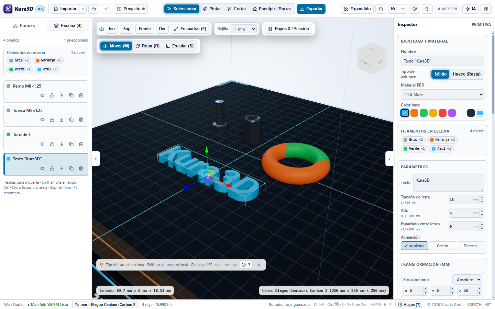
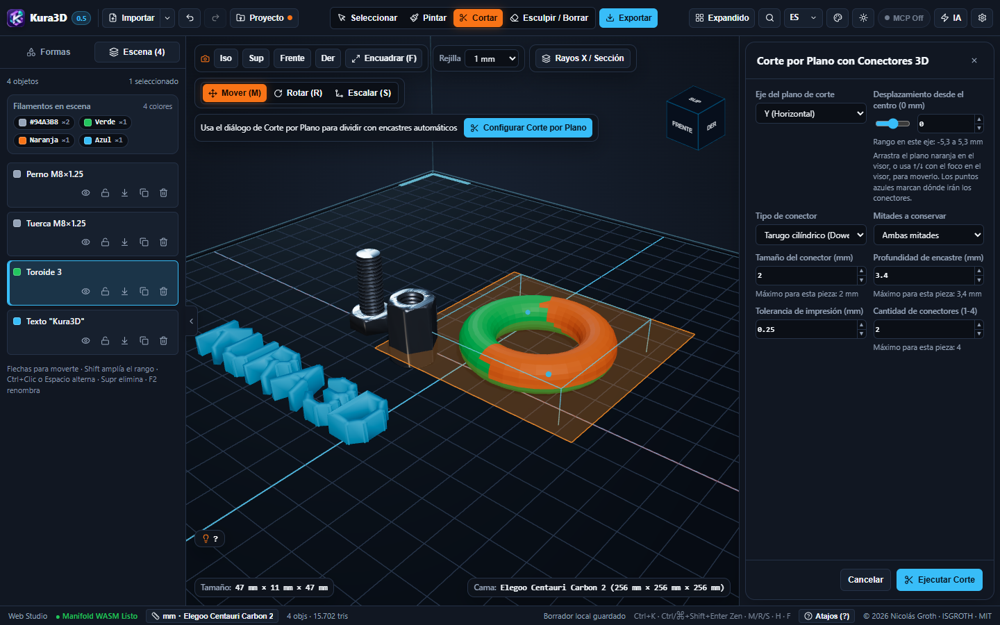
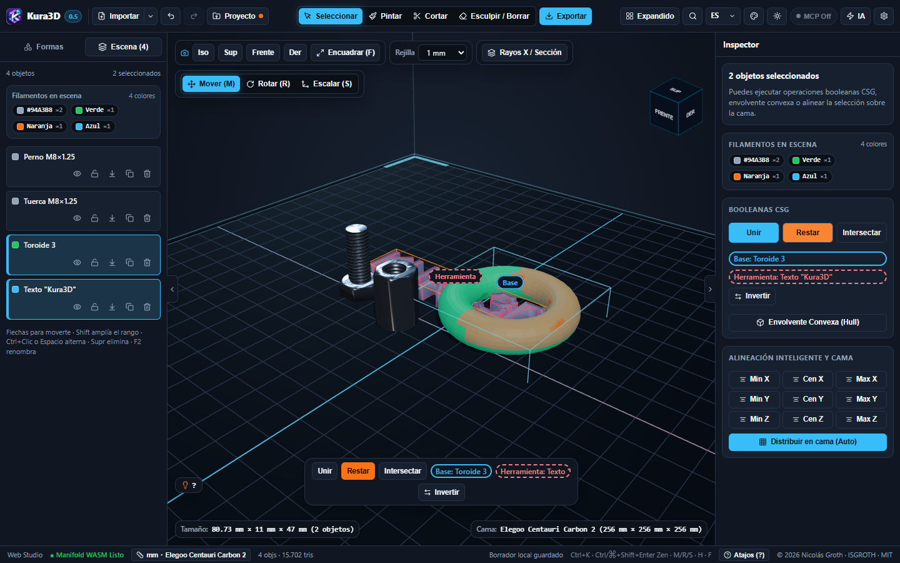
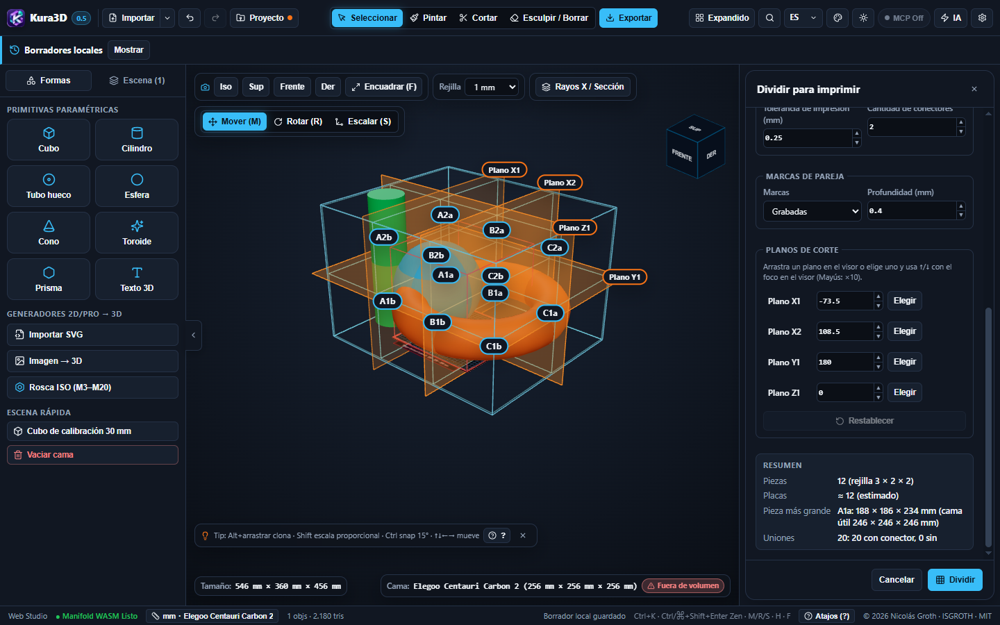
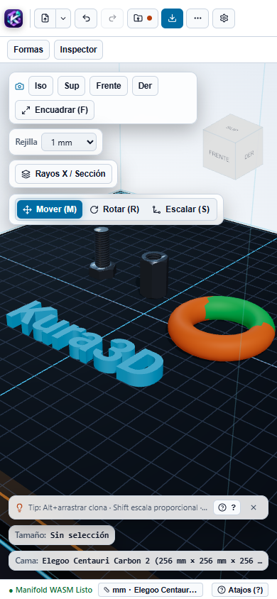

<p align="center">
  
</p>

<h1 align="center">Kura3D</h1>

<p align="center">
  <strong>Estudio abierto de modelado 3D para dejar cualquier pieza lista para imprimir</strong><br/>
  Creado por <strong>Nicolás Groth</strong> · <strong>ISGROTH — Innovación y Soluciones GROTH</strong>
</p>

<p align="center">
  
  
  
  
  
</p>

---

**Kura3D** (*kura* es "piedra" en mapudungun) reúne en una sola herramienta lo que hoy está repartido en varias: importar o crear un modelo, cortarlo, ahuecarlo, unirlo con encajes, pintarlo por colores y exportarlo para tu slicer. Funciona en el navegador y como aplicación de escritorio, **100 % local**: la inteligencia artificial es opcional.

El trabajo del slicer (laminado, G-code, boquillas, soportes) queda fuera. Kura3D entrega archivos que los slicers abren sin sorpresas.

> **Estado: beta en desarrollo activo.** El avance de cada funcionalidad, con sus notas de calidad, está en el [tablero](docs/TABLERO.md). La versión web es la más probada; la aplicación de escritorio todavía tiene verificaciones pendientes.

## Capturas



*Estudio en tema oscuro: piezas paramétricas, pintura por colores de filamento y el inspector con sus parámetros.*



*Corte por plano con uniones: el plano naranja y los puntos azules marcan dónde irán los conectores.*



*Booleanas con vista previa fantasma y rótulos Base y Herramienta antes de aplicar la operación.*



*Dividir para imprimir: el plan se dibuja en el visor con sus planos arrastrables y el código de cada pieza; el panel resume piezas, placas y uniones.*


*Seis idiomas y temas accesibles, claro y oscuro, desde Ajustes.*



*En el móvil: la barra se recoge en menús y la barra de estado conserva unidad e impresora.*

## Qué puedes hacer hoy

**Proyecto**
- Proyectos `.kura` con escena, materiales, pintura e historial de deshacer. Autoguardado y recuperación de borradores.
- Importar **STL, 3MF, OBJ y PLY**, varios archivos a la vez, por diálogo o arrastrando. Lee los 3MF de slicers (componentes, instancias, colores de filamento) conservando las posiciones.
- Exportar **3MF, STL, OBJ con colores, GLB y PLY**, la escena completa o la selección.

**Modelado**
- Primitivas, texto 3D, unión, resta e intersección.
- **Corte por plano con conectores** (espiga, pasador, cola de milano) con holgura configurable, también en aros y piezas en L.
- **Ahuecado** con pared uniforme y orificio de drenaje.
- **Moldes** de 1 pieza, 2 mitades, caja madre y núcleo/cavidad.
- **Roscas ISO M3–M64** con paso y holgura automáticos según la norma.
- Texto y SVG en relieve, grabado o incrustado sobre cualquier superficie.
- Litofanías planas y cilíndricas, y cortadores desde una imagen.
- Simplificar y refinar mallas, alinear y distribuir en la cama.

**Preparación para imprimir**
- Pintura 3D por caras para impresión multicolor, con separación por color.
- Detección de estructuras para separar un modelo en partes.
- Análisis de imprimibilidad: malla cerrada, voladizos, tamaño de cama y peso aproximado.
- Siluetas de cama de 12 impresoras (Elegoo, Bambu Lab, Snapmaker, FlashForge y genéricas).

**Estudio**
- 6 idiomas, 6 temas en claro y oscuro con contraste verificado, y modo compacto.
- Uso por teclado: atajos, paleta de comandos (`Ctrl/⌘+K`), lista de escena y menús navegables.
- Campos numéricos que aceptan expresiones y unidades (`10+5`, `2cm`).

**Inteligencia artificial (opcional)**
- Asistente local sin conexión que entiende órdenes simples en español e inglés.
- Proveedores externos: Anthropic, OpenAI, Gemini, Ollama y **cualquier API compatible con OpenAI** (DeepSeek, Qwen, OpenRouter, LM Studio). En escritorio las claves se guardan en el llavero del sistema.
- **Servidor MCP** con 30 herramientas para que un agente externo opere el mismo motor de la app, con token obligatorio, modo solo lectura y carpeta de exportación acotada. Ver [mcp-server/README.md](mcp-server/README.md).

## Hacia dónde va

El orden de trabajo está en el [roadmap](docs/ROADMAP.md). Lo siguiente:

1. **Dividir para imprimir:** partir un modelo grande según el tamaño de tu cama, con uniones, piezas nombradas, marcas de pareja y animación de armado.
2. **Vista previa en el visor** antes de aplicar cada operación.
3. **Placas** como parte del proyecto y exportación por placa.
4. **Multimaterial verificado** en OrcaSlicer, Bambu Studio, Snapmaker Orca, PrusaSlicer y Cura.
5. **Estudio configurable:** paneles móviles, pestañas de proyecto, clic derecho y línea de comandos.
6. **Extensiones de terceros**, con las reglas ya escritas en [docs/EXTENSIONES.md](docs/EXTENSIONES.md).

## Instalación y desarrollo

Requisitos: **Node.js 20 o superior**. Para la aplicación de escritorio, además **Rust estable** y los [requisitos de Tauri v2](https://tauri.app/start/prerequisites/).

```bash
# Dependencias
npm install
npm --prefix mcp-server install

# Versión web
npm run dev
npm run build

# Aplicación de escritorio (Windows, Linux, macOS)
npm run tauri:dev
npm run tauri:build

# Servidor MCP
npm run mcp:build
npm run mcp:start

# Pruebas
npm test
npm run mcp:test
```

## Tecnología

React 19, TypeScript y Vite · Three.js con react-three-fiber · Zustand · [Manifold](https://github.com/elalish/manifold) en WebAssembly como motor geométrico · Tauri v2 con Rust para el escritorio.

Todas las dependencias tienen licencia permisiva (MIT, Apache-2.0, BSD, ISC).

## Cómo se construye

Kura3D se desarrolla con agentes de IA organizados en tres equipos independientes: desarrollo, QA y evaluación. Cada funcionalidad recibe una nota de 1 a 100 en usabilidad, código y funcionalidad, con evidencia, y solo se da por lista con 85 o más en las tres. Las reglas están en [CLAUDE.md](CLAUDE.md) y las notas en [docs/EVALUACIONES.md](docs/EVALUACIONES.md).

## Documentación

- [Tablero de funcionalidades](docs/TABLERO.md)
- [Roadmap y prioridades](docs/ROADMAP.md)
- [Registro de funcionalidades](docs/FUNCIONALIDADES.md)
- [Evaluaciones de calidad](docs/EVALUACIONES.md)
- [Consultas pendientes](docs/CONSULTAS_PROYECTO.md) · [Decisiones tomadas](docs/DECISIONES.md)
- [Reglas para extensiones](docs/EXTENSIONES.md)
- [Backlog detallado](docs/PLAN_DESARROLLO.md)
- [Servidor MCP](mcp-server/README.md)
- [Historial de versiones](CHANGELOG.md) · [Seguridad](SECURITY.md) · [Cómo contribuir](CONTRIBUTING.md)

## Contribuir y apoyar

El proyecto es de código abierto y los aportes son bienvenidos: errores, traducciones, ideas y código. Lee [CONTRIBUTING.md](CONTRIBUTING.md) antes de empezar. Agregar un idioma no requiere programar; está explicado en [docs/EXTENSIONES.md](docs/EXTENSIONES.md).

---

<p align="center">
  © 2026 <strong>Nicolás Groth</strong> · <strong>ISGROTH — Innovación y Soluciones GROTH</strong> · <a href="LICENSE">Licencia MIT</a>
</p>
