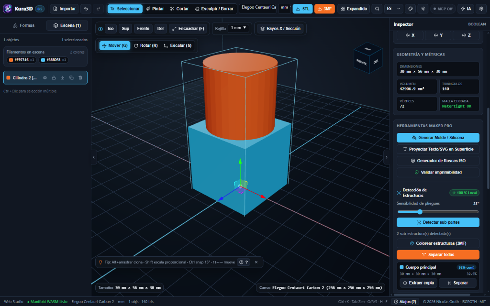
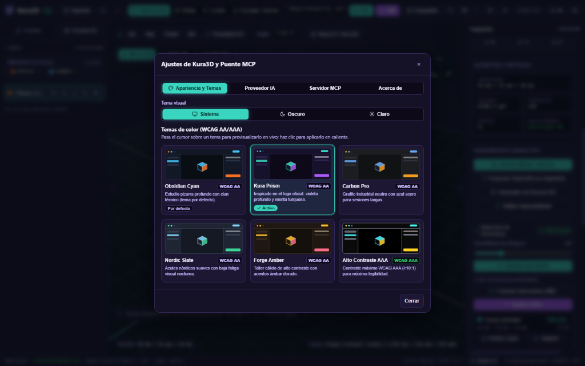
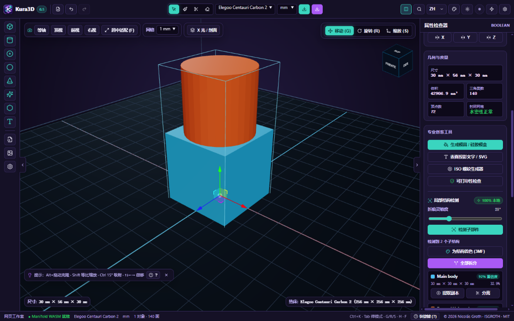
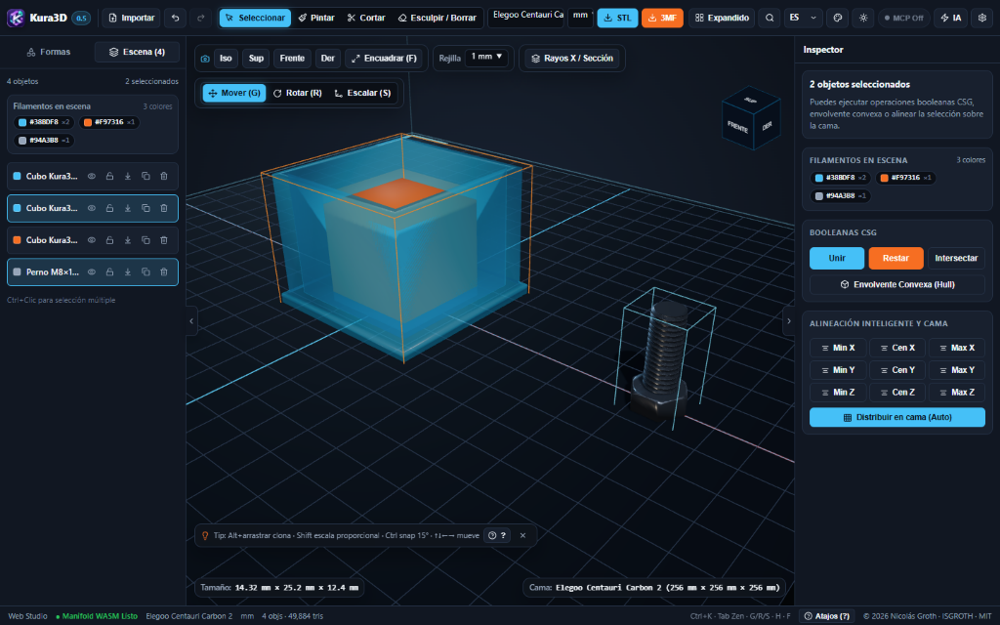
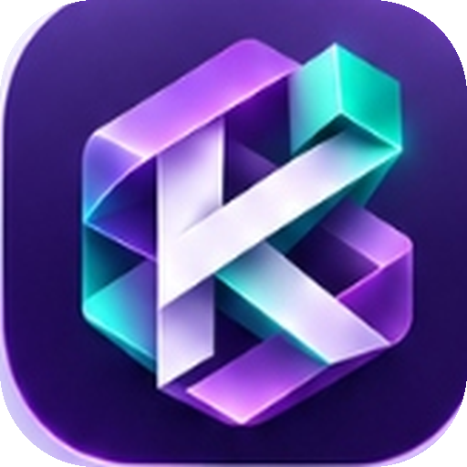
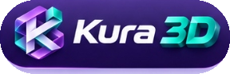
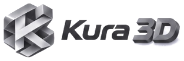

<p align="center">
  
</p>

<h1 align="center">Kura3D v0.5.0</h1>

<p align="center">
  <strong>Estudio de Modelado 3D Nativo y Web de Alto Rendimiento para Diseño e Impresión 3D</strong><br/>
  Desarrollado por <strong>Nicolás Groth</strong> (<code>ngroth@gmail.com</code>) para <strong>ISGROTH — Innovación y Soluciones GROTH</strong>
</p>

<p align="center">
  
  
  
  
  
  
</p>

---

**Kura3D** (*Kura* = roca/piedra en mapudungun) es un estudio CAD/3D nativo (**Tauri v2 + Rust**, ~6 MiB de instalador) y web (**React + Three.js + Manifold-3D WASM**), determinístico y **100 % local** (sin depender de IA externa), diseñado para crear, segmentar, modificar, validar y exportar modelos 3D listos para impresión multi-marca, moldes de silicona/velas, automatización vía **MCP** y asistente **Chat IA** opcional.

---

## Galería de Capturas (`v0.5.0`)

### 1. Estudio Principal (*Obsidian Cyan* por defecto) y Segmentación Estructural 3D Local
Detección determinística de sub-estructuras (PCA 3×3 + costuras cóncavas), coloreo multicolor para 3MF, ViewCube 3D interactivo y métricas *watertight* en vivo:



### 2. Temas de Color WCAG AA/AAA con Vista Previa Interactiva en Caliente
6 temas accesibles con cambio instantáneo en vivo (*Obsidian Cyan por defecto, Kura Prism, Carbon Pro, Nordic Slate, Forge Amber y Alto Contraste AAA*) compatibles con modo Claro y Oscuro:



### 3. Modo Compacto (Pantallas Pequeñas) + Soporte en 6 Idiomas (`ES · EN · DE · FR · HI · ZH`)
Rail vertical compacto de `56 px` con tooltips enriquecidos, tema **Kura Prism** y soporte completo en Español, Inglés, Alemán, Francés, Hindi (Devanagari) y Chino Simplificado:



### 4. Herramientas Maker Pro: Caja Madre para Moldes de Silicona + Roscas Métricas ISO
Generador automático de moldes para velas/silicona (4 modos), pernos/tuercas helicoidales ISO `M3–M20` con material PBR metálico, alineación inteligente y silueta de cama **Elegoo Centauri Carbon 2**:



---

## Identidad Visual Oficial

| Ícono de Aplicación | Lockup Horizontal | Variante Monocroma |
| :---: | :---: | :---: |
|  |  |  |

---

## Características Principales

- **Doble despliegue desde un solo código base:**
  - **Escritorio Nativo (Tauri v2 + Rust):** Splash Screen animada, instaladores nativos de ~6 MiB para **Windows (`.exe` NSIS / `.msi`)**, **Linux (`.AppImage` / `.deb`)** y **macOS (`.dmg`)** vía [`.github/workflows/release.yml`](.github/workflows/release.yml).
  - **Web Estática (Vite + WASM):** *code-splitting* por proveedor (`three`, `react`, `manifold-3d`) con carga optimizada.
- **6 Idiomas Internacionales (`src/i18n/`):** **Español (`es`)**, **English (`en`)**, **Deutsch (`de`)**, **Français (`fr`)**, **हिन्दी (`hi`)** y **中文 (`zh`)** con 100 % de paridad de claves y placeholders verificada por tests.
- **Proyectos locales `.kura`:** Nuevo, Abrir, Guardar y Guardar como desde el menú Proyecto. El archivo conserva geometría, transformaciones, materiales, selección, unidades e historial de Deshacer/Rehacer. Importar añade geometría al proyecto abierto. El escritorio vuelve a guardar en el destino elegido. En navegadores compatibles se usa el selector de guardado. Cuando el navegador solo admite descargas, Kura mantiene el aviso de cambios pendientes hasta que haya una escritura confirmada o se vuelva a abrir el archivo.
- **Escena vacía al arrancar.** Importa geometría, abre un `.kura` o agrega el cubo de ejemplo. Puedes soltar modelos STL, 3MF u OBJ juntos y deshacer todo el lote en un paso.
- **Recuperación local.** El editor guarda borradores de los cambios pendientes. Al volver a abrirlo, puedes recuperar su última copia con la escena, las unidades y el historial de Deshacer/Rehacer.
- **6 Temas de Color WCAG AA/AAA con Vista Previa en Vivo:** **Obsidian Cyan** *(por defecto)*, **Kura Prism**, **Carbon Pro**, **Nordic Slate**, **Forge Amber** y **Alto Contraste AAA (≥10:1)** conmutables en caliente en modo Claro, Oscuro o Sistema.
- **Interfaz Adaptativa, Precisión CAD y Atajos Profesionales:**
  - 3 modos de densidad: **Expandido**, **Compacto** (rail `56px` + tooltips) y **Zen** (100 % viewport con `Ctrl/⌘+Shift+Enter`) + plegado individual de barras laterales.
  - **Inspector de transformación.** `M` enfoca Mover, `R` Rotar y `S` Escalar. Mueve y rota con valores absolutos o deltas por eje. Escala por factor o por tamaño local, con bloqueo proporcional opcional. `Shift+M` abre Molde.
  - **`PrecisionNumberInput`:** flechas `↑/↓`, `Shift+↑/↓` (10×), `Alt/Ctrl+↑/↓` (0.1×), rueda del ratón y *drag-scrub* horizontal a 60fps con 1 solo paso Undo.
  - **Modificadores en gizmo:** `Alt + arrastrar` clona al vuelo, `Shift` (o candado `🔗`) escala proporcional, `Ctrl` activa *snap* de rejilla/15°, flechas `↑↓←→` / `RePág`/`AvPág` empujan con precisión, **ViewCube 3D**, **Paleta `Ctrl+K`** y hoja de atajos (`?` / `F1`).
- **Motor Geométrico Determinístico Manifold-3D (100 % Local — Sin IA Externa):**
  - **Detección y Segmentación Estructural 3D (PCA 3×3 + Costuras Cóncavas):** reconoce cuerpo principal, tanques/cilindros, tubos/conductos, cúpulas/escafandras y bloques; permite colorear para 3MF multicolor, extraer sub-partes cerrando tapas o separar todas las estructuras.
  - **Generador Automático de Moldes y Contra-moldes (Velas / Silicona / Resina):** 1 pieza, 2 mitades con llaves de registro + embudo, **Caja Madre para silicona** y **Núcleo/Cavidad**.
  - **Proyección Conformal de Texto y SVG sobre CUALQUIER Superficie:** relieve (+), grabado (−) o incrustación multicolor a ras (*Flush Inlay*) sobre caras planas, cilindros (`360°`), esferas o STLs orgánicos.
  - **Módulos Dinámicos (+ / − con primitivas o STL/3MF)**, **Corte con vista previa láser 3D y uniones (`dowel`/`peg`/`dovetail`)**, **Ahuecado (Hollow)**, **Validador de Imprimibilidad** (voladizos > 45° en rojo 3D, peso/metros de filamento), **Simplificador/Refinador** (`simplify`/`refineToLength`), **Convex Hull**, **Roscas ISO `M3–M20`**, **Litofanía Plana y Cilíndrica**, **Imagen → Silueta/Cortador**, **5 texturas procedurales**, **pintado 3D** y **Vista Rayos X** (*Clipping Plane*).
- **12 Impresoras Multi-Marca, Materiales PBR y Exportador 3MF Multi-Slicer Pro:**
  - Siluetas 3D de cama con zona de purga para **Elegoo Centauri Carbon 2 & 1**, **Bambu Lab (A1 Mini, A1/P1S/X1C, H2D)**, **Snapmaker (Artisan, J1s)**, **FlashForge (AD5M/Pro, AD5X)**, genéricas y Estudio Libre.
  - 8 materiales PBR (*PLA Mate, PLA Silk, PETG Translúcido, ABS, Fibra de Carbono, Silicona, Cera/Vela, Metálico*), 5 sistemas de unidades (`mm`, `cm`, `m`, `in`, `ft`) y exportación **STL binario Z-up**, **OBJ** y **3MF** con `<basematerials>` y `Metadata/model_settings.config`.
- **Servidor MCP Open-Source Seguro (`mcp-server/`):** **30 herramientas `kura_*`**, desactivado por defecto en la UI, puerto configurable (`127.0.0.1`), **autenticación Bearer Token (`timingSafeEqual`)**, **Modo Solo Lectura** y *rate-limiting*.
- **Chat IA Dinámico Opcional:** Gemini, OpenAI, Anthropic, Ollama (local) y asistente determinístico offline, con etiquetas explícitas **`⚡ 100 % Local`** vs **`☁️ IA Externa`**.

---

## Instalación y Desarrollo

### Requisitos
- **Node.js ≥ 20** (recomendado 22 LTS)
- **Rust estable** (`rustup` + `cargo`) y requisitos nativos de Tauri v2 para compilar ejecutables de escritorio

### Comandos principales
```bash
# 1. Instalar dependencias
npm install
npm --prefix mcp-server install

# 2. Ejecutar versión Web
npm run dev
npm run build

# 3. Ejecutar y compilar App Nativa (Windows / Linux / macOS)
npm run tauri:dev
npm run tauri:build

# 4. Servidor MCP (Antigravity / Claude Desktop / Codex)
npm run mcp:build
npm run mcp:start

# 5. Ejecutar las pruebas del frontend y del servidor MCP
npm test
npm run mcp:test
```

### Plan de Instaladores Multiplataforma
- **Windows (x64):** `Kura3D_0.5.0_x64-setup.exe` (NSIS) y `Kura3D_0.5.0_x64_en-US.msi` (WiX) generados en `src-tauri/target/release/bundle/`.
- **Linux (x64):** `.AppImage` y `.deb` automatizados en [`.github/workflows/release.yml`](.github/workflows/release.yml).
- **macOS (Universal Apple Silicon + Intel):** `.dmg` automatizado en [`.github/workflows/release.yml`](.github/workflows/release.yml).

---

## Documentación Adicional
- [Continuidad del proyecto y próximos pasos](docs/CONTINUAR_KURA3D.md)
- [Plan de Desarrollo y Seguimiento (`docs/PLAN_DESARROLLO.md`)](docs/PLAN_DESARROLLO.md)
- [Historial de Versiones (`CHANGELOG.md`)](CHANGELOG.md)
- [Configuración Segura del Servidor MCP (`mcp-server/README.md`)](mcp-server/README.md)
- [Política de Seguridad (`SECURITY.md`)](SECURITY.md)
- [Guía de Contribución (`CONTRIBUTING.md`)](CONTRIBUTING.md)
- [Licencia MIT (`LICENSE`)](LICENSE)

---

<p align="center">
  © 2026 <strong>Nicolás Groth</strong> (<code>ngroth@gmail.com</code>) · <strong>ISGROTH — Innovación y Soluciones GROTH</strong> · Licencia MIT
</p>
