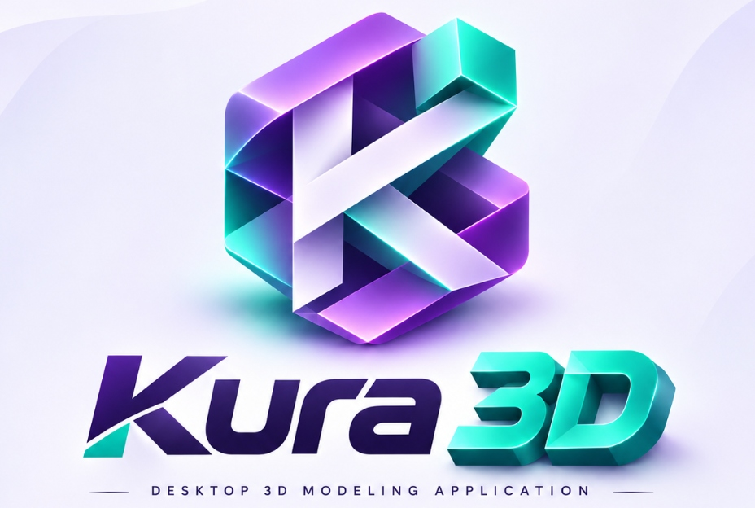
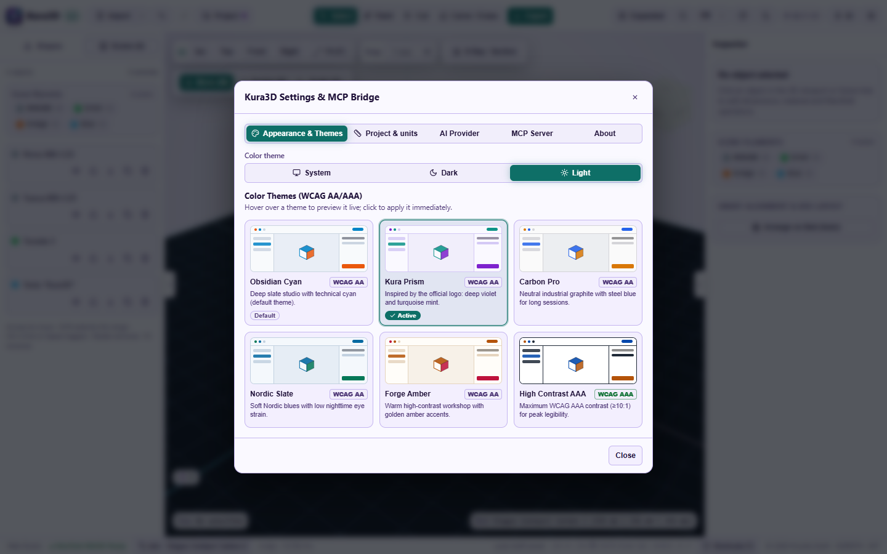

<p align="center">
  
</p>

<h1 align="center">Kura3D</h1>

<p align="center">
  <strong>Estudio abierto de modelado 3D para dejar cualquier pieza lista para imprimir</strong><br/>
  Creado por <strong>Nicolás Groth</strong> · <strong>ISGROTH — Innovación y Soluciones GROTH</strong>
</p>

<p align="center">
  
  
  
  
  
</p>

---

**Kura3D** (*kura* es "piedra" en mapudungun) reúne en una sola herramienta lo que hoy está repartido en varias: importar o crear un modelo, cortarlo, ahuecarlo, unirlo con encajes, pintarlo por colores y exportarlo para tu slicer. Funciona en el navegador y como aplicación de escritorio, **100 % local**: la inteligencia artificial es opcional.

El trabajo del slicer (laminado, G-code, boquillas, soportes) queda fuera. Kura3D entrega archivos que los slicers abren sin sorpresas.

> **Estado: beta en desarrollo activo.** El avance de cada funcionalidad, con sus notas de calidad, está en el [tablero](docs/TABLERO.md). La versión web es la más probada; la aplicación de escritorio todavía tiene verificaciones pendientes.

## Capturas

Las capturas de abajo y las de las [guías](docs/guia/README.md) se generan desde la propia app con `npm run docs:capturas`, así no quedan desactualizadas.


*El estudio: formas y escena a la izquierda, visor 3D con la cama de tu impresora y el inspector con medidas exactas a la derecha.*


*Dividir para imprimir: una pieza más grande que la cama queda en piezas con código, uniones y animación de armado.*


*Medir: distancias, ángulos, áreas, volumen y cuánto líquido cabe en un recipiente.*


*Corte por plano con uniones: el plano naranja y los puntos azules marcan dónde irán los conectores.*



*Seis idiomas y temas accesibles, claro y oscuro, desde Ajustes.*


*En el móvil: la barra se recoge en menús y la barra de estado conserva unidad e impresora.*

## Qué puedes hacer hoy

**Proyecto**
- Proyectos `.kura` con escena, materiales, pintura e historial de deshacer. Autoguardado y recuperación de borradores. En escritorio, la lista de recientes recuerda las rutas y reabre con un clic (se puede desactivar en Ajustes).
- Importar **STL, 3MF, OBJ y PLY**, varios archivos a la vez, por diálogo o arrastrando. Lee los 3MF de slicers (componentes, instancias, colores de filamento) conservando las posiciones.
- **Ida y vuelta por 3MF exacta:** piezas, grupos, colores y posiciones se conservan al exportar y volver a abrir.
- **Aviso de unidades dudosas** al importar, con la corrección sugerida (por ejemplo «Escalar ×100») y un solo Deshacer.
- **Estado de la malla y Reparar malla:** el inspector dice si la malla está cerrada; si tiene agujeros o caras repetidas, un botón la repara y resume lo hecho.
- Exportar **3MF, STL, OBJ con colores, GLB y PLY**, la escena completa o la selección; un grupo como un archivo o uno por objeto.
- **Grupos y panel Escena** como árbol de capas: agrupar (`Ctrl+G`), plegar, ocultar, bloquear, renombrar y arrastrar.

**Modelado**
- Primitivas, texto 3D, unión, resta e intersección; **negativos** (`H`) que se restan todos juntos con «Aplicar restas».
- **Medir** (`D`): distancia con imán, ángulo, área, volumen y **capacidad de un recipiente** hasta su rebalse, en mm, cm o pulgadas y mL o litros.
- **Corte por plano con conectores** (espiga, pasador, cola de milano) con holgura configurable, también en aros y piezas en L; al conservar una sola mitad, tú eliges dónde dejarla.
- **Ahuecado** con pared uniforme y orificio de drenaje.
- **Moldes** de 1 pieza, 2 mitades, caja madre y núcleo/cavidad.
- **Roscas ISO M3–M64** con paso y holgura automáticos según la norma.
- **Asistentes**: crea una caja con tapa, un llavero o una placa de enchufe respondiendo unas preguntas, con reglas en vivo y un solo paso de deshacer (**Insertar › Asistentes**).
- **Alojamiento de imán**: un clic sobre una cara deja el hueco para un imán redondo o cuadrado, con holgura, opción oculta y aviso de pared mínima; tus medidas se guardan como preajustes (**Insertar › Alojamiento de imán**).
- Texto y SVG en relieve, grabado o incrustado sobre cualquier superficie.
- Litofanías planas y cilíndricas, y cortadores desde una imagen.
- Simplificar y refinar mallas, alinear y distribuir en la cama.
- **Suavizar malla**: quita facetado y ruido de escaneos sin cambiar los triángulos, con aristas protegidas, zona pintada y vista previa antes de aplicar (**Acciones › Malla › Suavizar…**).

**Preparación para imprimir**
- **Dividir para imprimir:** parte un modelo más grande que tu cama en piezas con código (A1, B1…), uniones (conectores o imanes enfrentados para que quede desmontable), marcas de pareja, animación de armado, «Preparar para imprimir» por placas y exportación de un archivo por pieza.
- Pintura 3D por caras para impresión multicolor, con separación por color.
- Detección de estructuras para separar un modelo en partes.
- Análisis de imprimibilidad: malla cerrada, voladizos, tamaño de cama y peso aproximado.
- **Orientar para imprimir:** compara cómo apoyar la pieza en la cama (soporte aproximado, voladizo, base, altura y si cabe), con motivos claros, vista previa en el visor con las zonas en voladizo resaltadas y un paso para aplicar; no genera soportes.
- **Comprobar encaje:** choques (en mm³) y holguras entre piezas y referencias, con las restas pendientes aplicadas en copia, una recomendación por par y la zona o la cota resaltada en el visor; no cambia la escena.
- Siluetas de cama de 12 impresoras (Elegoo, Bambu Lab, Snapmaker, FlashForge y genéricas).

**Estudio**
- 6 idiomas, 6 temas en claro y oscuro con contraste verificado, y modo compacto.
- Uso por teclado: atajos, paleta de comandos (`Ctrl/⌘+K`), lista de escena y menús navegables.
- Campos numéricos que aceptan expresiones y unidades (`10+5`, `2cm`).

**Inteligencia artificial (opcional)**
- Asistente local sin conexión que entiende órdenes simples en español e inglés.
- Proveedores externos: Anthropic, OpenAI, Gemini, Ollama y **cualquier API compatible con OpenAI** (DeepSeek, Qwen, OpenRouter, LM Studio). En escritorio las claves se guardan en el llavero del sistema.
- **Servidor MCP** con 49 herramientas `kura_*` para que un agente externo opere el mismo motor de la app, con token obligatorio, modo solo lectura y carpeta de exportación acotada. Guía de uso, seguridad y ejemplos en [docs/MCP.md](docs/MCP.md); detalle técnico en [mcp-server/README.md](mcp-server/README.md).

## Guías

Paso a paso con capturas, para quien imprime y no programa: [**índice de guías**](docs/guia/README.md).

[Primeros pasos](docs/guia/primeros-pasos.md) · [Importar y reparar](docs/guia/importar-y-reparar.md) · [Dividir para imprimir](docs/guia/dividir-para-imprimir.md) · [Cortar y ahuecar](docs/guia/cortar-y-ahuecar.md) · [Sólidos negativos y restas](docs/guia/solidos-negativos-y-restas.md) · [Objetos de referencia](docs/guia/objetos-de-referencia.md) · [Comprobar encaje](docs/guia/comprobar-encaje.md) · [Orientar para imprimir](docs/guia/orientar-para-imprimir.md) · [Grupos y escena](docs/guia/grupos-y-escena.md) · [Medir](docs/guia/medir.md) · [Colores y pintura](docs/guia/colores-y-pintura.md) · [Generadores](docs/guia/generadores.md) · [Asistentes](docs/guia/asistentes.md) · [Alojamiento de imán](docs/guia/alojamiento-de-iman.md) · [Exportar](docs/guia/exportar.md) · [Guardar y recuperar](docs/guia/guardar-y-recuperar.md) · [Servidor MCP](docs/MCP.md) · [Ajustar a la impresora](docs/guia/ajustar-a-la-impresora.md)

## Hacia dónde va

El orden de trabajo está en el [roadmap](docs/ROADMAP.md). Lo siguiente:

1. **Placas** como parte del proyecto y exportación por placa.
2. **Multimaterial verificado** en OrcaSlicer, Bambu Studio, Snapmaker Orca, PrusaSlicer y Cura.
3. **Estudio configurable:** paneles móviles, pestañas de proyecto, clic derecho y línea de comandos.
4. **Extensiones de terceros**, con las reglas ya escritas en [docs/EXTENSIONES.md](docs/EXTENSIONES.md).

## Instalación y desarrollo

Requisitos: **Node.js 20 o superior**. Para la aplicación de escritorio, además **Rust estable** y los [requisitos de Tauri v2](https://tauri.app/start/prerequisites/).

```bash
# Dependencias
npm install
npm --prefix mcp-server install

# Versión web
npm run dev
npm run build

# Aplicación de escritorio (Windows, Linux, macOS)
npm run tauri:dev
npm run tauri:build

# Servidor MCP
npm run mcp:build
npm run mcp:start

# Pruebas
npm test
npm run mcp:test
```

## Tecnología

React 19, TypeScript y Vite · Three.js con react-three-fiber · Zustand · [Manifold](https://github.com/elalish/manifold) en WebAssembly como motor geométrico · Tauri v2 con Rust para el escritorio.

Todas las dependencias tienen licencia permisiva (MIT, Apache-2.0, BSD, ISC).

## Cómo se construye

Kura3D se desarrolla con agentes de IA organizados en tres equipos independientes: desarrollo, QA y evaluación. Cada funcionalidad recibe una nota de 1 a 100 en usabilidad, código y funcionalidad, con evidencia, y solo se da por lista con 85 o más en las tres. Las reglas están en [CLAUDE.md](CLAUDE.md) y las notas en [docs/EVALUACIONES.md](docs/EVALUACIONES.md).

## Documentación

- [Guías de uso](docs/guia/README.md) · [Servidor MCP: guía](docs/MCP.md)
- [Tablero de funcionalidades](docs/TABLERO.md)
- [Roadmap y prioridades](docs/ROADMAP.md)
- [Registro de funcionalidades](docs/FUNCIONALIDADES.md)
- [Evaluaciones de calidad](docs/EVALUACIONES.md)
- [Consultas pendientes](docs/CONSULTAS_PROYECTO.md) · [Decisiones tomadas](docs/DECISIONES.md)
- [Reglas para extensiones](docs/EXTENSIONES.md)
- [Backlog detallado](docs/PLAN_DESARROLLO.md)
- [Servidor MCP](mcp-server/README.md)
- [Historial de versiones](CHANGELOG.md) · [Seguridad](SECURITY.md) · [Cómo contribuir](CONTRIBUTING.md)

## Contribuir y apoyar

El proyecto es de código abierto y los aportes son bienvenidos: errores, traducciones, ideas y código. Lee [CONTRIBUTING.md](CONTRIBUTING.md) antes de empezar. Agregar un idioma no requiere programar; está explicado en [docs/EXTENSIONES.md](docs/EXTENSIONES.md).

---

<p align="center">
  © 2026 <strong>Nicolás Groth</strong> · <strong>ISGROTH — Innovación y Soluciones GROTH</strong> · <a href="LICENSE">Licencia MIT</a>
</p>
