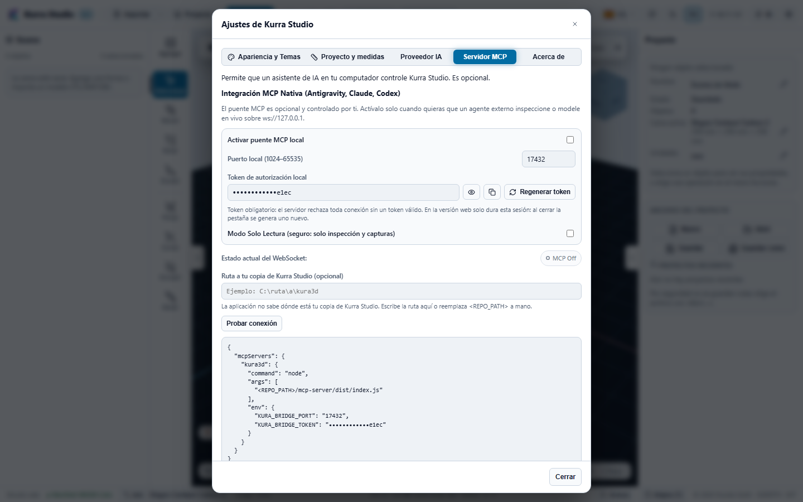

# Servidor MCP de Kura3D

El servidor MCP deja que un asistente de IA (Claude, Codex, Antigravity u otro cliente compatible con el [Model Context Protocol](https://modelcontextprotocol.io)) **cree, mida, corte y exporte modelos** con el mismo motor geométrico que usa la app. Es opcional: Kura3D funciona completo sin él.

Dos formas de usarlo:

- **Con la app abierta (puente en vivo):** cada herramienta que ejecuta el agente se ve al instante en el visor 3D, y el agente puede capturar una imagen del visor.
- **Sin interfaz (modo headless):** si la app no está abierta, el servidor mantiene la escena en memoria y ejecuta toda la geometría con el mismo motor (Manifold). Sirve para automatizar: crear, restar, dividir, medir y exportar STL o 3MF a una carpeta.

> Los detalles técnicos del servidor (variables de entorno, esquema de validación, recursos MCP) están en [mcp-server/README.md](../mcp-server/README.md). Esta página es la guía de uso.

## Instalación

Requisitos: **Node.js 20 o superior**. Desde la carpeta del proyecto:

```bash
npm install
npm --prefix mcp-server install
npm run mcp:build      # compila el servidor en mcp-server/dist/index.js
```

Para comprobar que arranca (queda esperando a un cliente por stdio; salir con `Ctrl+C`):

```bash
npm run mcp:start
```

## Conectar un cliente

1. En Kura3D abre **Ajustes** (`Ctrl+,`) y la pestaña **Servidor MCP**.
2. Activa **Activar puente MCP local**. La app genera un **token** de autorización; puedes verlo, copiarlo o regenerarlo.
3. Pulsa **Copiar configuración JSON MCP** y pégalo en la configuración de tu cliente, o registra el servidor con Claude Code (cambia `<TOKEN>` por el token y la ruta por la de tu copia):

   ```bash
   claude mcp add kura3d -e KURA_BRIDGE_PORT=17432 -e KURA_BRIDGE_TOKEN=<TOKEN> -- node "RUTA/A/kura3d/mcp-server/dist/index.js"
   ```

4. Reinicia el cliente. El estado en Ajustes pasa a **Conectado** cuando el servidor arranca.



Ejemplos de configuración para Claude Desktop, Codex CLI y Antigravity están en [mcp-server/README.md](../mcp-server/README.md#configuración-en-clientes-mcp). Si no pones token, el servidor sigue funcionando en modo headless por stdio, pero **no abre el puente con la app**.

## Seguridad

- **Solo en tu equipo.** El puente escucha únicamente en `127.0.0.1` (loopback); no es accesible desde la red. También rechaza peticiones con un `Host` u `Origin` ajenos.
- **Token obligatorio.** Toda conexión necesita el token; sin él (o con menos de 16 caracteres) el puente no se habilita. Tras 10 intentos fallidos en un minuto se bloquea el resto de la ventana. **Regenerar token** invalida el anterior y cierra las sesiones abiertas.
- **Nada de secretos en archivos ni logs.** El token no va en los proyectos `.kura` ni en los registros. En la app de escritorio se guarda en el llavero del sistema; en la versión web solo dura la sesión (al cerrar la pestaña se genera otro).
- **Modo Solo Lectura.** Con el interruptor de Ajustes, o con `KURA_BRIDGE_READ_ONLY=true` en el servidor, el agente solo puede inspeccionar y medir: las herramientas de escritura se rechazan. La columna *Acceso* de la tabla indica cuáles son de lectura.
- **Exportaciones confinadas.** Los archivos que escribe el agente quedan dentro de una sola carpeta (`KURA_EXPORT_DIR`, por defecto `~/Kura3D/exports`); se rechazan rutas que salgan de ella.
- **Límite de ritmo.** Máximo 120 comandos por minuto (configurable).

## Ejes y unidades

- Todas las medidas de las herramientas están en **milímetros**, cualquiera sea la unidad que muestre la app.
- Ejes como en la app y en los laminadores: **X hacia la derecha, Y hacia el fondo, Z hacia arriba** (altura). Posiciones, rotaciones (en grados; `rz` gira en la vertical), cortes (`axis: 'z'` es un corte horizontal), alineación (`minZ` es la base) y direcciones de armado (`-z`: la pieza entra bajando) usan esos ejes.
- En una primitiva, `width` es el largo en X, `depth` el fondo en Y y `height` la altura en Z.
- Las piezas nuevas se colocan por defecto en el primer hueco libre de la cama (`placement: "free"`), así no se solapan. Para preparar una resta hay que indicar `placement: "origin"` (la pieza queda en el centro) o una `position` explícita; si las piezas no se tocan, la resta responde `BOOLEAN_NO_EFFECT` y no cambia nada.

## Herramientas

La tabla se genera desde el servidor real (`npm run docs:mcp`), así que siempre coincide con lo que recibe el agente. Las descripciones están en inglés porque son las que el cliente MCP entrega al modelo. Los parámetros marcados con `*` son obligatorios; el esquema completo de cada herramienta lo entrega el servidor al cliente.

<!-- TABLA-HERRAMIENTAS:INICIO -->
<!-- Generada por `npm run docs:mcp` desde el servidor real (43 herramientas). No la edites a mano. -->

| Herramienta | Acceso | Qué hace | Parámetros principales (`*` = obligatorio) |
| :--- | :--- | :--- | :--- |
| `kura_align_objects` | escritura | Aligns multiple objects by edges or centers (min/center/max on X/Y/Z; minZ = bottom, maxZ = top, minY = front) or automatically distributes them in a grid on the bed. | `objectIds`* (lista de string), `mode`* (`minX` · `centerX` · `maxX` · `minY` · `centerY` · `maxY` · `minZ` · `centerZ` · `maxZ` · `arrange_grid`), `spacingMm` (number) |
| `kura_analyze_printability` | lectura | Checks fit on the active bed, contact with the bed plane (Z=0), critical overhangs, volume, estimated weight and printing warnings (`warnings` in English and `issues` with code and parameters). Weight and filament are a very rough estimate (`approximate: true`; the real value depends on the slicer) and do not affect the score. Safe in Read-only mode. | `objectId`* (string), `materialPreset` (`pla_matte` · `pla_silk` · `petg_clear` · `abs` · `carbon_fiber` · `silicone` · `wax_candle` · `metallic`), `infillPercent` (number), `overhangAngleDeg` (number) |
| `kura_apply_texture` | escritura | Applies procedural surface displacement (fuzzy skin, knurling, waves, honeycomb, grid or none). | `objectId`* (string), `pattern`* (`none` · `fuzzy` · `knurling` · `waves` · `honeycomb` · `grid`), `depth` (number), `scale` (number) |
| `kura_boolean_operation` | escritura | Performs union, subtraction or intersection between a target object and one or more tool objects. | `targetId`* (string), `toolIds`* (lista de string), `operation`* (`union` · `subtract` · `intersect`), `keepTools` (boolean), `resultName` (string) |
| `kura_capture_viewport` | lectura | Captures a PNG image of the 3D viewport when the Kura3D graphical app is connected via Live Bridge. | `width` (integer), `height` (integer) |
| `kura_colorize_structures` | escritura | Detects the structural regions of the model and assigns distinct colors per sub-structure for visual inspection or multicolor printing. | `objectId`* (string), `creaseAngleDeg` (number) |
| `kura_combine_objects` | escritura | Combines 2 or more objects into ONE object with several bodies, without boolean operations: the geometry is not merged and the total volume is the sum. Exports as a single STL. Use kura_separate_bodies to split it again, or kura_boolean_operation (union) to really merge geometry. | `objectIds`* (lista de string), `name` (string) |
| `kura_convex_hull` | escritura | Creates a closed solid that convexly wraps one or more selected objects. | `objectIds`* (lista de string), `name` (string) |
| `kura_create_primitive` | escritura | Creates a closed solid primitive (box, cylinder, tube, sphere, cone, torus, prism or text) in millimeters. Box, cylinder, tube and prism accept exact rounded or chamfered edges (params.edgeStyle, edgeSize, edgeScope). | `primitiveType`* (`box` · `cylinder` · `tube` · `sphere` · `cone` · `torus` · `prism` · `text`), `name` (string), `params` (objeto), `position` (lista), `rotation` (lista), `scale` (lista), … (+3) |
| `kura_create_thread` | escritura | Generates a threaded bolt, hexagonal nut or negative threaded cavity with calibrated clearance for 3D printing. | `kind`* (`bolt` · `nut` · `hole`), `diameterMm` (number), `pitchMm` (number), `lengthMm` (number), `clearanceMm` (number), `includeHead` (boolean), … (+3) |
| `kura_delete_object` | escritura | Permanently deletes an object from the scene by its identifier. | `objectId`* (string) |
| `kura_detect_structures` | lectura | Analyzes disconnected islands, dihedral folds and proportions of the object to detect geometric sub-structures (tanks, tubes, domes, blocks, main body). Safe in Read-only mode. | `objectId`* (string), `creaseAngleDeg` (number), `minRegionPercent` (number), `maxRegions` (integer) |
| `kura_diagnose_mesh` | lectura | Read-only. Checks whether an object mesh is a closed printable solid: open edges grouped into holes (size and object-local center in user axes, Z up), edges shared by more than two faces, duplicate or degenerate faces, inconsistent or inverted normals and tiny loose bodies. Does not change the scene. | `objectId`* (string) |
| `kura_export_3mf` | escritura | Exports the indicated objects (or the whole visible scene) as one standard 3MF with per-triangle colors, readable by OrcaSlicer, Bambu Studio, PrusaSlicer and Cura. The former `slicerTarget` argument is obsolete and ignored. | `outputPath`* (string), `objectIds` (lista de string) |
| `kura_export_stl` | escritura | Exports the indicated objects (or the whole visible scene) as binary or ASCII STL directly to disk. | `outputPath`* (string), `objectIds` (lista de string), `binary` (boolean) |
| `kura_extract_structure` | escritura | Extracts a previously detected structural region (`regionId`) as a new independent 3D object, optionally removing those faces from the source object. | `objectId`* (string), `regionId`* (string), `removeFromSource` (boolean) |
| `kura_fit_to_bed` | escritura | Makes one or more objects (as a block) fit the bed. With dryRun=true (default when no alternative is given) it only returns the alternatives without changing the scene: "scale" (largest uniform factor in the current orientation), "rotate" (first of the 24 orthogonal orientations that fits at real size, preferring the current resting face, then turns about Z), "rotateScale" (orientation with the largest factor) and "split" (when nothing fits at real size: use kura_split_for_bed with the same bed). Each one has factor, resulting size [X, Y, Z] in mm (X right, Y back, Z up), orientation (downFace, steps), whether the resting face changes, warnings (thin walls, below minimum scale, functional parts such as ISO threads or split connectors that stop being standard) and one suggested option. Factor per axis = (bed − 2·margin) / size; it only shrinks. Apply with dryRun=false and alternative: one undo step; the block ends centered on the bed and resting at Z = 0. | `objectIds` (lista de string), `dryRun` (boolean), `alternative` (`scale` · `rotate` · `rotateScale`), `bedWidthMm` (number), `bedDepthMm` (number), `bedHeightMm` (number), … (+1) |
| `kura_generate_mold` | escritura | Automatically generates a mold or counter-mold (1 part, 2 parts with keys, master box for silicone, or core-cavity) from a master object. | `objectId`* (string), `mode`* (`direct_1part` · `direct_2part` · `silicone_master` · `core_cavity`), `wallMarginMm` (number), `boxWallMm` (number), `splitAxis` (`x` · `y`), `pourSpout` (boolean), … (+4) |
| `kura_get_scene_state` | lectura | Returns the current scene objects, their transforms, dimensions in mm, active units and 3D printer profile. Axes as in slicers: X right, Y back, Z up (height); dimensionsMm is [X, Y, Z]. | — |
| `kura_group_objects` | escritura | Groups objects so they are selected, moved, rotated and scaled together as one set. The objects stay independent (nothing is merged). Groups can be nested. Use kura_ungroup to undo. | `objectIds`* (lista de string), `name` (string) |
| `kura_hollow_object` | escritura | Converts a solid into a hollow shell with wall thickness in millimeters and an optional drain hole. | `objectId`* (string), `wallThickness`* (number), `drainHole` (boolean), `drainHoleRadius` (number) |
| `kura_import_svg` | escritura | Converts SVG vector strokes into an extruded 3D solid. | `svgContent`* (string), `name` (string), `depth` (number), `targetWidth` (number), `curveSegments` (integer), `placement` (`free` · `origin`) |
| `kura_measure_capacity` | lectura | Read-only. How much liquid (or food, sand…) the object holds as a container in its CURRENT orientation: the empty space retained by the solid below a fill level. Returns the overflow height (the highest level before it spills, above the object base, Z up), the maximum capacity (mm³ and mL), what fits up to levelMm if given, every separate cavity (cavityIndex picks one; largest first) and closed hollows sealed inside (reported apart, not as capacity). A solid object returns capacity 0. Rotate the object to measure another tilt. Does not change the scene. | `objectId`* (string), `levelMm` (number), `cavityIndex` (integer) |
| `kura_measure_distance` | lectura | Read-only. Straight-line distance in mm between two points given in user axes (X right, Y back, Z up), plus the components deltaMm = [ΔX, ΔY, ΔZ] from A to B. Does not change the scene. | `pointA`* (lista), `pointB`* (lista) |
| `kura_measure_object` | lectura | Read-only. Total surface area (mm²), volume (mm³ and mL; 1 cm³ = 1 mL), whether the mesh is closed, and the world bounding box and size in user axes (Z up) of one object, with its rotation and scale applied. Does not change the scene. | `objectId`* (string) |
| `kura_mirror_object` | escritura | Generates an exact mirror image of the mesh along the X, Y or Z axis (Z = upside down) by inverting coordinates and triangle winding so outward normals stay valid. | `objectId`* (string), `axis`* (`x` · `y` · `z`) |
| `kura_paint_object` | escritura | Paints the whole object with a hexadecimal color (#rrggbb), or only a brush stroke around `localPoint`. | `objectId`* (string), `color`* (string), `localPoint` (lista) |
| `kura_plane_cut` | escritura | Splits an object with a plane normal to X, Y or Z (Z = horizontal plane, the default), optionally generating mechanical connectors (dowel, peg, dovetail). | `objectId`* (string), `axis` (`x` · `y` · `z`), `offset` (number), `connectorType` (`none` · `dowel` · `peg` · `dovetail`), `connectorSize` (number), `connectorDepth` (number), … (+4) |
| `kura_project_on_surface` | escritura | Projects text or SVG graphics onto a face or cylinder of the object as raised relief (emboss), engraving (deboss) or flush multicolor inlay (flush_inlay). | `objectId`* (string), `kind`* (`text` · `svg`), `mode`* (`emboss` · `deboss` · `flush_inlay`), `text` (string), `svgContent` (string), `axis` (`+z` · `-z` · `+x` · `-x` · `+y` · `-y` · `cylindrical`), … (+5) |
| `kura_refine_mesh` | escritura | Subdivides and optionally smooths the mesh down to the target edge length in mm. | `objectId`* (string), `targetEdgeLengthMm` (number), `smooth` (boolean) |
| `kura_repair_mesh` | escritura | Repairs an object mesh so it becomes a closed solid accepted by the geometry engine: welds nearby vertices, removes degenerate and duplicate faces, separates edges with more than two faces, orients normals consistently, closes holes by triangulating their boundary and drops tiny slivers. Returns what was done, what could not be fixed (e.g. holes larger than maxHoleMm) and engine warnings. Fails with MESH_REPAIR_FAILED if the result is still not a valid solid. | `objectId`* (string), `maxHoleMm` (number), `weldMm` (number), `removeTinyShells` (boolean) |
| `kura_separate_bodies` | escritura | Splits an object made of several loose bodies (for example a combined object) into separate objects. | `objectId`* (string) |
| `kura_set_material` | escritura | Sets the physical/visual material preset of the object (pla_matte, pla_silk, petg_clear, abs, carbon_fiber, silicone, wax_candle, metallic). | `objectId`* (string), `materialPreset`* (`pla_matte` · `pla_silk` · `petg_clear` · `abs` · `carbon_fiber` · `silicone` · `wax_candle` · `metallic`) |
| `kura_set_printer_profile` | escritura | Sets the bed volume and active profile from the 12 multi-brand presets (elegoo-centauri-carbon-2, elegoo-centauri-carbon-1, bambu-p1s-x1c-a1, bambu-a1-mini, bambu-h2d, snapmaker-artisan, snapmaker-j1s, flashforge-ad5m, flashforge-ad5x, generic-220, generic-300 or free-studio). | `profileId`* (string) |
| `kura_set_units` | escritura | Changes the Kura3D display unit (mm, cm, m, in, ft). | `units`* (`mm` · `cm` · `m` · `in` · `ft`) |
| `kura_simplify_mesh` | escritura | Reduces triangle density while respecting the geometric tolerance in mm. | `objectId`* (string), `toleranceMm` (number) |
| `kura_split_by_color` | escritura | Splits a multicolor painted model into one closed, printable solid per color for multi-material printing. Each non-base color takes a layer of depthMm inward from its painted surface; the base color keeps the rest. The parts do not overlap and their volumes add up to the original. | `objectId`* (string), `depthMm` (number) |
| `kura_split_disconnected` | escritura | Splits a mesh made of several separate bodies into independent objects. | `objectId`* (string) |
| `kura_split_for_bed` | escritura | Splits a large object into pieces that fit on the bed (by default the active profile bed), with connectors at each joint, grid-based name ("Object · A1": letter = X column, number = Z level (height), lowercase = Y row) and optional engraved mating marks. Cut planes shift toward the simplest section. With dryRun=true it only returns the plan (planes and estimated pieces) without changing the scene. Returns a short summary; detail=true adds the full plan. Error SPLIT_TOO_MANY_PIECES (with needed = pieces required) if more than maxPieces would be needed; maxPieces="auto" raises the limit to 400. A section thinner than minWallForConnectorMm becomes a flat cut to glue (kind="glue", with a warning); connectorType="lap" (edge overlap, changes the joint shape) uses it on all joints. | `objectId`* (string), `dryRun` (boolean), `detail` (boolean), `bedWidthMm` (number), `bedDepthMm` (number), `bedHeightMm` (number), … (+18) |
| `kura_transform_object` | escritura | Updates position [X, Y, Z] in mm (Z up), Euler XYZ rotation [rx, ry, rz] in radians (rz turns around the vertical), scale [sx, sy, sz] or metadata of an object. | `objectId`* (string), `position` (lista), `rotation` (lista), `scale` (lista), `name` (string), `isHole` (boolean), … (+2) |
| `kura_ungroup` | escritura | Removes a group; its objects (and subgroups) move to the parent group. The objects are not changed. | `groupId`* (string) |
| `kura_update_primitive_params` | escritura | Regenerates a primitive (radius, height, segments, text…) or a thread (diameter, pitch, length, clearance) with new parameters, keeping id, name, position, rotation, scale, color and material. Fails if an operation has already changed the mesh. If the part had painted faces, the paint is lost. | `objectId`* (string), `params`* (objeto) |
| `kura_validate_assembly` | lectura | Read-only. Revalidates the assembly of a split group (parts from kura_split_for_bed) using the joints saved in each part: closure (volume, interference, gaps), connector clashes, an assembly order with insertion directions, blocked parts and, per blocking joint, the options (`glue` or `change-type:<type>`), plus weak joints (measured vs recommended radius). Pass groupId (the id of the original object) for the whole group, or ids for a selection of parts of the same group (only joints between selected parts are checked). Does not change the scene. | `groupId` (string), `ids` (lista de string) |

<!-- TABLA-HERRAMIENTAS:FIN -->

## Ejemplos de punta a punta

Los ejemplos se ejecutaron contra el motor sin interfaz el 23 de noviembre de 2026 con `node scripts/docs-mcp-ejemplos.mjs` (necesita `npm run mcp:build`). Los identificadores (`id`) son distintos en cada corrida; los volúmenes y las medidas deberían repetirse. Las llamadas se muestran en JSON, como las envía un cliente.

### 1. Una caja con un agujero

Crea una caja de 40 × 30 × 20 mm, un cilindro que la atraviese, resta el cilindro y exporta.

```jsonc
// 1. La caja
kura_create_primitive { "primitiveType": "box", "name": "Caja",
  "params": { "width": 40, "depth": 30, "height": 20 } }
// → id "kura_1_…", dimensionsMm [40, 30, 20], volumeMm3 24000

// 2. El cilindro del agujero, en el centro (placement "origin")
kura_create_primitive { "primitiveType": "cylinder", "name": "Agujero",
  "params": { "radius": 5, "height": 30 }, "placement": "origin" }
// → dimensionsMm [10, 10, 30]

// 3. Restar
kura_boolean_operation { "targetId": "<id caja>", "toolIds": ["<id cilindro>"],
  "operation": "subtract", "resultName": "Caja con agujero" }
// → resultId "kura_3_…", consumedIds [caja, cilindro], volumeMm3 ≈ 22439, isManifold true

// 4. Medir y exportar
kura_measure_object { "objectId": "<resultId>" }
// → volumeMm3 ≈ 22439.28, volumeMl 22.44, isClosed true, sizeMm [40, 30, 20]
kura_export_stl { "outputPath": "caja-con-agujero.stl", "objectIds": ["<resultId>"] }
// → format "stl-binary", triangles 144, el archivo queda en la carpeta de exportación
```

Si olvidas `placement: "origin"` en el paso 2, el cilindro aparece al lado y el paso 3 responde `BOOLEAN_NO_EFFECT` ("las piezas no se tocan").

### 2. Dividir un modelo grande

Un estante de 400 × 200 × 180 mm no cabe en una cama de 256 mm. Primero se pide solo el plan y luego se divide.

```jsonc
kura_create_primitive { "primitiveType": "box", "name": "Estante",
  "params": { "width": 400, "depth": 200, "height": 180 } }

kura_split_for_bed { "objectId": "<id>", "dryRun": true }
// → pieces 2, planes 1, counts { x: 2, y: 1, z: 1 }   (solo el plan; no cambia la escena)

kura_split_for_bed { "objectId": "<id>" }
// → pieces 2, parts [ { code "A1", plate 0 }, { code "B1", plate 1 } ],
//   joints { total 1, withConnector 1 }, assembly { ok true, steps 2 }

kura_validate_assembly { "groupId": "<id del estante>" }
// → ok true, order [ { step 1, code "A1", direction "-z" }, { step 2, code "B1", direction "-x" } ]
```

La cama es la del perfil de impresora activo (`kura_set_printer_profile`), o se indica con `bedWidthMm` y similares. Los códigos de pieza siguen la regla A1, A2, B1a: la letra es la columna en X, el número el nivel en altura y la minúscula la fila en Y.

### 3. Medir un volumen

Un vaso de 40 mm de diámetro y 50 mm de alto, hueco por dentro: cuánto líquido cabe.

```jsonc
kura_create_primitive { "primitiveType": "cylinder", "name": "Vaso",
  "params": { "radius": 20, "height": 50 }, "placement": "origin" }
kura_create_primitive { "primitiveType": "cylinder", "name": "Interior",
  "params": { "radius": 18, "height": 48 }, "position": [0, 0, 2], "placement": "origin" }
kura_boolean_operation { "targetId": "<vaso>", "toolIds": ["<interior>"], "operation": "subtract" }
// → resultId, volumeMm3 ≈ 13884 (el material del vaso)

kura_measure_capacity { "objectId": "<resultId>" }
// → capacityMl 48.54, overflowHeightMm 50, cavities [ { capacityMl 48.54 } ]
```

La capacidad depende de la orientación actual del objeto: gira la pieza para medirla inclinada. Con `levelMm` se pregunta cuánto cabe hasta cierta altura.

### 4. Caja con esquinas redondeadas

Caja, Cilindro, Tubo y Prisma aceptan bordes exactos: `edgeStyle` (`sharp`, `round` o `chamfer`), `edgeSize` en mm y `edgeScope` (`all`, `vertical` o `top`; cilindro y tubo, `all` o `top`). Las medidas exteriores no cambian.

```jsonc
kura_create_primitive { "primitiveType": "box", "name": "Caja redondeada", "placement": "origin",
  "params": { "width": 40, "depth": 30, "height": 20, "edgeStyle": "round", "edgeSize": 5, "edgeScope": "vertical" } }
// → dimensionsMm [40, 30, 20], volumeMm3 ≈ 23561 (fórmula: 20·(40·30 − (4 − π)·5²) ≈ 23571),
//   edgeSizeApplied 5, edgeSizeMax 14.995, edgeSizeClamped false

kura_update_primitive_params { "objectId": "<id>", "params": { "edgeSize": 40 } }
// → edgeSizeApplied 14.995, edgeSizeClamped true (el radio no cabe: se acota a la mitad del lado menor)
```

## Límites conocidos

- `kura_capture_viewport` solo funciona con la app conectada; en modo headless responde que no está soportada (nunca devuelve una imagen aproximada).
- El puente en vivo y el modo headless tienen escenas separadas: lo que haces en la app no aparece en la escena headless y viceversa.
- Las exportaciones solo escriben dentro de `KURA_EXPORT_DIR`.
- La resta y la intersección entre piezas que no se tocan no hacen nada (`BOOLEAN_NO_EFFECT`). Conviene medir el resultado con `kura_measure_object` antes de exportar.
- El 3MF exportado es estándar y no está verificado todavía en todos los laminadores; ver [docs/ROADMAP.md](ROADMAP.md).
