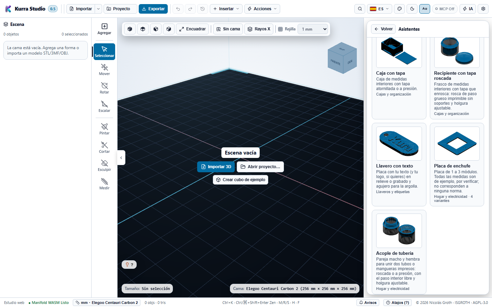
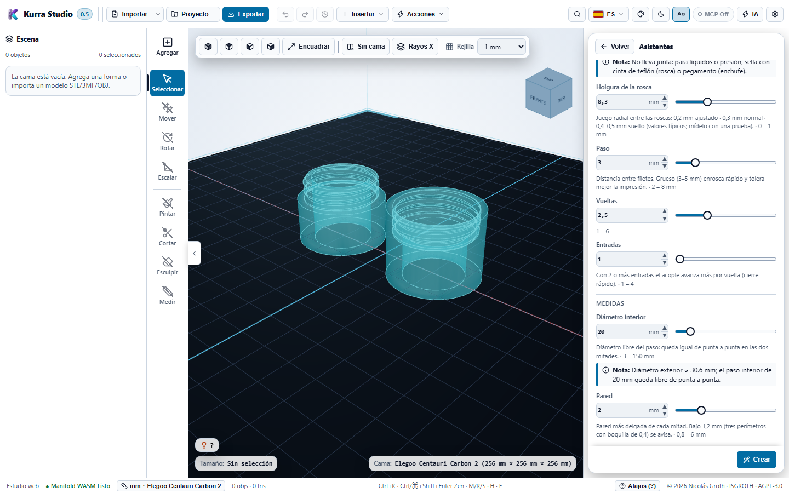
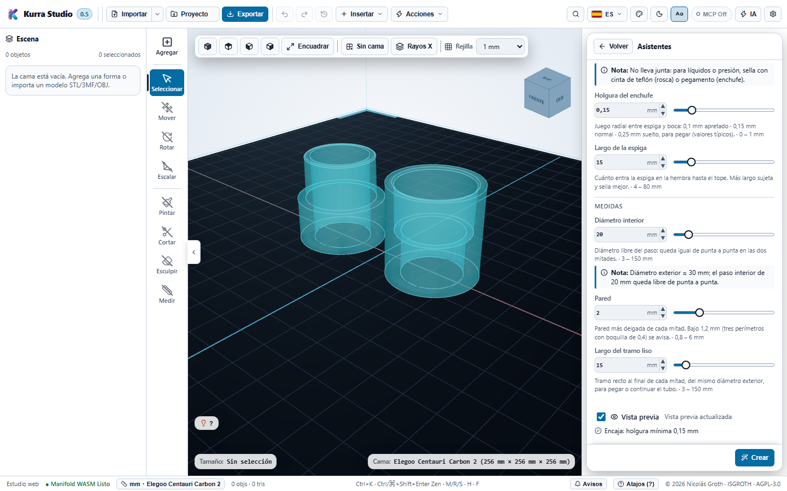
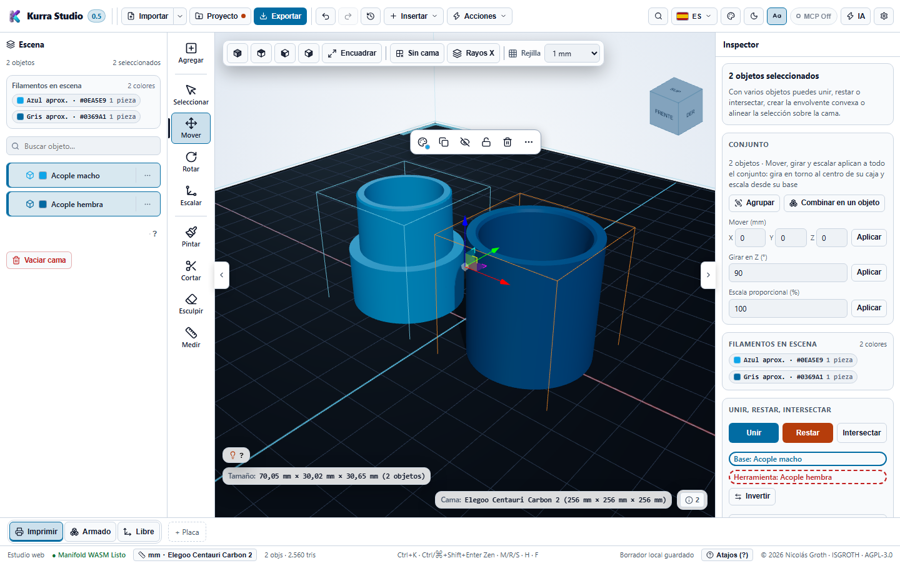
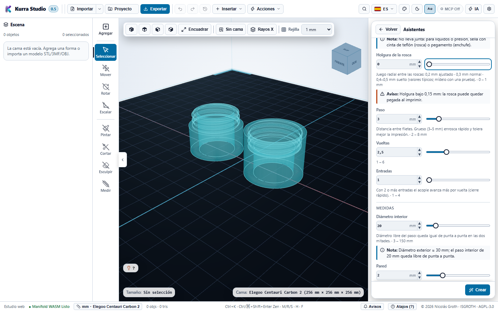

# Acople de tubería

El asistente **Acople de tubería** crea una pareja **macho y hembra** para unir dos tubos o mangueras impresos. Eliges el diámetro del paso interior, la pared y el tipo de unión (**roscada** o **a presión**), y Kurra Studio arma las dos mitades, listas para imprimir sin soportes. Antes de crear comprueba que encajen y te dice la holgura mínima que queda entre ellas.

Solo prepara la geometría: no lamina ni genera G-code.

## Crear el acople

1. Elige **Insertar › Asistentes** y, en la galería, la tarjeta **Acople de tubería** (categoría *Hogar y electricidad*). También sirve `Ctrl+K` y escribir *Acople*.

   

2. Rellena el formulario. Viene con medidas razonables (paso interior de 20 mm, pared de 2 mm, unión roscada):
   - **Medidas**: *Diámetro interior* (el paso libre, igual de punta a punta en las dos mitades), *Pared* (la más delgada de cada mitad) y *Largo del tramo liso* (el tramo recto al final de cada mitad, para pegar o continuar el tubo).
   - **Unión**: *Tipo de unión* y sus campos. Con **Roscada**: *Holgura de la rosca*, *Paso*, *Vueltas* y *Entradas*. Con **A presión (enchufe)**: *Holgura del enchufe* y *Largo de la espiga*. Los campos de la otra unión se ocultan.
3. Mira la barra **Vista previa**: además del fantasma de las dos mitades, dice **Enrosca: holgura mínima 0,31 mm** (roscada, valores por defecto) o **Encaja: holgura mínima 0,15 mm** (a presión). Si la holgura no alcanza, aparece un aviso: *Sin holgura suficiente* (menos de 0,1 mm, se pegaría al imprimir) o *Interferencia* (las piezas se cruzan), con icono y texto, no solo color.

   

   

4. Pulsa **Crear**. El **Acople macho** y el **Acople hembra** salen lado a lado, cada uno apoyado en su tramo liso con la espiga o la boca hacia arriba, en un solo paso de deshacer. Un aviso repite el resultado de la verificación.

   

Para cambiar las medidas después, selecciona una de las mitades y pulsa **Editar con el asistente**: el formulario vuelve con tus respuestas y **Actualizar** reemplaza las dos (ver [Asistentes](asistentes.md#editar-con-el-asistente)).

## Cómo es cada unión

- **Roscada.** El macho lleva rosca exterior y la hembra rosca interior, con el mismo perfil del [recipiente con tapa roscada](tapa-roscada.md#cómo-es-la-rosca): trapecio con flancos a 45° del eje (se imprime vertical, sin voladizos más tendidos que 45°), crestas planas y bisel de entrada en la punta del macho y en la boca de la hembra. El largo roscado es *vueltas × paso × entradas*. La hembra llega a tope cuando su boca apoya en el hombro del macho.
- **A presión (enchufe).** El macho termina en una espiga lisa con una leve conicidad (1° por lado: centra la hembra al enchufar sin trabarla) y un chaflán en la punta; la hembra tiene el mismo cono más la holgura y la **boca ensanchada** a 45° (0,6 mm) para que la espiga entre guiada. El tope es el hombro del macho.
- **Paso interior libre.** El agujero del diámetro pedido atraviesa las dos mitades de punta a punta; armadas, nada lo estrecha.
- **Tramo liso.** Cada mitad termina en un tramo recto del mismo diámetro exterior que la hembra, para pegar el tubo o seguir modelándolo.
- **Sin junta.** El acople no lleva junta tórica: para líquidos o presión, sella con cinta de teflón (rosca) o pegamento (enchufe).

## Holgura: cómo elegirla

Son medidas del modelo, no ajustes de la impresora. Como punto de partida:

| Unión | Ajustada | Normal | Suelta |
|---|---|---|---|
| Roscada (*Holgura de la rosca*) | 0,2 mm | 0,3 mm | 0,4 – 0,5 mm |
| A presión (*Holgura del enchufe*) | 0,1 mm (entra con fuerza) | 0,15 mm | 0,25 mm (para pegar) |

Suelta conviene con boquilla de 0,6 mm o más, PETG o materiales que se expanden, y piezas grandes. Si dudas, imprime primero un acople pequeño (paso interior de 8–10 mm) con la misma holgura y ajusta. Fuera de esos márgenes aparece un aviso (rosca bajo 0,15 o sobre 0,6 mm; enchufe bajo 0,1 o sobre 0,3 mm). Con holgura 0 la vista previa avisa que no encaja:

La holgura que muestra la vista previa es la **medida** con Manifold sobre las dos piezas armadas, no la que escribiste: en la roscada incluye el juego de los flancos (por eso 0,3 mm pedidos dan ≈ 0,31 mm); en la de presión coincide con la pedida.

## Pared mínima

La pared puede bajar hasta 0,8 mm (dos perímetros con boquilla de 0,4 mm), pero **bajo 1,2 mm** (tres perímetros) aparece un aviso: una pared de dos perímetros en una pieza que se enrosca o se enchufa suele rajarse al apretar. Si el tubo va a llevar presión, usa 2 mm o más. La pared pedida es la más delgada de cada mitad: en el macho, entre el paso interior y la raíz de la rosca o la punta de la espiga; en la hembra, entre la rosca interior o la boca y el exterior.

## Consejos de modelado para imprimir

- **Imprime las mitades como salen**, apoyadas en su tramo liso: la rosca, el cono y la boca ensanchada no necesitan soportes.
- **Espiga de 8 mm o más** en la unión a presión: con menos sujeta poco (hay aviso).
- **Entre 1,5 y 3 vueltas** en la roscada; con dos entradas cierra con menos giro.
- **Diámetro exterior.** El aviso informativo del formulario dice el diámetro exterior aproximado; si necesitas que calce dentro de otro tubo, ajusta la pared.

## Desde un agente (MCP)

`kura_create_pipe_coupling` crea el acople con las mismas medidas del formulario (`joint`: `thread` o `press`, `clearanceMm` para la holgura de la unión elegida) y responde `fit`: estado, holgura mínima medida, volumen de interferencia, `minWallMm` y `thinWall`. Detalles en [MCP](../MCP.md).

## Si algo no sale

- **La vista previa dice *pausada***: pulsa **Actualizar**. Con acoples muy grandes la comprobación tarda más.
- **La rosca o el enchufe quedaron apretados al imprimir**: sube la holgura 0,05–0,1 mm y vuelve a crear con **Editar con el asistente**.
- **Gotea**: agrega cinta de teflón en la rosca o pega el enchufe; sube el *Largo de la espiga* o las *Vueltas* para más superficie de contacto.

Anterior: [Recipiente con tapa roscada](tapa-roscada.md) · Siguiente: [Alojamiento de imán](alojamiento-de-iman.md) · [Índice](README.md)
