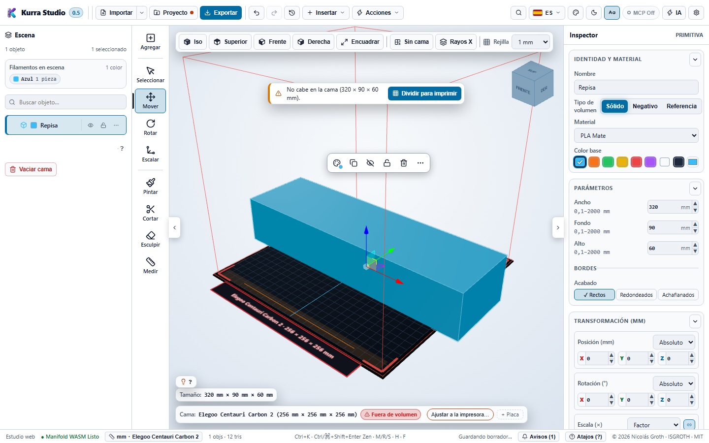
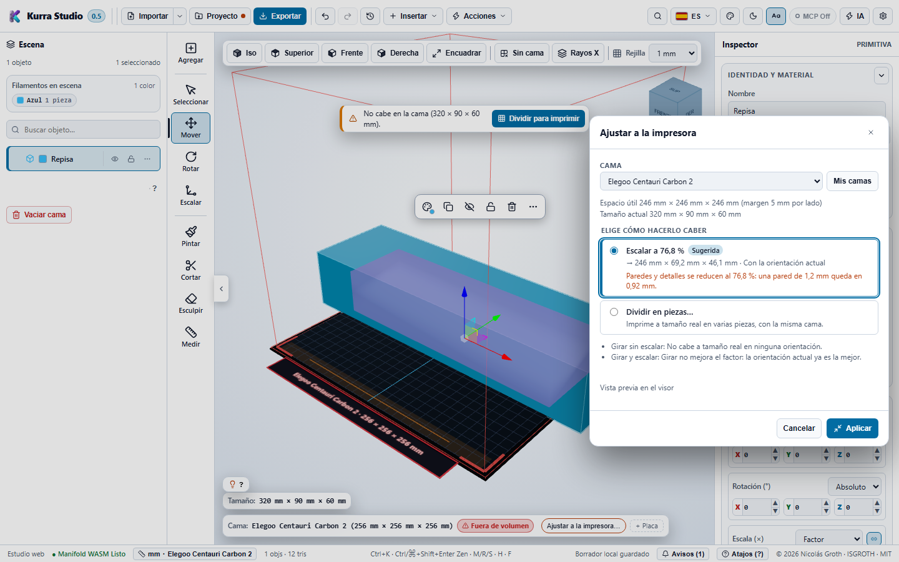
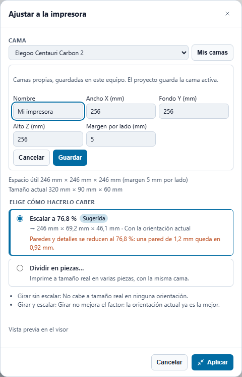

# Ajustar a la impresora

Cuando una pieza no cabe en tu cama, **Ajustar a la impresora** te muestra las formas de hacerla caber y tú eliges una: escalarla, girarla, girarla y escalarla, o dividirla en piezas. Nada se aplica solo, y lo que apliques se deshace en un paso.

## Abrirlo

Tienes tres caminos:

- En el pie del visor, junto al aviso **Fuera de volumen**, pulsa **Ajustar a la impresora…**. Si no hay nada seleccionado, toma las piezas que se salen de la cama.
- Clic derecho sobre la pieza → **Ajustar a la impresora…**. Si tienes varias seleccionadas, se ajustan juntas, como un bloque.
- **Ctrl+K** y escribe «ajustar».

## Elegir una alternativa

1. Revisa la **cama** arriba del diálogo. Puedes cambiarla ahí mismo; el espacio útil descuenta un margen por lado (5 mm, o el que tenga tu cama).
2. Elige una de las tarjetas. Cada una dice cuánto queda la pieza en X × Y × Z:
   - **Escalar a N %**: la achica parejo, sin girarla.
   - **Girar sin escalar**: la pone en otra posición donde cabe a tamaño real. Primero prueba girarla sobre la cama (Z); si hace falta, la acuesta y te dice **qué cara queda apoyada**.
   - **Girar y escalar a N %**: busca entre las 24 posiciones posibles la que deja la pieza más grande. Solo aparece si mejora a *Escalar*.
   - **Dividir en piezas…**: aparece cuando no cabe a tamaño real de ninguna forma. Abre [Dividir para imprimir](dividir-para-imprimir.md) con la misma cama.
3. La opción marcada como **Sugerida** es solo una pista: girar si cabe a tamaño real; dividir si habría que achicarla a menos de la mitad.
4. Al elegir, el visor muestra un **fantasma** violeta con el resultado. Con el teclado, las flechas cambian de opción.
5. Pulsa **Aplicar**. La pieza queda centrada en la cama y apoyada. **Ctrl+Z** la devuelve como estaba.

## Avisos que puedes ver

- **Paredes y detalles se reducen**: al escalar, una pared de 1,2 mm queda más delgada. Revisa que tu pieza la aguante.
- **Queda bajo el 50 % del tamaño**: conviene dividir en vez de achicar tanto.
- **Cambia la cara apoyada**: revisa que la pieza quede estable y que no aparezcan voladizos nuevos.
- **Medidas que dejan de ser estándar**: si el bloque tiene una **rosca ISO** generada en Kurra Studio (por ejemplo M8) o piezas de Dividir con **conectores** o **tarugos**, al escalar dejan de tener su medida. Si la rosca es un objeto aparte dentro de un bloque de varios, **Mantener aparte** la deja fuera del ajuste con su tamaño. Los conectores de Dividir están fundidos en la pieza: no se pueden dejar aparte.

Kurra Studio solo reconoce las medidas que creó él mismo (roscas, conectores, tarugos y piezas con parámetros). En una malla importada no puede saber si un agujero es para un tornillo.

## Mis camas

Si tu impresora no está en la lista, crea tu propia cama:

1. En el diálogo, pulsa **Mis camas** y luego **Nueva cama**.
2. Escribe el nombre, el **ancho X**, el **fondo Y**, el **alto Z** y el **margen por lado**, en milímetros (acepta coma decimal).
3. **Guardar** la deja como cama activa. Desde la lista puedes **Editar**, **Duplicar** o **Borrar** tus camas.

Tus camas se guardan en este equipo. El proyecto `.kura` guarda la cama activa: al abrir un proyecto hecho con otra cama, Kurra Studio te avisa y puedes elegir **Usar mi cama** o **Mantener la del proyecto**.

## Problemas frecuentes

- **No aparece «Girar sin escalar»**: la pieza es más larga que cualquier lado útil de la cama; ninguna posición la deja caber a tamaño real.
- **El porcentaje parece bajo**: el margen por lado se descuenta en los tres ejes. Con una cama de 256 mm y margen de 5 mm, el espacio útil es 246 mm.
- **El perfil «Estudio libre» no deja ajustar**: no tiene cama. Elige una impresora o crea tu cama.
- **No se ajusta una pieza bloqueada**: desbloquéala primero.
