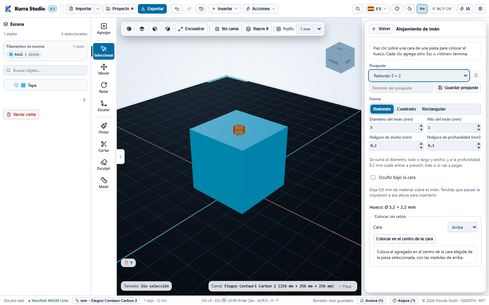
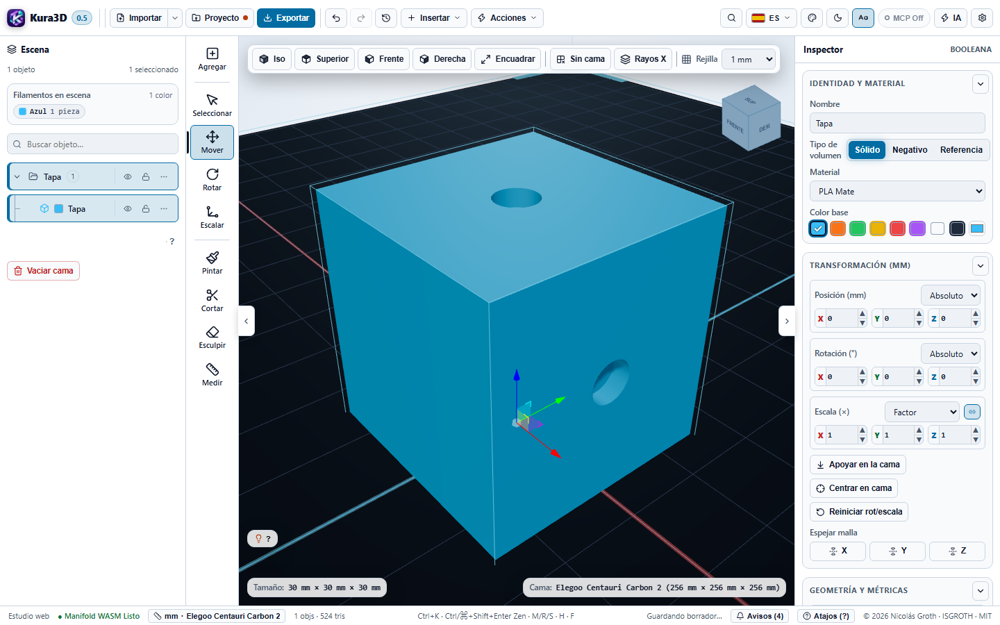

# Alojamiento de imán

Un alojamiento de imán es el hueco donde va un imán de neodimio: para cerrar una tapa, pegar una pieza a una superficie metálica o alinear dos mitades. En Kurra Studio lo colocas con un clic sobre una cara de una pieza. El hueco queda como **pieza negativa**, orientado según esa cara, y se abre en la pieza cuando aplicas las restas, como cualquier negativo (ver [Sólidos negativos y restas](solidos-negativos-y-restas.md)).

Kurra Studio solo prepara la geometría. No lamina, así que tampoco inserta la pausa de impresión por ti.

## Abrir el panel

1. Ten al menos una pieza sólida visible en la escena. Si no hay ninguna, Kurra Studio te avisa y el panel no se abre.
2. Elige **Insertar › Alojamiento de imán** en la barra superior. También puedes hacer clic derecho sobre la pieza y elegir **Más › Alojamiento de imán**, o abrir la paleta con `Ctrl+K` y escribir *imán*.
3. El panel **Alojamiento de imán** se abre a la derecha. Viene con un imán **redondo de 5 × 2 mm** (diámetro × alto).

## Elegir el imán

- **Preajuste**: los incluidos son redondos de 5 × 2, 6 × 3, 8 × 3 y 10 × 3 mm, y uno cuadrado de 5 × 5 × 2 mm. Al elegir uno se cargan sus medidas.
- **Forma**: *Redondo* (diámetro × alto) o *Cuadrado* (lado × alto).
- **Diámetro** o **Lado**, y **Alto** del imán, en milímetros. Puedes escribir con coma decimal (`6,5`).
- **Holgura de ancho** y **Holgura de profundidad**: lo que se agrega al diámetro o lado y a la profundidad para que el imán entre. Por defecto son 0,2 mm, así que un imán de 5 × 2 deja un hueco de 5,2 × 2,2 mm. Se ajustan de 0 a 0,6 mm. Los 0,2 mm son un **punto de partida por verificar**, no una garantía: los agujeros impresos en FDM suelen salir más chicos que el modelo, así que si el imán no entra, prueba con 0,3 a 0,4 mm; si lo vas a pegar, también conviene subirlo. Imprime antes una pieza de prueba chica con la misma holgura.
- Un valor fuera de rango queda marcado junto a su campo y, mientras no lo corrijas, el panel no coloca nada.
- Debajo de los campos ves el tamaño real del hueco, por ejemplo *Hueco: Ø 5,2 × 2,2 mm*; mientras un campo tenga error dice que es inválido en vez de mostrar el último valor bueno.

### Abierto u oculto

Por defecto el hueco es **abierto**: su boca queda a ras de la cara y el imán se pone después de imprimir. Si activas **Oculto bajo la cara**, el hueco queda tapado por 0,6 mm de material: el imán no se ve, pero tienes que **pausar la impresión** a la altura donde se cierra el hueco para meterlo.

- **A qué altura pausar:** la de la cara menos 0,6 mm, medida en el eje de impresión (el techo del hueco queda ahí). Pausa justo antes de que la impresora cierre esa capa, mete el imán y reanuda.
- **El techo de 0,6 mm** son unas 3 capas impresas como puente sobre el vacío; con capas de 0,2 mm es lo que cubre el imán, y la calidad de ese puente depende de tu impresora.
- **Conviene solo en caras horizontales superiores:** en una cara lateral o inclinada el hueco no queda en una sola altura de pausa y el puente se imprime de costado. Ahí usa el hueco abierto.
- **Prueba antes de imprimir la pieza definitiva:** imprime una pieza de prueba chica con la misma holgura para comprobar que el imán entra y se sostiene, y ajusta las holguras si hace falta.

### Tus preajustes

1. Ajusta las medidas a tu imán.
2. Escribe un nombre en *Nombre del preajuste* (hasta 40 caracteres) y pulsa **Guardar preajuste**. Si ya tienes uno con ese nombre, se actualizan sus medidas.
3. Aparece en la lista bajo *Mis preajustes* y sigue ahí cuando vuelves a abrir Kurra Studio (se guarda en este navegador, no en el proyecto).
4. Para borrarlo, elígelo en la lista y pulsa el botón de la papelera. El aviso ofrece **Deshacer** para recuperarlo y el foco vuelve a la lista de preajustes.

## Colocar el hueco

1. Con el panel abierto, pasa el cursor sobre la pieza: una vista previa naranja translúcida (la ves también a través de la pieza) muestra el hueco sobre la cara que está bajo el cursor, perpendicular a ella.
2. Haz **clic** donde lo quieras. Se agrega un negativo llamado, por ejemplo, **Imán 5 × 2**, agrupado con la pieza para que se muevan juntos. Funciona en caras de arriba, de los costados e inclinadas, también si la pieza está girada o escalada.
3. Cada clic agrega otro alojamiento. Arrastrar para orbitar la cámara no coloca nada.
4. Termina con **Listo**, con la X del panel o con `Esc`.

Cada alojamiento es un paso de deshacer: `Ctrl+Z` quita solo el último.

### Pared mínima

Al colocar, Kurra Studio mide con rayos cuánto material queda entre el hueco y las otras caras de la pieza (al fondo y a los costados). Si queda menos de **1,2 mm** (unos tres perímetros de 0,4 mm), te avisa con la medida. Si el hueco atraviesa la pieza o se asoma por otra cara, también te lo dice. El aviso no impide colocarlo: decides tú si lo mueves o usas un imán más bajo. El panel muestra la pared mínima del último que colocaste.

### Caras curvas y piezas escaladas

- **En una cara curva** (un cilindro, una esfera) el imán puede **sobresalir** de la superficie, y con *Oculto bajo la cara* la tapa de 0,6 mm no queda pareja. Kurra Studio lo avisa al colocar. La vista previa naranja muestra la forma, las medidas y el eje del hueco, pero no cuánto sobresale: en una cara cóncava el hueco real sobresale más de lo que dibuja la vista previa.
- **Escalar la pieza no cambia el tamaño del imán.** El hueco se crea con las medidas reales del imán que elegiste, aunque la pieza esté escalada. Pero si después escalas el grupo o el negativo, el hueco se escala con ellos y deja de coincidir con tu imán: en ese caso borra el alojamiento y vuelve a colocarlo con la pieza ya escalada.

## Abrir los huecos

1. Cuando tengas todos los alojamientos, elige la pieza y usa **Aplicar restas** (en el inspector, sección de piezas, o con `Ctrl+K`).
2. Los negativos se restan y la pieza queda como un sólido cerrado con los huecos de las medidas pedidas.

El hueco redondo es un polígono de 64 lados que *rodea* el círculo pedido: su ancho más chico es justo el diámetro del hueco, así el imán siempre entra.

## Si algo no sale

- **El panel no se abre:** no hay ninguna pieza sólida visible. Crea o muestra una pieza, o cambia a *Sólido* una que esté como negativo o referencia.
- **El clic no coloca nada:** revisa que no haya un campo marcado en rojo; el panel lo indica arriba. Si el motor está ocupado con otra operación, espera a que termine.
- **El hueco quedó en una cara que no querías:** `Ctrl+Z` y vuelve a hacer clic. También puedes mover el negativo como cualquier pieza antes de aplicar las restas.
- **El imán no entra o queda suelto:** cambia la holgura. Las medidas de los imanes varían entre marcas; mide el tuyo con un pie de metro antes de imprimir.

Anterior: [Asistentes](asistentes.md) · Siguiente: [Torreta para tornillo](torreta-para-tornillo.md) · [Índice](README.md)
