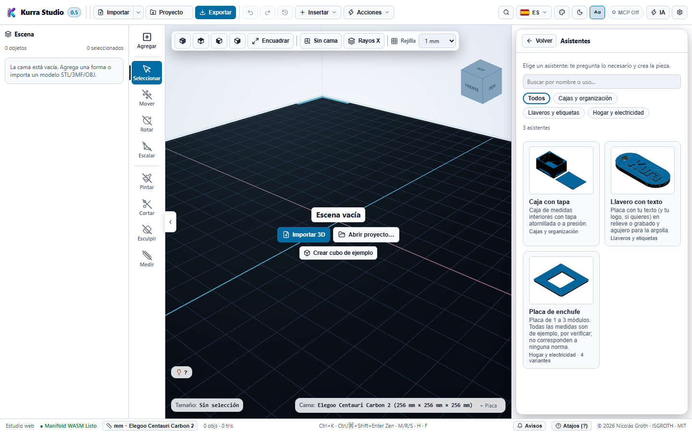
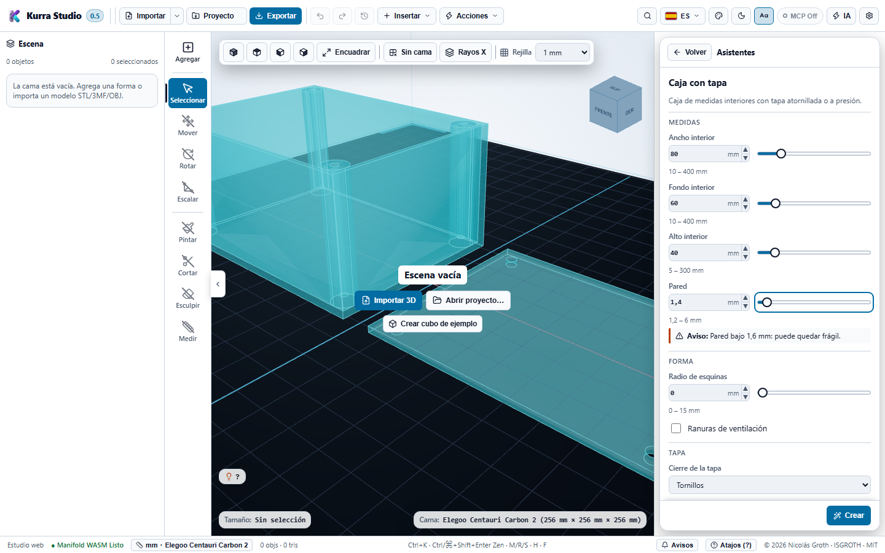
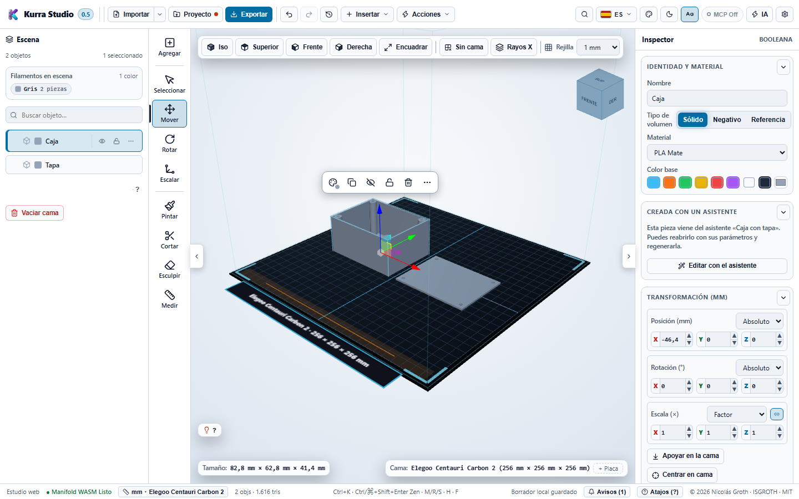
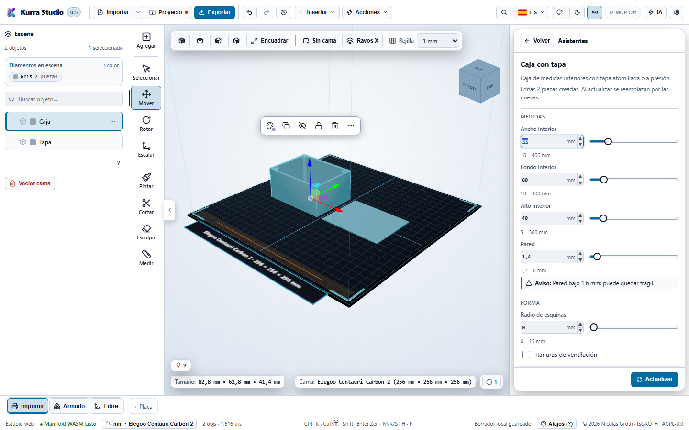

# Asistentes

Un asistente crea una pieza completa a partir de unas pocas preguntas: eliges las medidas, y Kura3D arma la pieza (o varias, como una caja y su tapa) lista para revisar, dividir o exportar. Hoy vienen tres: **Caja con tapa**, **Llavero con texto** y **Placa de enchufe**. Cada uno está hecho con una *receta*, un archivo de datos (sin código) que describe sus preguntas, sus reglas y los pasos para construir la pieza.

Los asistentes solo preparan la geometría. No laminan ni generan G-code.

## Abrir un asistente

1. Elige **Insertar › Asistentes** en la barra superior (en el teléfono, en la hoja **Agregar**). También sirve `Ctrl+K` y escribir *Asistentes* o el nombre del asistente, por ejemplo *Asistente: Caja con tapa*, que abre su formulario directo.
2. Se abre el panel **Asistentes** a la derecha, con la lista. Cada tarjeta trae el nombre, una descripción corta y, si el asistente ofrece variantes, cuántas.

## Crear una caja con tapa

1. En la lista, elige **Caja con tapa** (con el teclado: `Tab` hasta la tarjeta y `Enter`). El foco queda en el primer campo.
2. Rellena el formulario, que viene con medidas razonables:
   - **Medidas**: ancho, fondo y alto *interiores*, y el grosor de la pared. Cada campo muestra su rango (por ejemplo 10 – 400 mm) y admite escribir el valor, usar las flechas del teclado o arrastrar sobre el campo.
   - **Forma**: radio de las esquinas y ranuras de ventilación. Si activas *Ranuras de ventilación* aparece *Ancho de ranura*.
   - **Tapa**: cierre con tornillos (eliges el diámetro) o a presión. Con *A presión* el campo del tornillo se oculta, porque ya no hace falta.
3. Mientras cambias valores, el asistente revisa las reglas de la pieza. Un **aviso** (por ejemplo, *Pared bajo 1,6 mm: puede quedar frágil*) aparece junto al campo y no te impide crear. Un **error** (un valor fuera de rango, o postes de tornillo que no caben) también aparece junto al campo, con el nombre del campo y el rango permitido, y deshabilita **Crear** hasta que lo corrijas. Los avisos llevan un icono y la palabra *Aviso* o *Error*: no dependen solo del color.
4. Mira el visor: mientras el formulario no tiene errores, una **vista previa** (ver más abajo) muestra la caja y la tapa translúcidas, en el lugar donde caerán.
5. Pulsa **Crear** (o `Enter` en cualquier campo). Mientras se construye, los campos se deshabilitan y el panel dice *Creando «Caja con tapa»…*. Si la vista previa ya está lista con esas medidas, no se calcula de nuevo y las piezas quedan exactamente donde estaba el fantasma.
6. Al terminar, el panel se cierra, la **Caja** y la **Tapa** quedan seleccionadas y encuadradas, y un aviso dice qué se creó. Si alguna pieza no cabe en tu cama, el aviso te lo dice para que la dividas (ver [Dividir para imprimir](dividir-para-imprimir.md)).

Para deshacerlo, `Ctrl+Z`: quita la caja y la tapa de una sola vez.

## Vista previa en el visor

Sobre el botón **Crear** está el interruptor **Vista previa**, activado por defecto (se recuerda mientras dura la sesión). Con él activado:

- Tras cada cambio de un campo, y una breve espera (unos 0,3 s), el visor dibuja en translúcido lo que se va a crear, en el mismo hueco libre de la cama donde caería. Si cambias otro campo mientras calcula, el cálculo anterior se cancela y el fantasma se atenúa hasta que llega el nuevo.
- Si no tocas nada, o vuelves a unas medidas ya calculadas, no se recalcula.
- A su derecha, un texto discreto dice el estado (*Calculando vista previa…*, *Vista previa actualizada*). Se anuncia sin interrumpir a los lectores de pantalla.
- Si el formulario tiene un error, o la receta no puede construir la pieza con esas medidas, el fantasma desaparece y la vista previa dice *Sin vista previa: revisa los campos*; el motivo ya está junto al campo y no salen avisos emergentes.
- Si calcular tarda más de unos 1,5 s, la vista previa se **pausa** (*Vista previa pausada: demasiado pesada*) y deja de calcular sola. El botón **Actualizar** la calcula a mano, sin tope de tiempo. Mientras tanto puedes pulsar **Crear** con normalidad.
- Si Kura3D está ocupado con otra operación, la vista previa espera su turno: nunca la retrasa.

Apaga el interruptor si prefieres no ver el fantasma. La vista previa no toca la escena ni el historial de deshacer.

## Editar con el asistente

Las piezas creadas por un asistente se acuerdan de cómo se hicieron. Para volver a abrir una:

1. Selecciónala. En el inspector aparece la ficha **Creada con un asistente** con el botón **Editar con el asistente**. También está en el menú de clic derecho, en **Más**.
2. Se abre el asistente de esa receta con las respuestas y la variante con las que se creó, y el botón ahora es **Actualizar**. Un texto arriba recuerda cuántas piezas se reemplazarán.
3. Cambia lo que quieras (la vista previa muestra cómo quedará) y pulsa **Actualizar**. Todas las piezas de ese juego (por ejemplo la caja *y* su tapa) se reemplazan por las nuevas en **un solo paso de deshacer** (`Ctrl+Z` las devuelve como estaban).

Las piezas nuevas conservan la **posición** donde estaba el juego, el **nombre** si lo habías cambiado, el **color** y el **grupo** al que pertenecían. Si moviste la tapa por separado, el juego nuevo vuelve a la disposición de la receta, anclada en la posición de la caja.

Lo que conviene saber:

- **Si modificaste la pieza después** (la cortaste, le aplicaste restas, la pintaste), Kura3D avisa antes: *se regenerará desde la receta y se perderán esos cambios*, con **Cancelar** para no tocar nada. En piezas creadas antes de esta función no se puede saber si hubo cambios, así que el aviso aparece siempre.
- **Archivos y objetos elegidos** (el logo del llavero, por ejemplo) no se guardan en la pieza: el formulario te dice qué volver a elegir.
- **Respuestas guardadas que ya no sirven** (porque la receta cambió) se descartan, se usa el valor por defecto y el formulario lo indica.
- **Si la receta ya no existe** o cambió a una versión mayor incompatible, el panel lo explica y ofrece **Crear una nueva**, en lugar de abrir un formulario con datos que no corresponden.

## Variantes

Algunos asistentes traen **variantes**: conjuntos de medidas ya preparados, como los estándares de placa de enchufe de distintos países. Elige una en *Variante* y los campos se rellenan; después puedes ajustar cualquiera. Volver a *Medidas por defecto* restituye los valores originales. Las variantes marcadas *(sin verificar)* están sin comprobar contra una pieza real: mide antes de imprimir.

## Si algo no sale

- **El botón Crear está deshabilitado:** hay un campo con un error; búscalo marcado con *Error* y el motivo. Corrígelo y se habilita.
- **Un error aparece arriba del formulario, bajo «Corrige esto antes de crear»:** la receta no pudo construir la pieza con esas medidas (por ejemplo, una pieza demasiado compleja). Cambia los valores y vuelve a intentar. La escena no se toca cuando algo falla.
- **La vista previa no aparece:** el interruptor **Vista previa** está apagado, o el formulario tiene un error. Si dice *pausada*, pulsa **Actualizar**.
- **`Esc`:** dentro de un formulario vuelve a la lista; desde la lista cierra el panel. El botón **Volver a la lista** hace lo mismo con el mouse o el dedo.

Anterior: [Generadores](generadores.md) · Siguiente: [Alojamiento de imán](alojamiento-de-iman.md) · [Índice](README.md)
