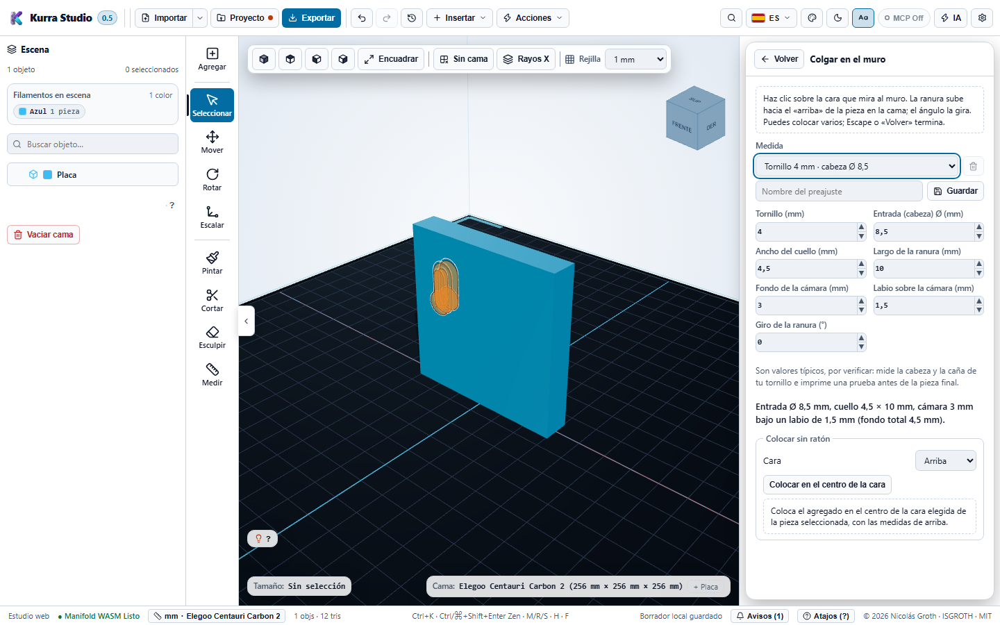
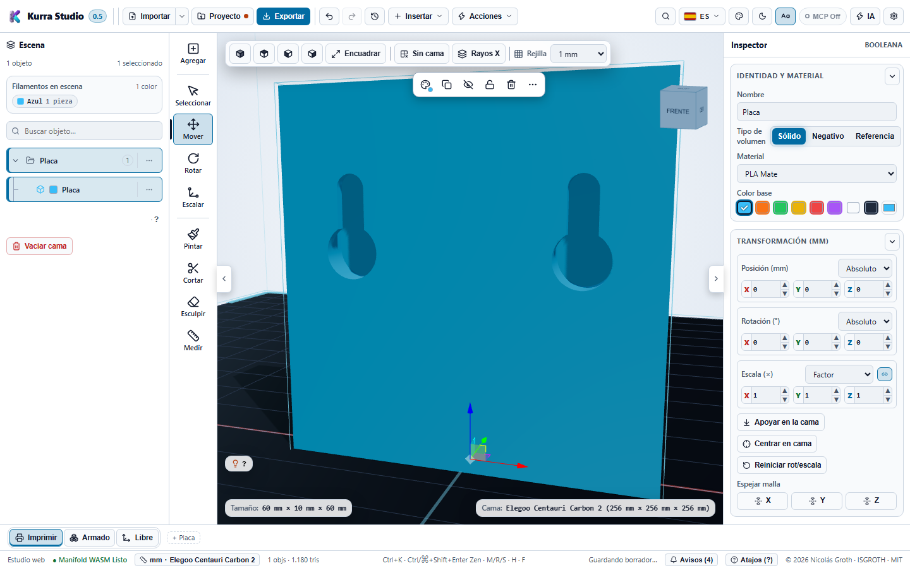

# Colgar en el muro

Un **ojo de cerradura** (*keyhole*) es la ranura que tienen los cuadros, los routers o los organizadores para colgarlos de un tornillo en la pared: metes la cabeza del tornillo por el agujero grande, bajas la pieza y la cabeza queda atrapada detrás de la ranura. En Kurra Studio lo colocas con un clic sobre una cara.

El ojo es una **pieza negativa**: se resta de tu pieza cuando usas **Aplicar restas** (ver [Sólidos negativos y restas](solidos-negativos-y-restas.md)). Tiene tres partes:

- La **entrada**: un agujero redondo del tamaño de la cabeza del tornillo.
- La **ranura del cuello**: sube desde la entrada. Es más angosta que la cabeza; por ahí pasa solo la caña.
- La **cámara**: detrás de la ranura, del ancho de la cabeza. Ahí se desliza la cabeza hasta el final de la ranura. Entre la cámara y la cara queda un **labio** de al menos 1,2 mm que sujeta la cabeza.

## Abrir el panel

1. Ten al menos una pieza sólida visible en la escena. Si no hay ninguna, Kurra Studio te avisa y el panel no se abre.
2. Elige **Insertar › Colgar en el muro** en la barra superior. También puedes hacer clic derecho sobre la pieza y elegir **Más › Colgar en el muro**, o abrir la paleta con `Ctrl+K` y escribir *colgar* o *keyhole*.
3. El panel **Colgar en el muro** se abre a la derecha, con el tornillo de **4 mm**: entrada Ø 8,5 mm, cuello de 4,5 mm, ranura de 10 mm y cámara de 3 mm bajo un labio de 1,5 mm.

## Elegir la medida

Los valores incluidos son **típicos y por verificar**: cada marca de tornillo tiene su cabeza. Mide la tuya con un pie de metro.

| Tornillo | Entrada (cabeza) | Cuello | Ranura | Cámara | Labio | Fuente |
|---|---|---|---|---|---|---|
| 3 mm | Ø 6,5 | 3,5 | 8 | 3 | 1,5 | Cabeza típica ~6 mm + 0,5; por verificar |
| 3,5 mm | Ø 7,5 | 4 | 9 | 3 | 1,5 | Cabeza típica ~7 mm + 0,5; por verificar |
| **4 mm** (por defecto) | Ø 8,5 | 4,5 | 10 | 3 | 1,5 | Cabeza típica ~8 mm + 0,5; por verificar |
| 5 mm | Ø 10,5 | 5,5 | 12 | 3,5 | 1,5 | Cabeza típica ~10 mm + 0,5; por verificar |

- **Tornillo**: la medida nominal; da nombre al ojo (*Ojo de cerradura 4 mm*).
- **Entrada (cabeza) Ø**: diámetro del agujero de entrada y ancho de la cámara. Debe ser un poco más grande que la cabeza.
- **Ancho del cuello**: un poco más ancho que la caña del tornillo y al menos 0,5 mm más angosto que la entrada (si no, la cabeza se sale).
- **Largo de la ranura**: recorrido desde el centro de la entrada hasta el final, donde descansa el tornillo. Debe alcanzar para que la cabeza quede bajo el labio.
- **Fondo de la cámara**: lo que mide de alto la cabeza, con holgura.
- **Labio sobre la cámara**: material entre la cámara y la cara. Mínimo 1,2 mm (tres perímetros de 0,4 mm).
- **Giro de la ranura**: 0° apunta hacia arriba; cambia el ángulo si la pieza cuelga en otra posición.

Si un campo está fuera de rango o las medidas no calzan entre sí, el campo queda marcado y el panel no coloca nada hasta que lo corrijas. Guarda tus medidas con nombre como en los otros agregados (*Nombre del preajuste* › **Guardar**); quedan en este navegador.

## Colocar el ojo

1. Gira la vista para ver la **cara que va contra la pared** (normalmente la de atrás).
2. Pasa el cursor sobre ella: la vista previa naranja muestra la entrada, la ranura y la cámara. **La ranura sube hacia el «arriba» de la pieza tal como está en la cama** (el eje vertical proyectado en la cara).
3. Haz **clic** donde lo quieras. Se agrega el ojo agrupado con la pieza. Lo que tenías seleccionado no cambia; cada clic agrega otro y `Ctrl+Z` quita solo el último.
4. Termina con **Listo**, con la X del panel o con `Esc`.

Para que la pieza cuelgue derecha usa **dos ojos a la misma altura**. Kurra Studio compara el punto donde descansa cada tornillo.

### Avisos

Kurra Studio revisa cada ojo al colocarlo y te avisa sin impedirlo:

- **La cámara atraviesa la pieza**: la pared es más delgada que labio + cámara. Usa una cara más gruesa o baja el fondo de la cámara.
- **Pared delgada detrás**: quedan menos de 1,2 mm de material detrás de la cámara; puede romperse al colgar.
- **Se asoma por el borde**: la figura sale por un lado de la cara. Muévela hacia adentro.
- **No está a la misma altura**: hay otro ojo en la misma cara y sus puntos de cuelgue difieren más de 0,2 mm. La pieza colgaría torcida.
- **Cara no vertical**: aviso suave; normalmente el ojo va en la cara que mira al muro.

Si la figura es más ancha que la cara en esa zona (sale de la pieza por lados opuestos), el ojo **no se coloca** y Kurra Studio te lo dice.

El ojo **sigue a su pieza**: si la mueves, la giras o la escalas, el ojo va con ella y conserva sus medidas. Al duplicar la pieza se copia; al borrarla se borra. Se guarda en el proyecto `.kura`.

## Aplicar las restas

1. Cuando tengas todos los ojos, usa **Aplicar restas** (en el inspector o con `Ctrl+K`).
2. Queda **una sola pieza cerrada** con la ranura abierta, lista para exportar.

Las pruebas del motor comprueban que una cabeza del diámetro de la entrada entra, se desliza por la cámara hasta el final de la ranura sin tocar material, y que **no** pasa por la ranura del cuello.

## Si algo no sale

- **El tornillo no entra o no baja:** sube la entrada o el cuello de a 0,2 mm.
- **La pieza se descuelga:** la cabeza pasa por el cuello. Angosta el cuello o usa un tornillo de cabeza más grande.
- **La pieza queda separada de la pared:** baja el fondo de la cámara o atornilla un poco más.

Anterior: [Torreta para tornillo](torreta-para-tornillo.md) · Siguiente: [Paso de cable](paso-de-cable.md) · [Índice](README.md)
