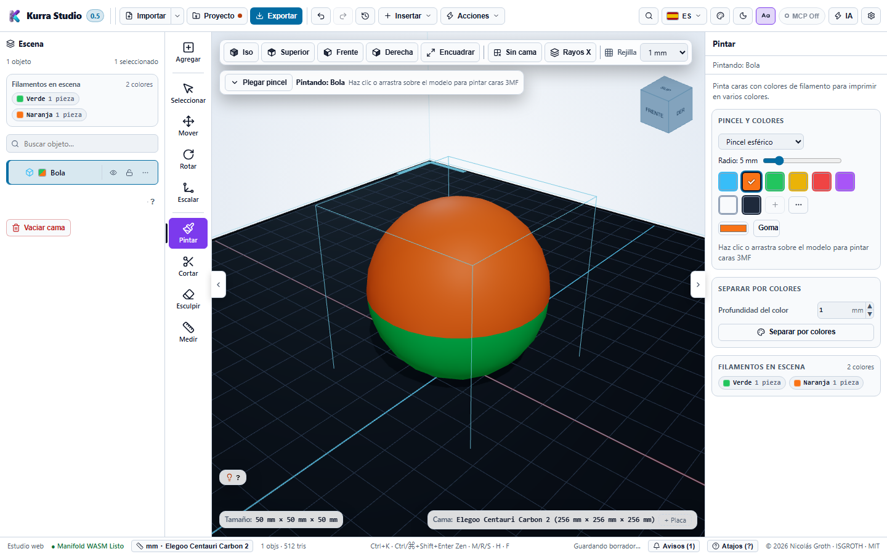
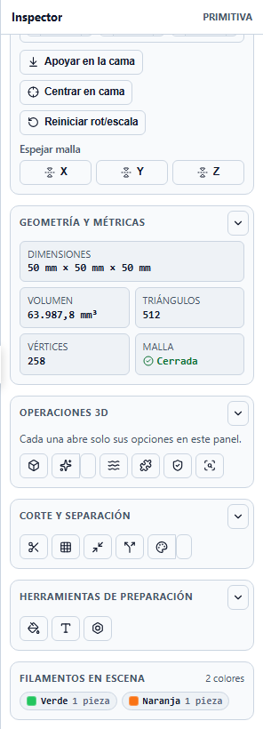

# Colores y pintura

Para imprimir en varios colores (o con varios filamentos) puedes **pintar caras** del modelo y luego **separar por colores**: cada color queda como un sólido cerrado, listo para asignarle su filamento.

## Pintar

1. Pulsa **Pintar** en la barra vertical de herramientas (o la tecla **P**). No hace falta seleccionar antes: el pincel pinta directo el objeto que tocas, y el primer trazo lo selecciona. El panel derecho muestra solo las opciones de pintura (pincel, colores, goma, separar por colores y filamentos) y dice «Sobre: nombre». En pantallas estrechas, o con el panel plegado, las mismas opciones están en la barra del visor.
2. Elige el **Modo de pincel**: *Pincel esférico* (pinta alrededor del cursor), *Relleno por ángulo* (pinta la zona de caras continuas) u *Objeto completo*.
3. Elige el **filamento** (color) en la paleta, o uno personalizado. El **Radio** del pincel está en milímetros reales; las teclas **[** y **]** lo achican y agrandan.
4. Haz clic o arrastra sobre el modelo. Cada trazo es un paso del historial: **Ctrl+Z** lo deshace.
5. **Goma** devuelve las caras pintadas al color base. Cuando termines, **V** vuelve a Seleccionar.

## Personalizar la paleta

- **Cambiar una muestra:** clic derecho sobre ella (o, con el teclado, enfócala y pulsa **Mayús+F10** o la tecla Menú). Se abre su edición: **Cambiar el color** abre el selector de color y **Quitar de la paleta** la elimina (siempre queda al menos una). **Esc** la cierra.
- **Agregar:** **+** agrega el color actual del pincel (elígelo antes con el selector de color libre).
- **Opciones de la paleta (…):** elige una paleta predefinida (*Original*, *Vivos*, *Sobrios*, *Pastel*, *Escala de grises*), **Usar los colores del proyecto** (los que ya tienen tus objetos, de más a menos usado) o **Volver a la paleta original**.
- La paleta se recuerda en este navegador; no se guarda en el proyecto. Con muchas muestras se ven las primeras 24 y el resto con **N más**.

Si el modelo tiene pocos triángulos (un cubo, por ejemplo), el pincel pinta caras enteras y Kura3D lo avisa con la opción **Refinar malla para pintar con detalle**. Las primitivas paramétricas piden confirmación antes de pintar, porque pintar las convierte en una malla fija.

## Separar por colores

1. Con el objeto pintado seleccionado, pulsa **Separar por colores** en el resumen del objeto (panel derecho, grupo *Corte y Separación*) o elige **Acciones › Separar por colores**.
2. Kura3D entrega **un sólido cerrado por color**: el color base conserva el resto y cada color adicional toma una capa hacia adentro desde la superficie pintada (la profundidad es configurable). Los volúmenes suman el del original.
3. Cada pieza aparece en la pestaña **Escena** con su color («Bola — Verde», «Bola — Naranja») y el resumen *Filamentos en escena* cuenta cuántos hay.
4. Si no te convence, **Ctrl+Z** lo deshace en un paso.

Para exportar con los colores, ver [Exportar](exportar.md): el 3MF conserva el color por cara.

## Problemas frecuentes

- **El pincel pinta cuadrados enteros:** la malla es muy gruesa; usa *Refinar malla para pintar con detalle*.
- **Pinté la cara equivocada:** **Ctrl+Z** por trazo, o la **Goma**.
- **Sobre texto 3D pintado, alguna pieza puede salir abierta:** Kura3D avisa cuáles y ofrece repararlas (*Reparar malla*).
- **Pintar está apagado:** la escena está vacía o todos los objetos están ocultos, con candado o son referencias; el tooltip y la barra de estado dicen el motivo.

Anterior: [Medir](medir.md) · Siguiente: [Generadores](generadores.md) · [Índice](README.md)
