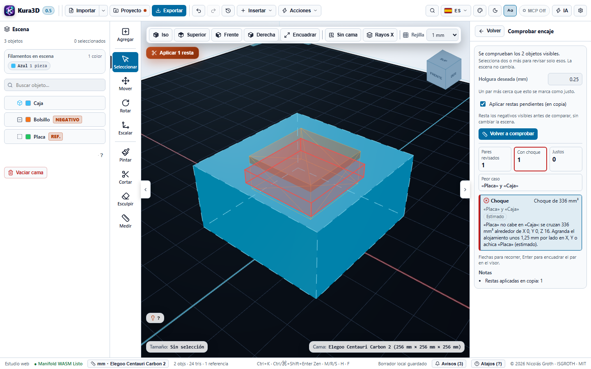
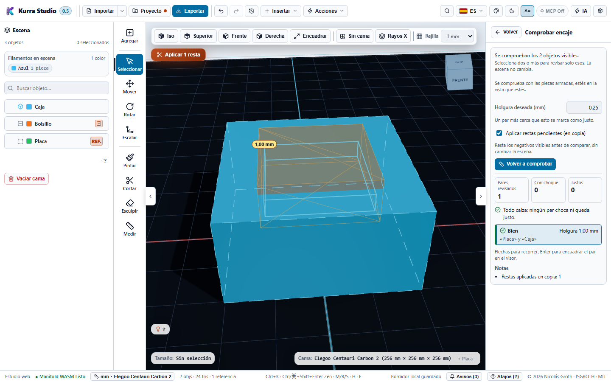

# Comprobar encaje

**Comprobar encaje** revisa si las piezas de tu diseño chocan entre sí o con una [referencia](objetos-de-referencia.md) (una placa, un tornillo, un imán), y cuánta holgura queda entre ellas. Sirve para saber, antes de imprimir, si la placa entra en su bolsillo o si la tapa cierra sin quedar apretada.

Es una revisión **bajo pedido** y **no cambia la escena**: no mueve nada, no aplica restas y no agrega pasos de deshacer.

## Comprobar

1. Abre **Acciones ▸ Comprobar encaje…**, o haz clic derecho sobre un objeto y elige **Comprobar encaje…** en el grupo *Analizar*.
   - Si seleccionaste dos o más objetos, se revisan solo esos. Si no, se revisa todo lo visible.
   - Con menos de dos objetos la opción aparece deshabilitada y dice por qué.
2. En el panel de la derecha (en el teléfono, la hoja inferior):
   - **Holgura deseada (mm):** la distancia mínima que esperas entre superficies. Por defecto 0,25 mm, la tolerancia de encaje del proyecto.
   - **Aplicar restas pendientes (en copia):** cuenta los [negativos](solidos-negativos-y-restas.md) visibles como si ya estuvieran restados. Así un bolsillo o un agujero que todavía no aplicaste se comprueba como quedará. Viene marcada.
3. Pulsa **Comprobar**. Mientras calcula ves la fase («Revisando par 2 de 5») y una barra de avance. **Cancelar** la detiene.

## Leer el resultado

- **Resumen:** pares revisados, cuántos tienen choque, cuántos quedan justos y el peor caso.
- **Lista de pares**, del más grave al menos. Cada par dice su estado con icono y texto:
  - **Choque:** las piezas se cruzan. La cifra es el volumen que se cruza (mm³).
  - **Justo:** no se tocan, pero la holgura es menor que la deseada.
  - **Bien:** la holgura es suficiente.
  - **Lejos:** están a más del tope de búsqueda.
- Debajo de cada par va la **recomendación** en texto: por ejemplo «Agranda el alojamiento unos 1,25 mm por lado en X, Y» o «sepáralas 0,15 mm hacia +Z (arriba)».
- Las marcas **Aproximado** (una malla no está cerrada), **Estimado** (la cifra de la recomendación es una estimación) y **Copia simplificada** (una malla muy densa se simplificó solo para el cálculo) avisan que el número no es exacto.
- Si nada choca ni queda justo, el panel dice **Todo calza**.
- Si ningún objeto está cerca de otro, el panel lo dice y no hay pares que comparar: eso no significa que calcen.
- Si cambias la selección después de comprobar, el resultado anterior desaparece y el panel te pide **Volver a comprobar**.
- **Notas:** mallas abiertas, restas que no se pudieron aplicar o un resultado parcial si había demasiados pares.

## Ver un par en el visor

Haz clic en un par, o recórrelos con las **flechas** y pulsa **Enter**:

- Los dos objetos se marcan con su caja (uno con línea continua y el otro discontinua).
- Un **choque** se muestra como una caja roja translúcida en la zona que se cruza.
- Una **holgura** se muestra como un segmento entre los dos puntos más cercanos, con su valor en mm.
- Clic o **Enter** encuadran el par. Las flechas solo lo resaltan.

El resaltado se limpia al salir del panel con **Volver** o **Esc**.

## Cuando cambias la escena

Si mueves, escalas o editas uno de los objetos revisados (o agregas o quitas un negativo visible), el resultado deja de valer. El panel dice **«La escena cambió»** y el botón pasa a **Volver a comprobar**.

## Después de Ajustar a la impresora

Si [Ajustar a la impresora](ajustar-a-la-impresora.md) reescala piezas y hay referencias en la escena o medidas funcionales (agujeros, espesores), aparece un aviso con **Ver encaje**. Ese botón abre este panel y comprueba el bloque ajustado junto con las referencias.

## Problemas frecuentes

- **La opción está deshabilitada.** Hacen falta dos objetos visibles (o dos seleccionados). Los negativos no cuentan como objetos: se aplican como restas.
- **Dice «Choque» pero el agujero ya está hecho como negativo.** Revisa que **Aplicar restas pendientes** esté marcada y que el negativo esté visible.
- **El resultado sale «Aproximado».** Alguna malla no está cerrada (frecuente en modelos de fabricantes). El choque se estima; para una cifra exacta, repara la malla (ver [Importar y reparar](importar-y-reparar.md)).
- **No se ve el resaltado.** Elige un par en la lista; el resaltado aparece solo con el panel abierto.
