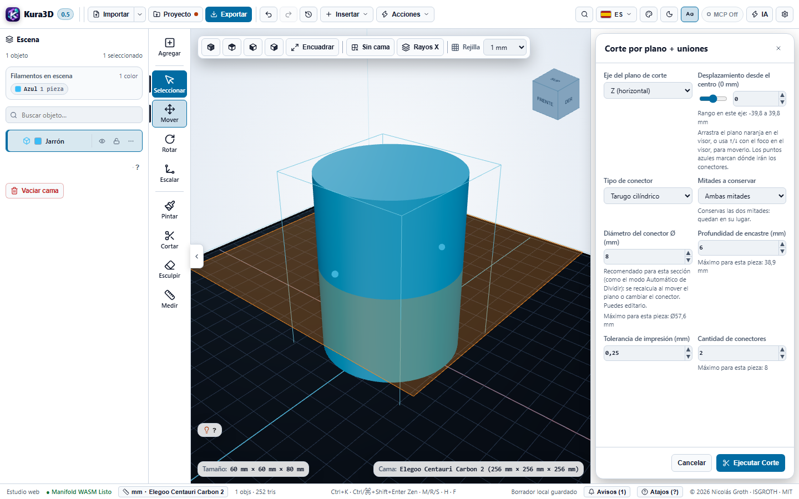
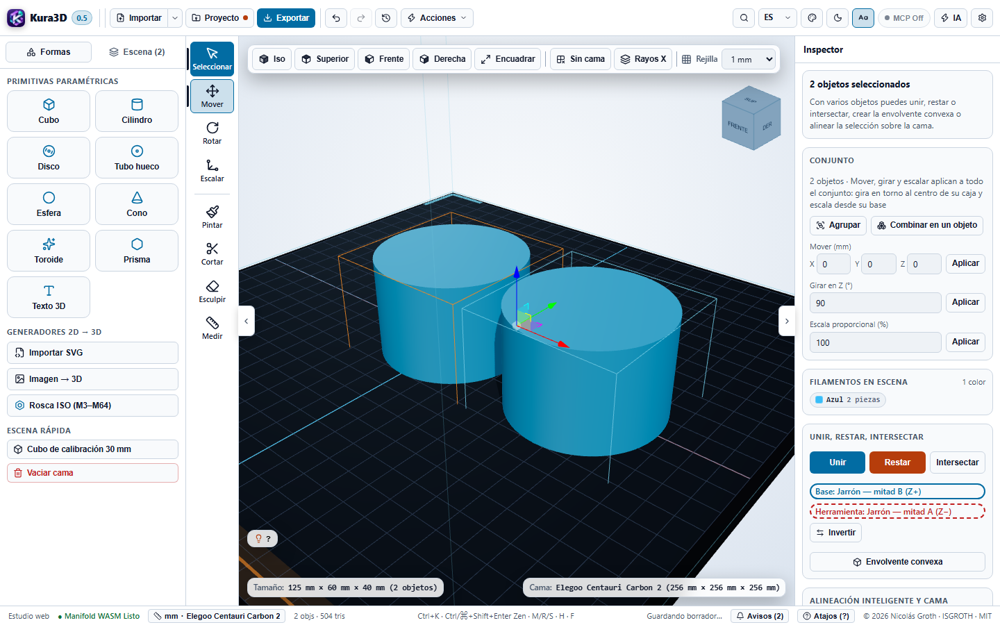
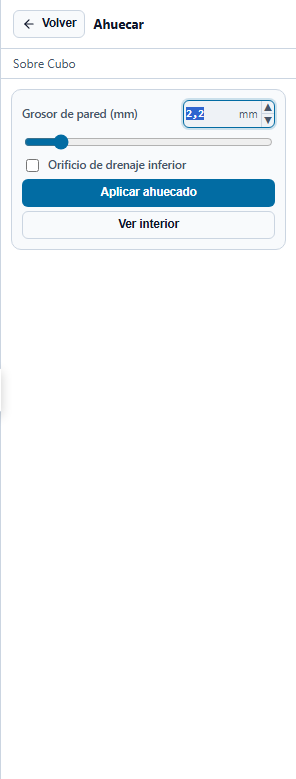

# Cortar y ahuecar

Dos operaciones para preparar una pieza: partirla con un plano (con o sin conectores para volver a unirla) y vaciarla por dentro para gastar menos material.

## Cortar con un plano

1. Selecciona la pieza y pulsa **C** (o el botón **Cortar** de la barra superior, o *Corte por plano + uniones* en el inspector). Se abre el panel *Corte por plano + uniones* y aparece el **plano naranja** en el visor.
2. Elige el **Eje del plano de corte**: *Z (horizontal)* corta en altura; X e Y cortan en vertical.
3. Mueve el plano: arrástralo en el visor, usa el deslizador o escribe el **Desplazamiento desde el centro (mm)**. Con el foco en el visor, las flechas ↑/↓ también lo mueven. Los puntos azules marcan dónde irán los conectores.
4. Elige el **Tipo de conector** (por ejemplo *Tarugo cilíndrico*) o *Sin conectores (corte limpio)*. Kura3D recomienda un diámetro según la sección; puedes editarlo, junto con la profundidad de encastre, la tolerancia de impresión y la cantidad.
5. En **Mitades a conservar** elige *Ambas mitades*, *Solo mitad positiva (+)* o *Solo mitad negativa (-)*.
6. Pulsa **Ejecutar Corte**. Las mitades se nombran con su eje: *mitad A (Z−)* y *mitad B (Z+)*.

### Dónde deja Kura3D la mitad que conservas

Si conservas una sola mitad y quedaría flotando sobre la cama, el diálogo pregunta **¿Dónde dejar la mitad que conservas?**: *Dejarla donde está* (útil para unirla luego con otra pieza), *Apoyarla en la cama* (baja en Z sin cambiar X ni Y) o *Apoyarla en un lugar libre* (busca un hueco sin tocar otros objetos). Kura3D recuerda tu elección y avisa si la mitad se superpondría con otro objeto.

## Ahuecar

1. Selecciona un sólido. En el inspector busca **Grosor de pared (mm)**, en Operaciones 3D.
2. Elige el grosor (campo o deslizador, por defecto 2,2 mm). Si la pieza es muy grande para ese grosor, un aviso te dice cuál es el máximo.
3. Opcional: marca **Orificio de drenaje inferior** para poder sacar el material sobrante (resina o polvo).
4. **Ver interior** te deja mirar dentro de la pieza (la cámara la encuadra); **Aplicar ahuecado** la vacía. Tras cortar por plano, la cámara también encuadra las mitades.

## Problemas frecuentes

- **El corte no hace nada o falla:** comprueba que el plano pase por la pieza (el rango permitido aparece bajo el desplazamiento).
- **El conector no cabe:** reduce el diámetro o la cantidad, o usa *Sin conectores* y pega las mitades.
- **Tras ahuecar, comprueba el volumen:** mira el *Volumen* del inspector; si no bajó, deshaz con **Ctrl+Z** y revisa la pieza con *Reparar malla*. Con algunos modelos importados complejos el ahuecado aún se está afinando.
- **Quise cortar varias veces:** el panel hace un plano por vez; repite el corte sobre cada mitad, o usa [Dividir para imprimir](dividir-para-imprimir.md) para varios planos a la vez.

Anterior: [Dividir para imprimir](dividir-para-imprimir.md) · Siguiente: [Sólidos negativos y restas](solidos-negativos-y-restas.md) · [Índice](README.md)
