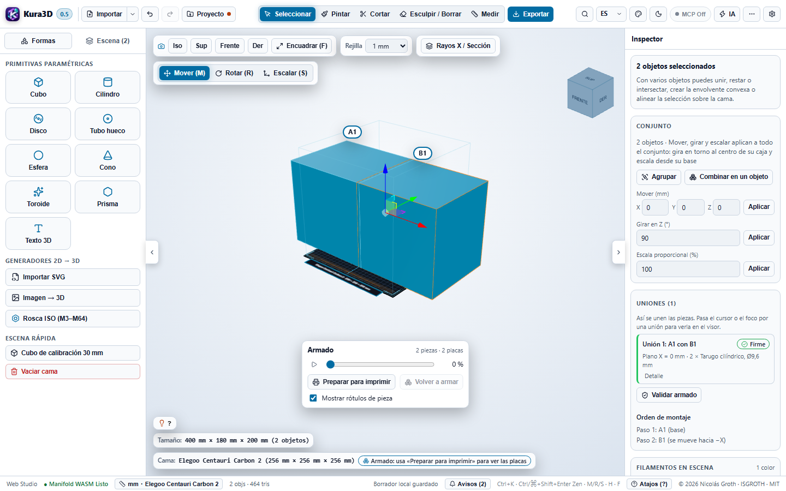

# Dividir para imprimir

Cuando una pieza es más grande que la cama de tu impresora, **Dividir para imprimir** la parte en trozos que caben, con uniones para volver a armarlos, un código por pieza (A1, B1…) y marcas para no confundirlas.

## Paso a paso

1. Selecciona la pieza grande y pulsa **Mayús+C** (o `Ctrl+K` y escribe *Dividir para imprimir*). Se abre el panel *Dividir para imprimir*.
2. En **Cama y cortes** la cama viene de tu impresora activa; puedes cambiarla y fijar un margen por lado. Marca los ejes en los que se puede cortar (X, Y, Z) y si se permite acostar piezas.
3. El plan se calcula solo y se dibuja en el visor: los **planos** de corte (naranja, con su nombre, por ejemplo *Plano X1*) y los códigos de cada pieza. Puedes arrastrar un plano o ajustarlo con su campo.
4. En **Uniones** elige el **tipo de conector**: tarugo cilíndrico, clavija cuadrada, cola de milano, tarugo suelto (se imprime aparte), solape de borde o sin conectores. Con **Tamaño automático (recomendado)** Kura3D calcula el diámetro según la superficie de cada unión.
5. Revisa el **Resumen**: piezas, placas estimadas, pieza más grande, uniones con conector y espacio libre contra la cama.
6. Pulsa **Dividir**. Las piezas quedan armadas en su lugar, agrupadas, con el código en cada una.

## Armar y preparar para imprimir

Tras dividir, el control **Armado** del visor deja ver cómo encajan:

1. Pulsa **Reproducir el armado** o arrastra el deslizador (0 % armado, 100 % explosionado; solo es una vista).
2. Pulsa **Preparar para imprimir** para apoyar cada pieza y acomodarla en placas; **Volver a armar** la devuelve a su sitio (un solo Deshacer).
3. En el inspector, la sección **Uniones** lista cada unión (*Firme* o débil) y el **Orden de montaje**. **Validar armado** vuelve a comprobarlo.
4. Para imprimir, **Exportar** ofrece *Un archivo por pieza (ZIP)* o *Un 3MF con todas las piezas en su disposición de impresión*.

Animación de muestra: [dividir-para-imprimir-armado.webm](img/dividir-para-imprimir-armado.webm) (se descarga o se abre en el navegador).

## Problemas frecuentes

- **«No se puede dividir: la pieza ya cabe en la cama»:** no hace falta dividir; cambia la cama o el margen si esperabas cortes.
- **Salen demasiadas piezas:** hay un tope de piezas; prueba permitir acostar piezas, cortar solo en un eje o usar una cama mayor.
- **Una unión aparece débil:** activa *Reforzar uniones débiles* o elige otro tipo de conector; también puedes dejar esa unión para pegar.
- **Quiero cambiar un plano:** arrástralo en el visor o usa su campo; el plan se recalcula; *Restablecer* vuelve a la propuesta.
- **No veo los códigos:** marca *Mostrar rótulos de pieza*.

Anterior: [Importar y reparar](importar-y-reparar.md) · Siguiente: [Cortar y ahuecar](cortar-y-ahuecar.md) · [Índice](README.md)
