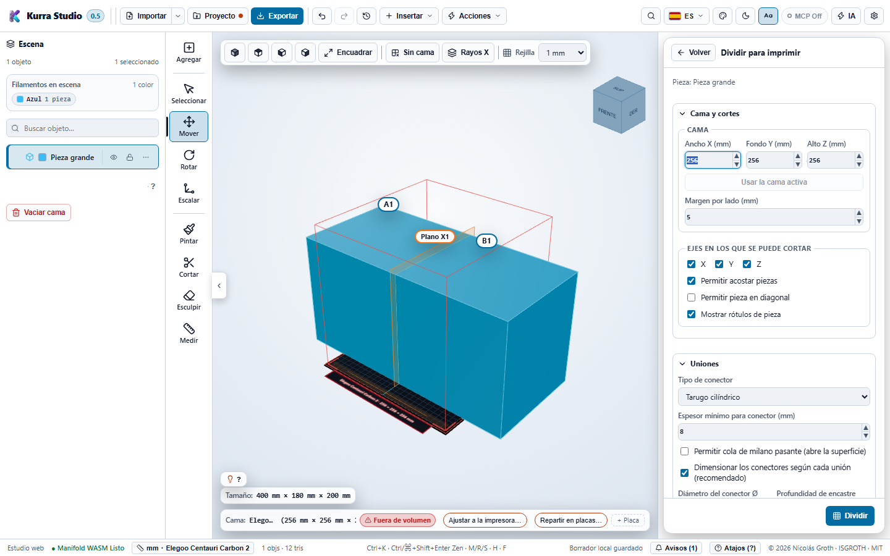
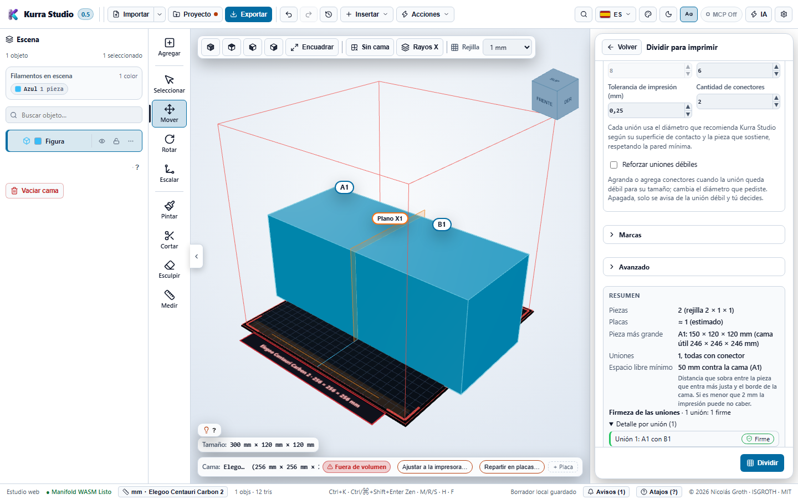
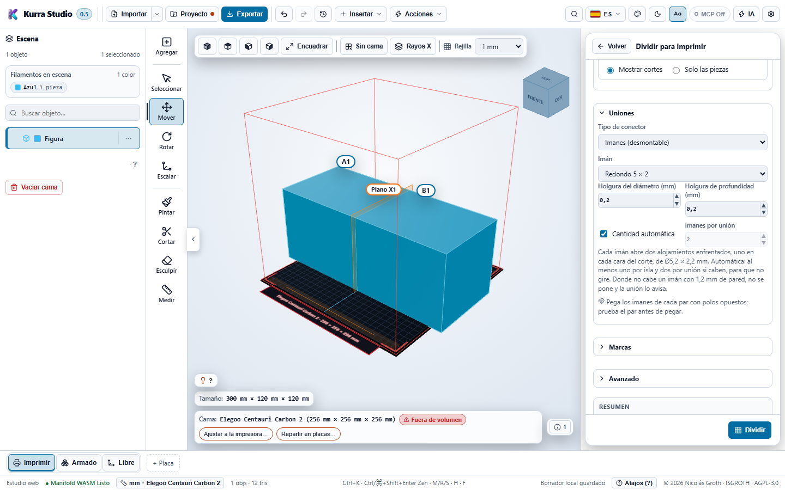
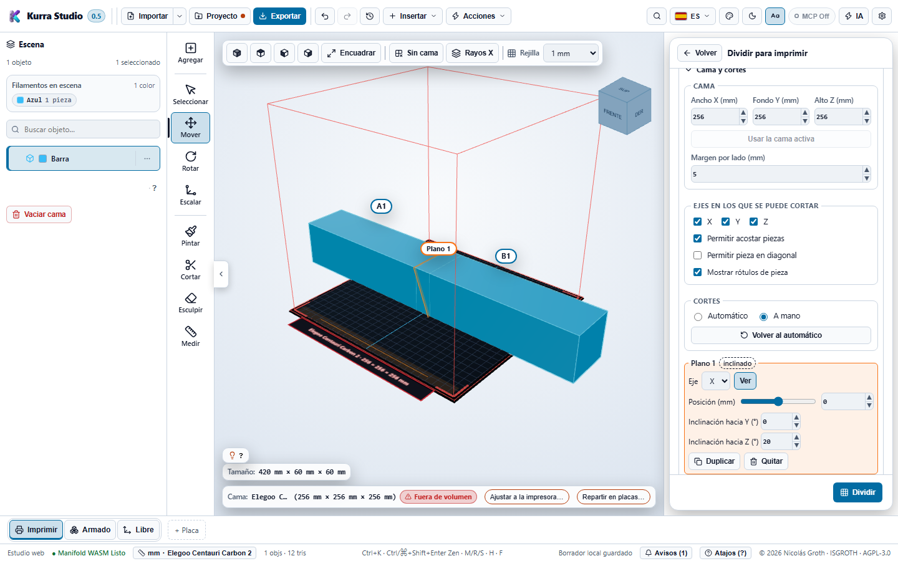
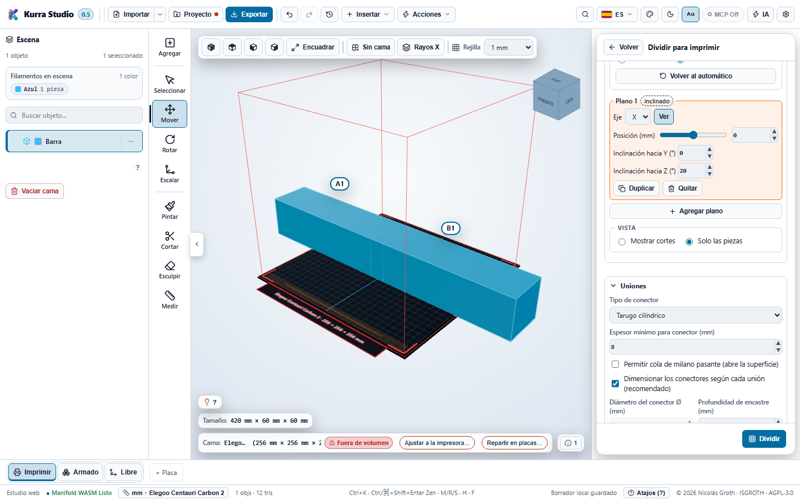

# Dividir para imprimir

Cuando una pieza es más grande que la cama de tu impresora, **Dividir para imprimir** la parte en trozos que caben, con uniones para volver a armarlos, un código por pieza (A1, B1…) y marcas para no confundirlas.

## Paso a paso

1. Selecciona la pieza grande y pulsa **Mayús+C** (o `Ctrl+K` y escribe *Dividir para imprimir*). Se abre el panel *Dividir para imprimir*.
2. En **Cama y cortes** la cama viene de tu impresora activa; puedes cambiarla y fijar un margen por lado. Marca los ejes en los que se puede cortar (X, Y, Z) y si se permite acostar piezas.
3. El plan se calcula solo y se dibuja en el visor: los **planos** de corte (naranja, con su nombre, por ejemplo *Plano X1*) y los códigos de cada pieza. Puedes arrastrar un plano o ajustarlo con su campo.
4. En **Uniones** elige el **tipo de conector**: tarugo cilíndrico, clavija cuadrada, cola de milano, tarugo suelto (se imprime aparte), **imanes** (la figura queda desmontable, ver abajo), solape de borde o sin conectores. Con **Dimensionar los conectores según cada unión (recomendado)** Kurra Studio calcula el tamaño según la superficie de cada una.
5. Revisa el **Resumen**: piezas, placas estimadas, pieza más grande, uniones con conector y espacio libre contra la cama.
6. Pulsa **Dividir**. Las piezas quedan armadas en su lugar, agrupadas, con el código en cada una. En el panel *Escena* el código (A1, B1…) va **siempre al comienzo** del nombre de cada pieza, así que se ve completo aunque el nombre largo quede cortado.

## Por las partes de la figura

En una figura o una estatua, la rejilla pareja corta donde toque: por la mitad del pecho o de una pierna. En **Cama y cortes → Cómo cortar** elige **Por las partes de la figura** y Kurra Studio busca los **estrechamientos** de la pieza (el cuello, la cintura, los tobillos, el punto donde las piernas entran a la cadera) y pone ahí los cortes, para que cada unión quede en una sección chica y se note menos.

1. Abre *Dividir para imprimir* y, en **Cómo cortar**, elige **Por las partes de la figura**.
2. Bajo el selector aparece el resumen, por ejemplo «Cortes en partes de la figura: 2 · cortes rectos adicionales: 1». Los planos propuestos se ven en el visor como siempre; puedes moverlos a mano.
3. Revisa la firmeza y pulsa **Dividir**: los nombres de pieza, las uniones, el armado y *Preparar para imprimir* funcionan igual que con la rejilla.

Lo que hace y lo que no:

- Se usan **los mismos cortes que harían falta con la rejilla** (el mínimo para que todo quepa); solo cambia dónde caen. Si un estrechamiento no cae donde la cama lo permite, ese corte es **recto** y el resumen lo cuenta aparte.
- Un estrechamiento se descarta si el corte partiría paredes a lo largo, dejaría islas diminutas (mechones de pelo, dedos) o más de seis trozos sueltos: ahí la unión sería frágil. Si ninguno sirve, el panel dice «No se encontraron estrechamientos útiles» y quedan los cortes de la rejilla.
- Los planos siguen siendo **rectos, alineados a los ejes y atraviesan todo el modelo**: un corte en el cuello de una figura de pie también corta lo que esté a esa altura (una mano levantada). No corta en diagonal ni solo un brazo.
- Busca estrechamientos en la forma, no reconoce partes del cuerpo: una pieza sin estrechamientos (una caja, una ocarina) queda igual que con la rejilla.
- La malla debe ser un sólido cerrado, igual que para la rejilla; si no, primero *Reparar malla*.

<!-- Capturas pendientes (generar desde la app web con el skill «capturas», nunca a mano):
     img/dividir-para-imprimir-05-partes.png: panel con «Cómo cortar: Por las partes de la figura» elegido, su explicación y el resumen de cortes, sobre una figura con estrechamiento (la pesa de e2e/dividir-partes.spec.ts o una figura real) y el plano en el cuello en el visor.
     img/dividir-para-imprimir-06-partes-rejilla.png (opcional): la misma pieza con «Rejilla pareja», para comparar dónde cae el corte. -->

## Qué tan firmes quedan las uniones

Antes de pulsar **Dividir**, en el **Resumen** aparece **Firmeza de las uniones**, por ejemplo «3 uniones: 2 firmes, 1 débil». Cada unión se califica como **Firme**, **Regular**, **Débil** o **Para pegar**, siempre con texto e icono (no solo color).

- Abre **Detalle por unión** para ver cada una: cuántos conectores lleva, su tamaño, cuánto entra y la pared mínima, y el motivo si no es firme («Un solo conector: resiste poco el giro», «El conector se achicó para caber en la sección»).
- Bajo el detalle, **Qué puedes hacer** ofrece botones: **Dimensionar según cada unión** (cada unión usa el conector que cabe en su sección), **Reforzar las uniones débiles** (agranda el conector o suma uno donde cabe) y **Usar solape de borde** (cambia todas las uniones a solape, que sirve en paredes delgadas).
- En un modelo muy grande el detalle no se calcula en vivo: el panel lo dice y la firmeza se mide al dividir.

## Unión con imanes (figura desmontable)

Con el tipo **Imanes (desmontable)** cada cara del corte recibe alojamientos de imán enfrentados con los de la otra cara, en vez de macho y hembra: al armar, los imanes quedan cara a cara y la figura se puede separar y volver a juntar.

1. En **Uniones** elige **Imanes (desmontable)**.
2. En **Imán** elige la medida: los preajustes incluidos (redondos de 5 × 2, 6 × 3, 8 × 3, 10 × 3 y 3 × 1 mm) o los tuyos, guardados en el panel *Alojamiento de imán*. Por defecto, 5 × 2 mm. Como unión sirven imanes **redondos, cuadrados y rectangulares**; el alojamiento de cada uno se dibuja con su forma. Si un imán no cabe en la sección, el panel lo advierte y esa unión queda para pegar.
3. Ajusta las **holguras** (diámetro y profundidad, +0,2 mm por defecto). La ayuda muestra la medida de cada alojamiento: medida del imán + holgura y profundidad = alto + holgura, en cada pieza.
4. Deja **Cantidad automática** o desmárcala y fija cuántos imanes lleva cada unión. En automático Kurra Studio reparte **varios imanes según el área de la sección**: al menos uno por isla y dos por unión cuando caben, para que no gire, y más en una sección grande. Eso vale también cuando la sección del corte es **oblicua** (inclinada respecto de la pieza): se mide su área real, no la de un corte recto.
5. Pulsa **Dividir**. Las piezas salen con los alojamientos ya abiertos, listas para imprimir.
6. Al armar: **pega los imanes de cada par con polos opuestos; prueba el par antes de pegar.** Kurra Studio no puede saber la polaridad de tus imanes; la sección **Uniones** del inspector te lo recuerda.

Cada imán deja 1,2 mm de pared alrededor y hacia el exterior. Donde no cabe, no se pone y la unión lo avisa (queda para pegar): elige un imán más chico o mueve el corte a una zona más ancha. 

Con imanes, el resumen del resultado habla en términos de imanes: «N uniones: hasta M con imán, según el espacio de cada unión; el resto se pega», y sugiere «elige un imán más chico» para tener imanes en más uniones. Las piezas se rotulan con su letra y número (por ejemplo A1·2), y los avisos ya no tapan la tarjeta de armado.

## Cortes a mano (cuando la rejilla automática no te sirve)

En **Cama y cortes**, el grupo **Cortes** tiene dos modos: **Automático** (la rejilla calculada) y **A mano**, donde tú decides cada plano.

1. Pulsa **Editar estos cortes a mano** para copiar los planos de la rejilla automática a una lista y ajustarlos sin empezar de cero (o elige **A mano**: si la lista está vacía, parte igual de la rejilla).
2. Cada fila es un plano (*Plano 1*, *Plano 2*…): elige el **eje** (X, Y o Z; Z es un corte horizontal), mueve la **posición** con el deslizador o escríbela en mm (el rango es el del modelo) y, si quieres, **inclínalo** hacia los otros dos ejes con los dos ángulos (paso de 5°, hasta ±45°). Puedes poner varios planos en un mismo eje y a la distancia que quieras.
3. **Agregar plano** suma uno en el centro del eje más largo; **Duplicar** copia el plano un poco más allá; **Quitar** lo elimina. **Ver** resalta ese plano en el visor; también puedes arrastrarlo ahí.
4. En **Vista**, **Solo las piezas** oculta los planos para ver cómo quedan las piezas; **Mostrar cortes** los vuelve a dibujar (los inclinados también).
5. Antes de dividir, el **Resumen** avisa por pieza: si una no cabe en la cama (por ejemplo «La pieza B1 no cabe en la cama…», y **Dividir** queda deshabilitado con el motivo) o si queda **muy delgada para su unión** (no cabe el alojamiento con su pared).
6. **Volver al automático** descarta la lista y vuelve a la rejilla calculada.

Los nombres de pieza (A1, B1…), las uniones, la firmeza, las marcas de pareja, el armado y **Preparar para imprimir** funcionan igual que con la rejilla automática. En un plano inclinado los conectores van **perpendiculares a la cara inclinada**.

Qué combinaciones no se permiten o cambian:

- **Dos planos del mismo eje que se cruzan dentro del modelo**: el plan se bloquea con el aviso «Los planos … se cruzan dentro del modelo». Sepáralos o cambia su inclinación.
- **Un plano inclinado que se cruza con cortes de otra dirección** (por ejemplo, un plano X inclinado más un corte horizontal): una espiga en una cara inclinada solo entra moviendo la pieza a lo largo de esa cara, así que una pieza con caras de unión en dos direcciones no tendría por dónde entrar. Esas uniones inclinadas quedan **para pegar** y el resumen lo dice antes de dividir. Con **imanes** (no sobresalen) o con planos inclinados paralelos entre sí, las uniones se conservan.

Los cortes a mano no se guardan en el proyecto (tampoco la rejilla automática): se recalculan al abrir el panel.

## Fragmentos diminutos

Un corte a veces deja esquirlas que no se pueden imprimir ni pegar. Kurra Studio las **descarta** (las que miden menos de 1 mm³ o de 10 partes por millón del volumen, y no se pueden fusionar con otra pieza) y lo avisa: «Se descartaron N fragmentos diminutos del corte (V mm³ en total): no se pueden imprimir ni pegar y no se entregan como pieza.» Si ese aviso te sorprende, mueve el corte unas décimas de milímetro.

## Armar y preparar para imprimir

Tras dividir, el control **Armado** del visor deja ver cómo encajan:

1. Pulsa **Reproducir el armado** o arrastra el deslizador (0 % armado, 100 % explosionado; solo es una vista).
2. Pulsa **Preparar para imprimir** para apoyar cada pieza y acomodarla en placas (en filas de cuatro, con la cámara sobre el conjunto); **Volver a armar** la devuelve a su sitio (un solo Deshacer).
3. En el inspector, la sección **Uniones** lista cada unión (*Firme* o débil) y el **Orden de montaje**. **Validar armado** vuelve a comprobarlo.
4. Para imprimir, **Exportar** ofrece *Un archivo por pieza (ZIP)* o *Un 3MF con todas las piezas en su disposición de impresión*.

Animación de muestra: [dividir-para-imprimir-armado.webm](img/dividir-para-imprimir-armado.webm) (se descarga o se abre en el navegador).

## Problemas frecuentes

- **«No se puede dividir: la pieza ya cabe en la cama»:** no hace falta dividir; cambia la cama o el margen si esperabas cortes.
- **Salen demasiadas piezas:** hay un tope de piezas; prueba permitir acostar piezas, cortar solo en un eje o usar una cama mayor.
- **Una unión aparece débil:** activa *Reforzar uniones débiles* o elige otro tipo de conector; también puedes dejar esa unión para pegar.
- **Quiero cambiar un plano:** arrástralo en el visor o usa su campo; el plan se recalcula; *Restablecer* vuelve a la propuesta.
- **No veo los códigos:** marca *Mostrar rótulos de pieza*.
- **«No cabe un imán…» en una unión con imanes:** la sección es muy angosta para ese imán con su pared; elige uno más chico (por ejemplo 3 × 1) o corta por una zona más ancha.
- **Una unión con imanes aparece débil:** un solo imán en una sección grande se suelta o gira; usa la cantidad automática, más imanes o uno más grande.

Anterior: [Importar y reparar](importar-y-reparar.md) · Siguiente: [Cortar y ahuecar](cortar-y-ahuecar.md) · [Índice](README.md)
