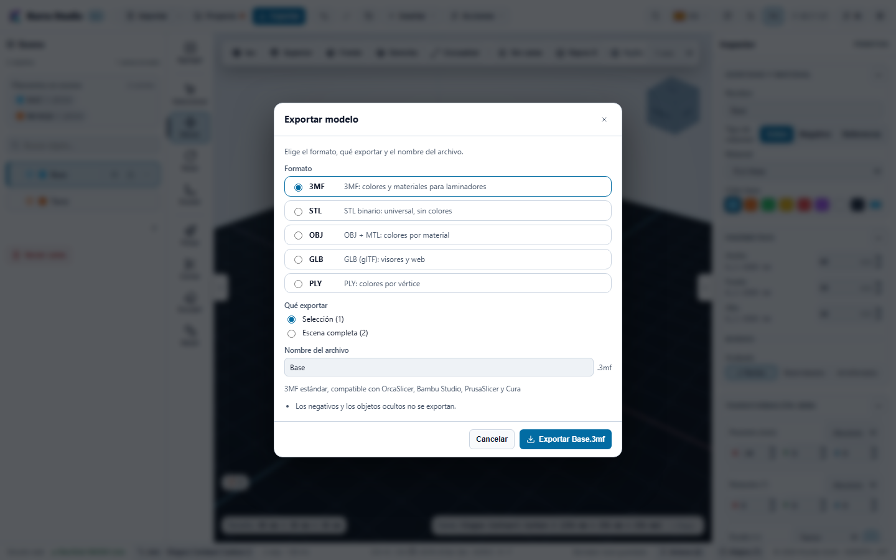
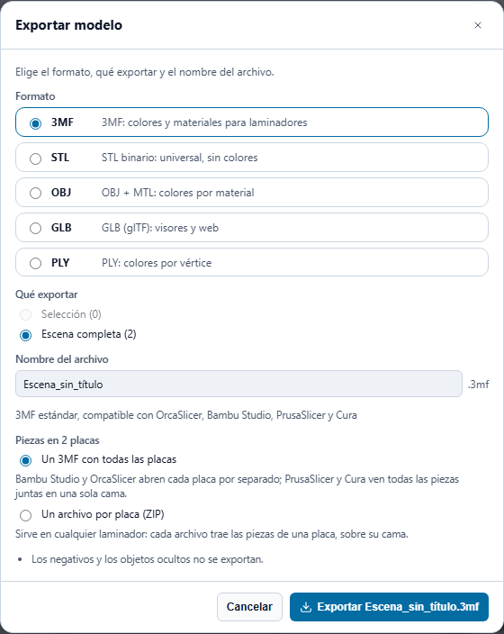
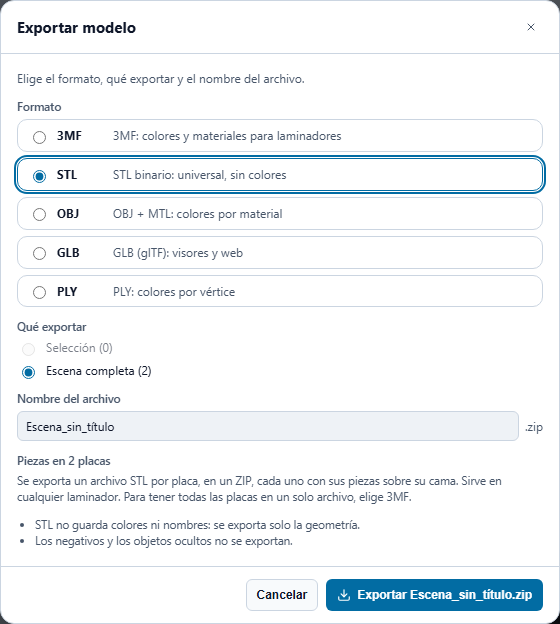

# Exportar

Cómo sacar tu modelo de Kurra Studio para abrirlo en tu laminador (OrcaSlicer, Bambu Studio, PrusaSlicer, Cura) o en otro programa. Kurra Studio no lamina ni genera G-code: entrega archivos que el laminador abre sin sorpresas.

## Paso a paso

1. Selecciona lo que quieres exportar o deja la escena como está.
2. Pulsa **Exportar** en la barra superior. Se abre *Exportar modelo*.
3. Elige el **Formato**:
   - **3MF:** colores y materiales para laminadores. Es el recomendado si pintaste o tienes varios colores; conserva el color por cara y los grupos.
   - **STL:** binario, universal, sin colores.
   - **OBJ** (con MTL, colores por material), **GLB** (visores y web) y **PLY** (colores por vértice).
4. En **Qué exportar** elige **Selección (n)** o **Escena completa (n)**.
5. Escribe el **Nombre del archivo** y pulsa **Exportar nombre.3mf**.

## Exportar con varias placas

Si tu escena tiene **dos o más [placas](placas.md)** con piezas, el diálogo muestra un grupo **Piezas en 2 placas** (el número cambia según tus placas) con las salidas disponibles:

- **Un 3MF con todas las placas** (formato 3MF): un solo archivo donde cada placa conserva sus piezas. Bambu Studio y OrcaSlicer abren cada placa por separado; PrusaSlicer y Cura ven todas las piezas juntas en una sola cama.
- **Un archivo por placa (ZIP):** un 3MF por placa dentro de un ZIP; cada archivo trae las piezas de una placa, sobre su cama. Sirve en cualquier laminador.
- **STL:** como el STL no guarda placas, siempre sale **un STL por placa en un ZIP**. El botón de exportar cambia a `.zip` y una nota lo explica. Para tener todas las placas en un solo archivo, elige 3MF.

Detalles que conviene saber:

- **Piezas sin placa quedan fuera.** Si alguna pieza no está en ninguna placa, no se exporta y un aviso te lo dice; asígnala a una placa con **Mover a placa** y vuelve a exportar.
- **Mismas coordenadas en cada placa:** una pieza que está al centro de la placa 2 sale al centro de su cama en el archivo, igual que si estuviera en la placa 1.
- **Nombres de archivo:** el nombre de cada placa se sanea (se quitan caracteres como `/` o `:`) para que el sistema lo acepte.
- **Sin placas, nada cambia:** con una sola cama el diálogo es el de siempre.
- **Estado:** el 3MF con todas las placas lo entienden Bambu Studio y OrcaSlicer, pero **todavía no está verificado en un laminador real**. Si importa que salga bien a la primera, usa **Un archivo por placa (ZIP)**, que funciona en cualquier laminador.

## Detalles que conviene saber

- **Los negativos y los objetos ocultos no se exportan** (el diálogo lo recuerda). Aplica las restas antes.
- **Grupos:** al exportar un grupo puedes entregarlo como un solo archivo o como uno por objeto.
- **Piezas de Dividir para imprimir:** el diálogo ofrece *Un archivo por pieza (ZIP)* o *Un 3MF con todas las piezas en su disposición de impresión*.
- **Escala:** los archivos salen en milímetros; el 3MF estándar es el mismo para todos los laminadores (no hay perfil por programa).
- Un mismo proyecto exportado dos veces produce el mismo 3MF, byte a byte.
- También puedes exportar desde `Ctrl+K` (*Exportar STL*, *Exportar 3MF*…) o con el menú del objeto (*Exportar selección como un STL…*).

## Problemas frecuentes

- **El laminador muestra la pieza gigante o diminuta:** revisa la unidad del laminador; Kurra Studio exporta en mm.
- **Me faltan piezas en el archivo:** estaban ocultas, eran negativos o no estaban seleccionadas con *Selección* marcada.
- **Los colores no aparecen en un STL:** el STL no guarda color; usa 3MF.
- **En el navegador el archivo se descarga:** en la versión web el archivo va a tu carpeta de descargas, y un aviso lo confirma; en escritorio eliges la carpeta.
- **No está verificado en todos los laminadores:** el 3MF multicolor se comprobará en OrcaSlicer, Bambu Studio, PrusaSlicer y Cura según el [roadmap](../ROADMAP.md).

Anterior: [Torreta para tornillo](torreta-para-tornillo.md) · Siguiente: [Guardar y recuperar](guardar-y-recuperar.md) · [Índice](README.md)
