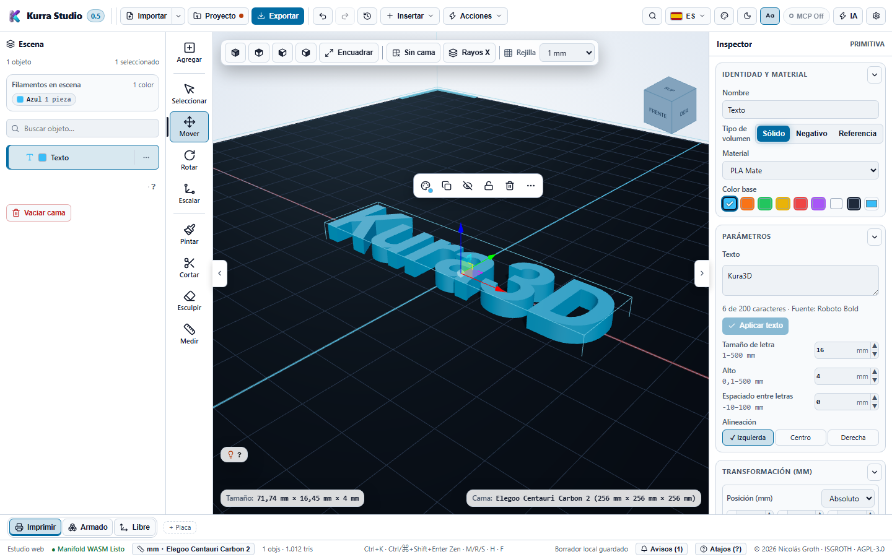
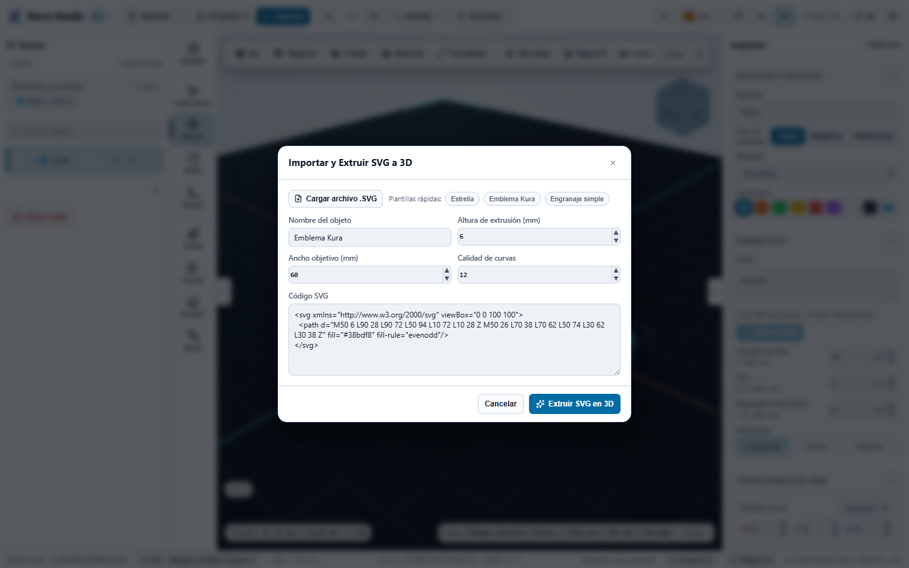
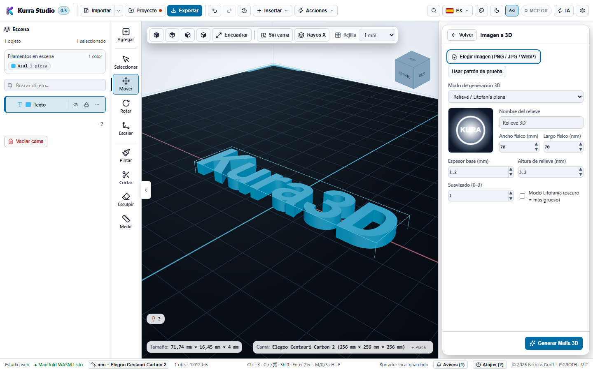
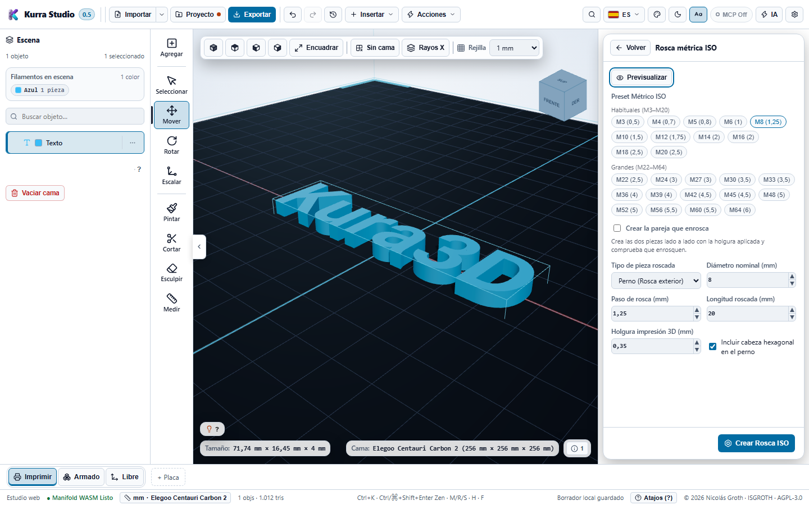
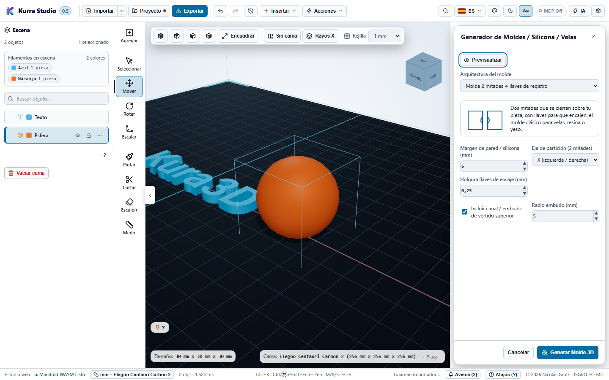

# Generadores

Kurra3D Studio crea formas a partir de un texto, un dibujo vectorial, una imagen o una norma de roscas, y moldes a partir de tu pieza. Todos están en el menú **Insertar** de la barra superior (en el teléfono, en la hoja **Agregar**) o en la paleta `Ctrl+K`.

## Texto 3D

1. Elige **Texto 3D** en **Agregar** (barra de herramientas) o **Insertar**. Se abre el panel *Texto 3D*: escribe el texto y el alto de letra y pulsa **Crear texto** (o **Enter**).
2. En el inspector, escribe tu texto en *Texto* y pulsa **Aplicar texto**. Con tildes y ñ funciona (fuente Roboto Bold).
3. Ajusta *Tamaño de letra*, *Alto* (el grosor), *Espaciado entre letras* y la *Alineación* (izquierda, centro, derecha). Admite varias líneas.

## SVG

1. Elige **Insertar › Importar SVG**. Puedes **Cargar archivo .SVG**, pegar el código o usar una plantilla rápida (*Estrella*, *Emblema Kura*, *Engranaje simple*).
2. Define el *Nombre*, la *Altura de extrusión*, el *Ancho objetivo* en mm y la *Calidad de curvas*.
3. Pulsa **Extruir SVG en 3D**.

## Imagen a 3D

1. Elige **Insertar › Imagen → 3D**, elige una imagen (PNG, JPG o WebP) o **Usar patrón de prueba**.
2. Escoge el **Modo de generación 3D**: *Relieve / Litofanía plana*, *Litofanía cilíndrica curva*, *Silueta 3D extruida* o *Cortador / Sello* (para galletas o arcilla).
3. Ajusta el tamaño físico, el espesor de base y la altura del relieve, y pulsa **Generar Malla 3D**.

## Roscas ISO

1. Elige **Insertar › Rosca ISO (M3–M64)** y elige un preset métrico (por ejemplo **M8 (1,25)**: el número entre paréntesis es el paso).
2. Elige el **tipo de pieza**: *Perno (rosca exterior)*, *Tuerca hexagonal* o *Agujero roscado negativo (−)*.
3. Revisa el paso, la longitud roscada y la **holgura de impresión 3D** (0,35 mm por defecto, ajustada a la norma).
4. **Previsualizar** y **Crear Rosca ISO**. El agujero roscado negativo se resta de la pieza que lo contiene (ver [Sólidos negativos y restas](solidos-negativos-y-restas.md)).

## Molde

1. Selecciona la pieza a copiar y pulsa **Mayús+M** (o *Generar Molde / Caja de Silicona* en `Ctrl+K`).
2. Elige la **arquitectura del molde**: de 1 pieza (cavidad directa), de 2 mitades con llaves de registro, caja madre para silicona (velas o resina) o núcleo y cavidad (pieza hueca colada).
3. Ajusta el margen de pared, la holgura de las llaves, el eje de partición y si lleva canal o embudo de vertido.
4. **Previsualizar** y **Generar Molde 3D**.

## Problemas frecuentes

- **El texto no cambia:** pulsa **Aplicar texto** tras escribir.
- **El SVG no carga:** revisa que el archivo sea un SVG válido; el aviso del diálogo dice qué falló.
- **Imagen a 3D sale con el relieve al revés:** prueba la opción *Modo Litofanía (oscuro = más grueso)*, y ajusta la altura de relieve.
- **Grabar dos veces el mismo texto en el mismo lugar de un cilindro** da un error claro; mueve el segundo grabado.
- **La tuerca no entra en el perno:** usa la misma preset y la holgura por defecto.

Anterior: [Colores y pintura](colores-y-pintura.md) · Siguiente: [Asistentes](asistentes.md) · [Índice](README.md)
