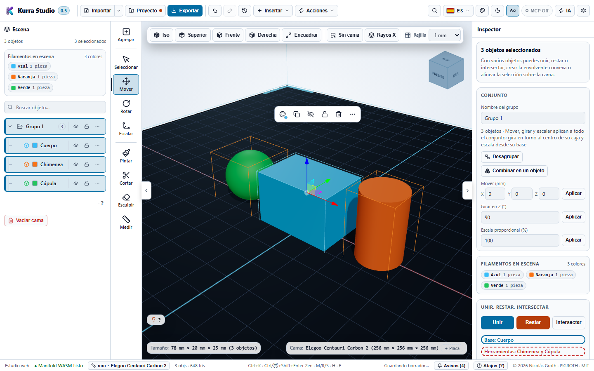

# Grupos y escena

Cuando una creación tiene varias piezas (el cuerpo, la chimenea, la cúpula), conviene agruparlas para moverlas juntas y verlas ordenadas como capas en el panel **Escena**.

## Agrupar

1. Selecciona varias piezas: en la lista de Escena, `Ctrl`+clic suma una pieza y `Mayús`+clic elige un rango; **Ctrl+A** selecciona todas.
2. Pulsa **Ctrl+G** (o **Agrupar** en el inspector). Aparece el grupo, por ejemplo *Grupo 1*, con un campo para renombrarlo.
3. Mover, girar o escalar el grupo afecta a todas sus piezas: gira alrededor del centro de su caja y escala desde su base. El inspector muestra *Mover (mm)*, *Girar en Z (°)* y *Escala proporcional (%)* con su botón **Aplicar**.
4. Para dejar de agrupar: **Ctrl+Mayús+G** (o **Desagrupar**).

## El panel Escena

La pestaña **Escena** del panel izquierdo lista todo como un árbol de capas, con el resumen de filamentos en uso y un buscador (**F3**).

- **Plegar** un grupo con su flecha; **ojo** para ocultarlo (lo oculto no se exporta); **candado** para bloquearlo.
- **F2** renombra el elemento seleccionado. Tras **Ctrl+G** queda seleccionado el grupo nuevo, así que F2 lo renombra a él.
- Las piezas de una división se ven como «A1a · nombre», con el mismo rótulo que el visor.
- **Arrastrar** una fila la mueve; los grupos pueden contener otros grupos.
- Con el teclado: ↑/↓ recorren; →/← despliegan, pliegan o suben un nivel; `Enter` selecciona; `Supr` elimina; `Alt+↑/↓` reordena; `Alt+→` mete la fila en el grupo de arriba y `Alt+←` la saca. El botón **?** bajo el árbol abre la ayuda con estos atajos.
- **Entrar a un grupo:** con el grupo seleccionado, `Enter`; `Esc` sale.

## Combinar y separar

- **Combinar en un objeto** junta varias piezas en un solo objeto con varios cuerpos, sin fusionar su geometría (el volumen total es la suma). Se exporta como un solo archivo.
- **Separar cuerpos** hace lo contrario.
- Para fusionar de verdad dos piezas que se tocan, usa **Unir** (ver [Sólidos negativos y restas](solidos-negativos-y-restas.md)).

## Problemas frecuentes

- **Una pieza no se mueve:** puede estar bloqueada (candado) o ser parte de un grupo; entra al grupo con `Enter` o mueve el grupo entero.
- **No encuentro una pieza:** escribe en *Buscar objeto…* del panel Escena.
- **Oculté algo y no sale al exportar:** es lo esperado; vuelve a mostrarlo con el ojo.
- **Quiero exportar un grupo:** ver [Exportar](exportar.md); se puede como un archivo o uno por objeto.

Anterior: [Sólidos negativos y restas](solidos-negativos-y-restas.md) · Siguiente: [Medir](medir.md) · [Índice](README.md)
