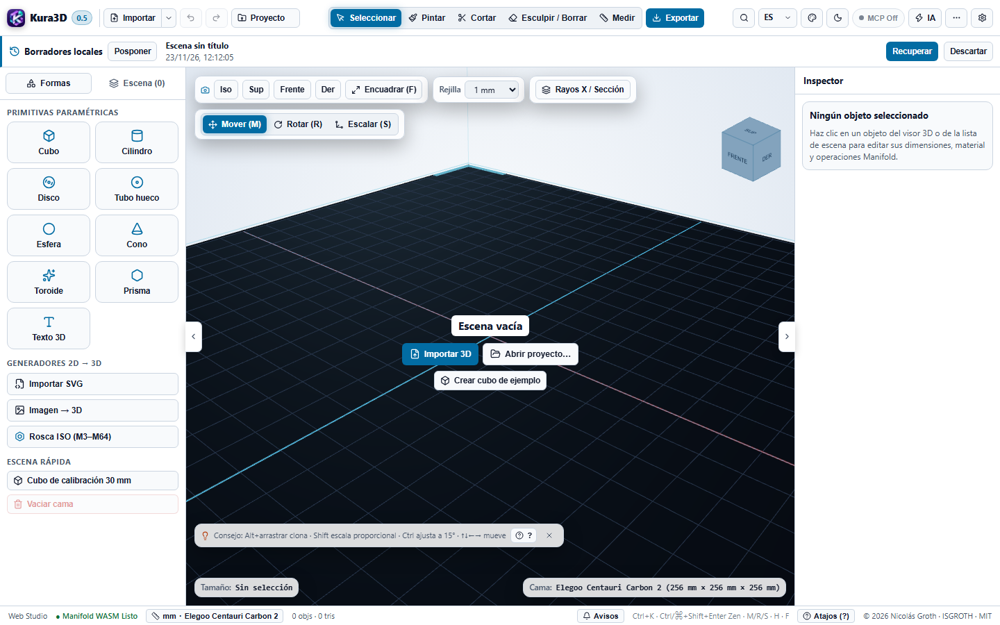

# Guardar y recuperar

Tu trabajo se guarda en un **proyecto `.kura`**, que conserva la escena, los materiales, la pintura y el historial de deshacer. Además, Kurra3D Studio hace un **borrador automático** por si cierras o se cae algo.

## Guardar un proyecto

1. Pulsa **Proyecto** en la barra superior: el panel derecho muestra el proyecto con su nombre («Escena sin título») y si hay *Cambios sin guardar*; un punto rojo junto al botón avisa lo mismo. Para cambiar el nombre, pulsa el lápiz junto a él (o **F2** con el foco en el lápiz), escribe y pulsa **Enter** (**Esc** cancela); el nombre nuevo se usa al guardar.
2. Pulsa **Guardar** (**Ctrl+S**, funciona en cualquier momento). La primera vez te pide un nombre. **Guardar como** (**Ctrl+Mayús+S**) crea una copia con otro nombre.
3. **Nuevo** (**Ctrl+N**) y **Abrir** (**Ctrl+O**) te preguntan antes si hay cambios sin guardar.

En la versión web, guardar descarga el archivo `.kura` a tu carpeta de descargas y un aviso lo confirma; para abrirlo, usa **Abrir** o arrástralo al visor. Debajo de los botones, el panel lista los **Proyectos recientes** (se puede desactivar en *Ajustes*).

## El borrador de recuperación

Mientras trabajas, la barra de estado muestra «Guardando borrador…» y luego «Borrador local guardado». Es una copia de seguridad automática en tu navegador o equipo, no un reemplazo de guardar el proyecto.

1. Si cierras la pestaña o la app sin guardar y vuelves a abrir Kurra3D Studio, aparece arriba el aviso **Borradores locales** con la fecha del borrador y cuántos objetos trae (los borradores guardados con versiones anteriores no lo indican).
2. Pulsa **Recuperar** para volver a tu escena, **Descartar** para borrarlo o **Posponer** para decidir después.
3. Si hay varios borradores, **Elegir borrador** te deja escoger.

Con escenas muy pesadas el borrador se guarda por bloques; si no cabe, Kurra3D Studio lo dice en la barra de estado en vez de fallar en silencio.

## Problemas frecuentes

- **No encuentro mi archivo guardado en la web:** busca `.kura` en la carpeta de descargas del navegador.
- **No aparece el aviso de borrador:** los borradores son locales a ese navegador y perfil; no los verás en otro navegador, en modo privado ni tras borrar los datos del sitio.
- **Guardé pero el punto rojo sigue:** hubo cambios después de guardar; guarda otra vez.
- **Abrí un proyecto y perdí el actual:** Kurra3D Studio pregunta antes; si lo descartaste, mira si queda un borrador.

Anterior: [Exportar](exportar.md) · [Índice](README.md)
