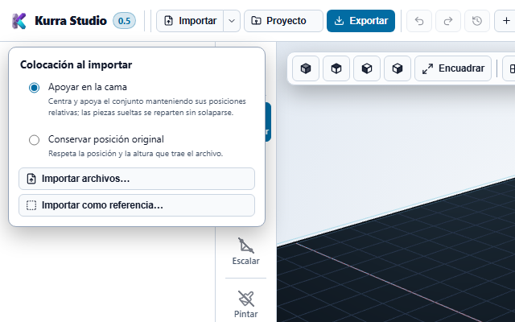
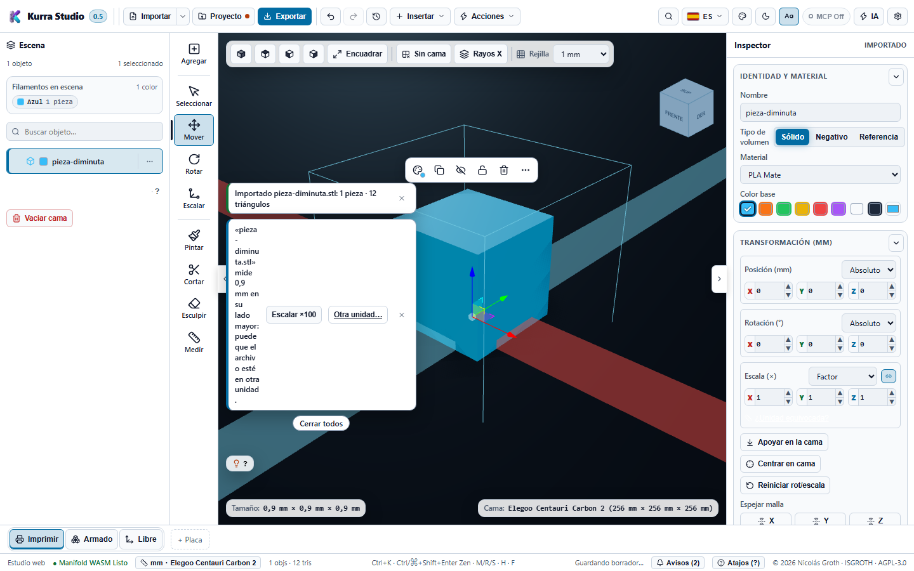
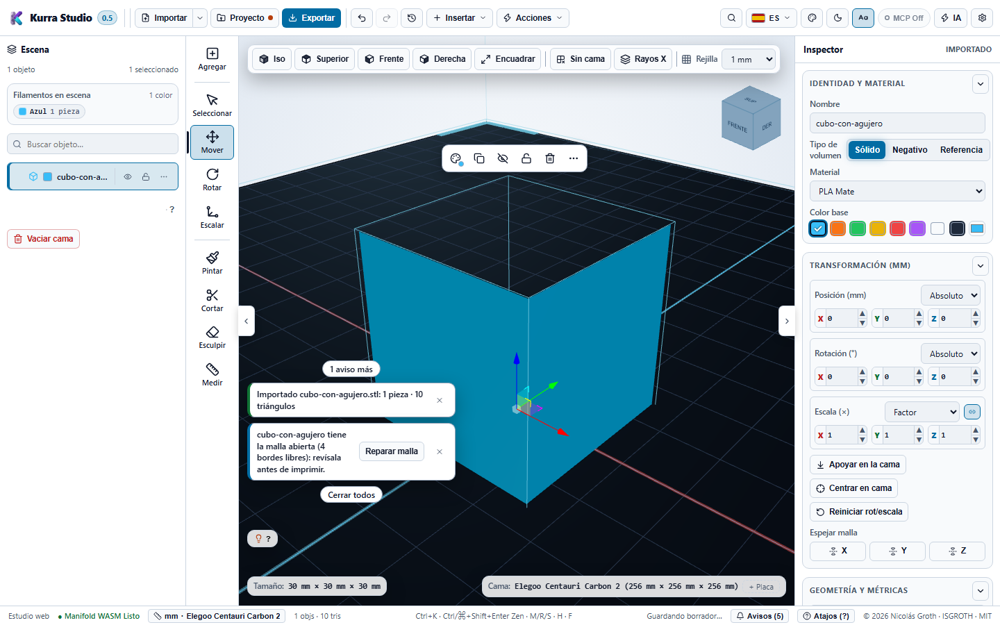
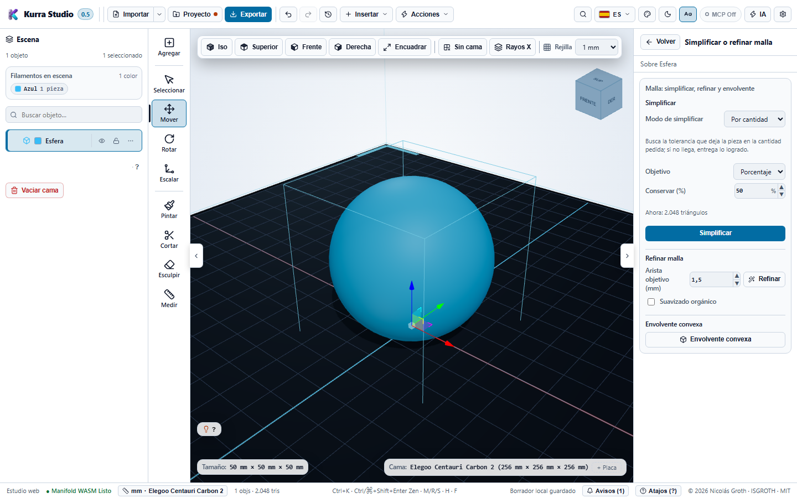
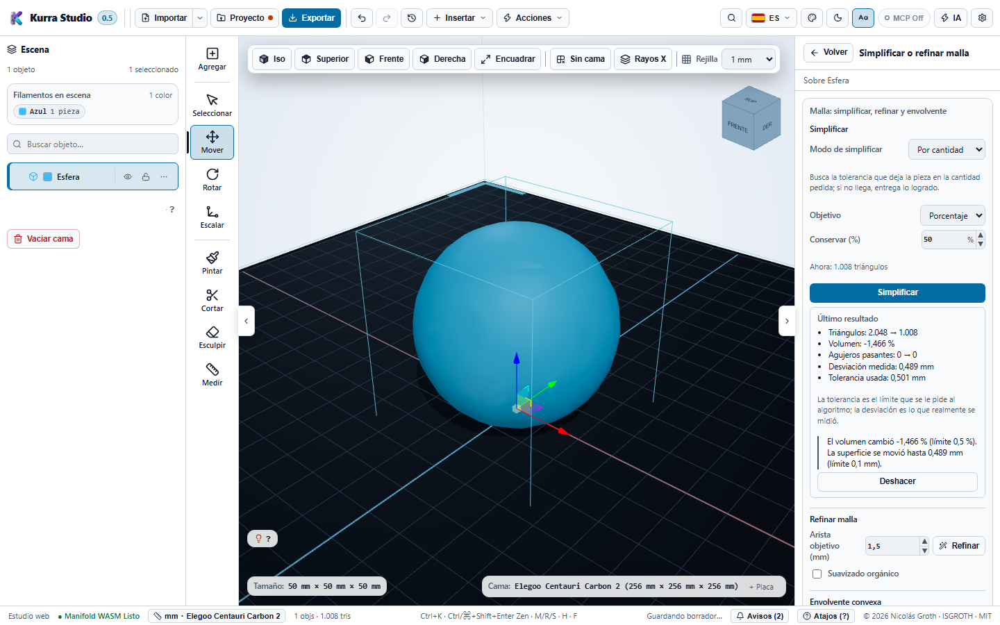
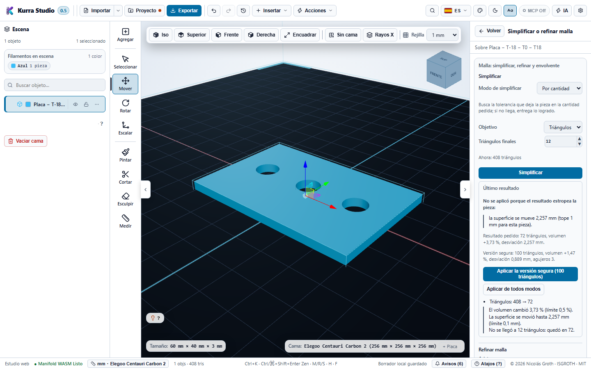

# Importar y reparar

Cómo traer un modelo que ya tienes (de Thingiverse, de un escáner, de otro programa), comprobar que está bien y arreglarlo si no lo está.

## Formatos

Kurra Studio abre **STL, 3MF, OBJ y PLY**, varios archivos a la vez. Los 3MF de laminadores conservan sus piezas, grupos y colores de filamento.

1. Pulsa **Importar** en la barra superior, o arrastra los archivos sobre el visor.
2. Con la flecha junto al botón eliges cómo se colocan: **Importar apoyando en la cama** (las piezas sueltas se reparten sin solaparse) o **Importar conservando la posición original** (respeta la posición y la altura que trae el archivo).
3. Al terminar, un aviso resume lo que entró (piezas y triángulos).

## Unidades dudosas

Un STL no dice en qué unidad está. Si el tamaño no parece razonable (por ejemplo, una pieza de 0,9 mm), Kurra Studio te avisa y ofrece corregirlo.

1. Lee el aviso: por ejemplo «mide 0,9 mm en su lado mayor: puede que el archivo esté en otra unidad».
2. Pulsa el botón del aviso (en el ejemplo, **Escalar ×100**; según el caso el factor puede ser otro, como ×1000 o ×25,4). Un solo **Ctrl+Z** lo revierte.
3. Si sabes en qué unidad se dibujó, pulsa **Otra unidad…**: se abre *¿En qué unidad está este modelo?* con cada opción probable (metros ×1000, pulgadas ×25,4, centímetros ×10, otra escala) y el tamaño en que quedaría, más **Ajustar el lado mayor a** con un campo para escribir los milímetros que quieres. Elige una y pulsa **Aplicar**; también se deshace con un solo **Ctrl+Z**.

## Estado de la malla y reparación

En el resumen del objeto (panel derecho), la sección *Geometría y métricas* muestra dimensiones, volumen, triángulos, vértices y el estado de la **malla**: *Cerrada* (lista para imprimir) o con bordes libres.

1. Si la malla tiene agujeros, al importar aparece un aviso con el número de **bordes libres** y el botón **Reparar malla**.
2. Pulsa **Reparar malla**. También está en el menú del objeto (clic derecho › **Malla › Reparar malla**), en la paleta `Ctrl+K` y en **Acciones › Malla › Reparar malla**.
3. Kurra Studio cierra los agujeros, quita caras duplicadas y corrige las normales. El aviso resume lo hecho («Malla reparada: 1 agujero cerrado · triángulos: 10 → 12») con un botón **Ver detalles**.

## Simplificar

Un modelo con muchos triángulos pesa y tarda, sobre todo en un computador con poca memoria. Tienes tres formas de abrir el panel:

- Selecciona la pieza y pulsa **Simplificar…** en su resumen del inspector, junto al número de triángulos.
- Elige **Acciones › Simplificar…**.
- Si importas un modelo pesado, el aviso trae el botón **Simplificar…**. Desde ahí el panel se abre ya en **Por cantidad**, con una meta sugerida (por ejemplo 500 000 triángulos) y el cursor en ese campo: revisa el número y pulsa **Simplificar**.

El panel se titula **Simplificar o refinar malla** y tiene tres grupos: **Simplificar**, **Refinar malla** y **Envolvente convexa**. Esta guía es del primero. En **Por cantidad**, **Enter** en el campo ejecuta, igual que el botón **Simplificar**; los números grandes se muestran con separador de miles (500.000).

Elige el **Modo de simplificar** y pulsa **Simplificar**:

- **Sin pérdida** (el que viene marcado en un modelo normal): quita solo los triángulos que sobran, como los de las caras planas. Se aplica únicamente si la pieza conserva sus agujeros pasantes, el volumen cambia menos de 0,01 % y la superficie no se mueve más de 0,01 mm. Si no pasa, el objeto queda intacto y el aviso dice por qué. En piezas orgánicas (figuras, escaneos) casi no hay nada que quitar sin perder forma.
- **Por tolerancia**: cuánto puede moverse la superficie, en mm (por defecto 0,01 mm). A mayor tolerancia, menos triángulos y más pérdida de forma: cilindros con menos lados, letras y redondeos achatados.
- **Por cantidad**: deja la pieza en un **porcentaje** de sus triángulos o en una cantidad de **triángulos** finales (debajo ves «Ahora: N triángulos»). Kurra Studio busca la tolerancia que llega a ese número y prefiere conservar los agujeros; si no puede llegar (por ejemplo, un cubo no baja de 12), entrega lo que logró y lo avisa.

Mientras trabaja puedes **Cancelar**. Al terminar aparece el **Último resultado**: triángulos antes → después, cambio de volumen, agujeros pasantes antes → después, la desviación medida y la tolerancia usada.

Si algo se movió más de lo prudente, el informe lo dice con palabras: «El volumen cambió…», «La superficie se movió hasta…» o «Cambió la cantidad de agujeros pasantes (2 → 1)», que es lo que ocurre cuando un agujero chico se cierra. Revísalo antes de imprimir. El mismo aviso sale en una notificación que **no se cierra sola** y, igual que el informe, trae el botón **Deshacer**: vuelve a la malla anterior en un solo paso (también con **Ctrl+Z**). La desviación se mide por muestreo: es una cota inferior, no el máximo exacto.

### Cuando el resultado estropearía la pieza

Kurra Studio **no aplica** un resultado «destructivo». Lo es si pierde un agujero pasante, si el volumen cambia más de 5 %, o si la superficie se aleja más de 1 mm o del 1 % de la diagonal de la pieza (el mayor de los dos). En ese caso la pieza queda intacta y el informe muestra:

- **No se aplicó porque el resultado estropea la pieza**, con cada motivo en palabras («la superficie se mueve 2,257 mm (tope 1 mm para esta pieza)»);
- los números del **resultado pedido** y de la **versión segura** (la que más triángulos quita sin pasar la regla);
- dos botones: **Aplicar la versión segura (N triángulos)** y **Aplicar de todos modos**. Cada uno es un solo paso de deshacer (**Ctrl+Z**).

Por eso una malla gruesa bloquea pedidos que en una malla densa pasan: una esfera de solo 512 triángulos al 50 % cambia su volumen 5,4 % y se bloquea (ofrece una versión segura de 476 triángulos), mientras que una de 2.048 triángulos baja a la mitad sin problema. Si lo que quieres es justamente ese resultado agresivo, **Aplicar de todos modos** lo hace; el informe lo marca como forzado.

## Problemas frecuentes

- **El archivo no entra:** hay un tope de 256 MiB por archivo y 512 MiB por lote. Si falta memoria, el error lo dice.
- **El modelo aparece enorme o diminuto:** es la unidad; usa el aviso, el enlace **¿Unidad equivocada?** junto a la escala en el inspector, o escala a mano. Un aviso con una acción pendiente no se cierra solo, y si lo cierras su botón sigue en **Avisos** (barra de estado) hasta que se aplique.
- **Tras reparar sigue un aviso de «agujeros grandes cerrados con una tapa»:** revisa que la forma sea la esperada; un agujero real (un asa, por ejemplo) no debería taparse.
- **Se importó apoyado en la cama y lo quería donde estaba:** deshaz e importa con *conservando la posición original*.

Anterior: [Primeros pasos](primeros-pasos.md) · Siguiente: [Dividir para imprimir](dividir-para-imprimir.md) · [Índice](README.md)
