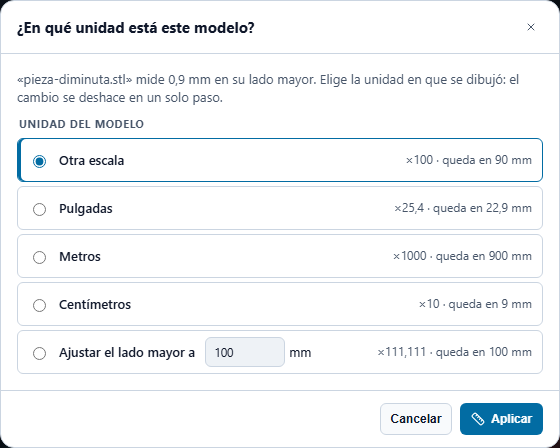
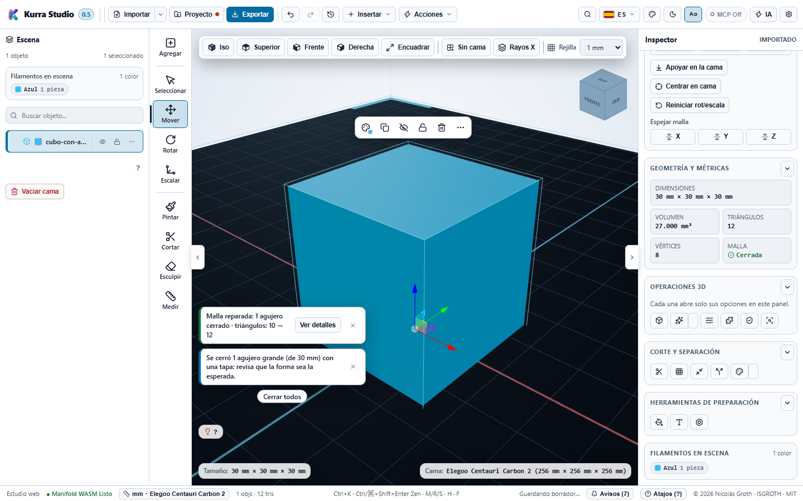
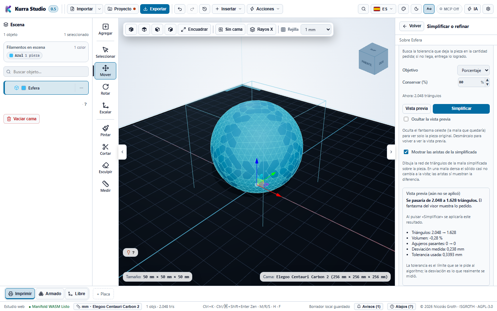

# Importar y reparar

Cómo traer un modelo que ya tienes (de Thingiverse, de un escáner, de otro programa), comprobar que está bien y arreglarlo si no lo está.

## Formatos

Kurra Studio abre **STL, 3MF, OBJ y PLY**, varios archivos a la vez. Los 3MF de laminadores conservan sus piezas, grupos y colores de filamento.

1. Pulsa **Importar** en la barra superior, o arrastra los archivos sobre el visor.
2. Con la flecha junto al botón eliges cómo se colocan: **Importar apoyando en la cama** (las piezas sueltas se reparten sin solaparse) o **Importar conservando la posición original** (respeta la posición y la altura que trae el archivo).
3. Al terminar, un aviso resume lo que entró (piezas y triángulos).

## Unidades dudosas

Un STL no dice en qué unidad está. Si el tamaño no parece razonable (por ejemplo, una pieza de 0,9 mm), Kurra Studio te avisa y ofrece corregirlo.

1. Lee el aviso: por ejemplo «mide 0,9 mm en su lado mayor: puede que el archivo esté en otra unidad».
2. Pulsa el botón del aviso (en el ejemplo, **Escalar ×100**; según el caso el factor puede ser otro, como ×1000 o ×25,4). Un solo **Ctrl+Z** lo revierte.
3. Si sabes en qué unidad se dibujó, pulsa **Otra unidad…**: se abre *¿En qué unidad está este modelo?* con cada opción probable (metros ×1000, pulgadas ×25,4, centímetros ×10, otra escala) y el tamaño en que quedaría, más **Ajustar el lado mayor a** con un campo para escribir los milímetros que quieres. Elige una y pulsa **Aplicar**; también se deshace con un solo **Ctrl+Z**.

## Estado de la malla y reparación

En el resumen del objeto (panel derecho), la sección *Geometría y métricas* muestra dimensiones, volumen, triángulos, vértices y el estado de la **malla**: *Cerrada* (lista para imprimir) o con bordes libres.

1. Si la malla tiene agujeros, al importar aparece un aviso con el número de **bordes libres** y el botón **Reparar malla**.
2. Pulsa **Reparar malla**. También está en el menú del objeto (clic derecho › **Malla › Reparar malla**), en la paleta `Ctrl+K` y en **Acciones › Malla › Reparar malla**.
3. Kurra Studio cierra los agujeros, quita caras duplicadas y corrige las normales. El aviso resume lo hecho («Malla reparada: 1 agujero cerrado · triángulos: 10 → 12») con un botón **Ver detalles**. Si hubo que cerrar un agujero grande, queda a la vista una advertencia que te pide revisar la forma, y el resumen pasa al histórico de información (ver [Mensajes](mensajes.md)).

## Simplificar

Un modelo con muchos triángulos pesa y tarda, sobre todo en un computador con poca memoria. Tienes tres formas de abrir el panel:

- Selecciona la pieza y pulsa **Simplificar…** en su resumen del inspector, junto al número de triángulos.
- Elige **Acciones › Malla › Simplificar…**.
- Pulsa **Ctrl+K**, escribe *Simplificar* y elige **Simplificar…**: el panel se abre con la pieza seleccionada, listo para pedir la vista previa.
- Si importas un modelo pesado, el aviso trae el botón **Simplificar…**. Desde ahí el panel se abre ya en **Por cantidad**, con una meta sugerida (por ejemplo 500 000 triángulos) y el cursor en ese campo: revisa el número y pulsa **Simplificar**.

El panel se titula **Simplificar o refinar** (para salir, **Volver** arriba a la izquierda o `Esc`) y tiene tres grupos: **Simplificar**, **Refinar malla** y **Envolvente convexa**. Esta guía es del primero. **Enter** en un campo numérico lanza la **Vista previa** (igual que su botón) y no modifica la pieza: para aplicar, pulsa **Simplificar**. En **Por tolerancia**, lo que escribes es la tolerancia máxima: más tolerancia nunca deja más triángulos que una menor, y si pasa de lo que la pieza aguanta se usa la mayor que todavía sirve. El informe dice «Tolerancia pedida» (lo que escribiste) y, aparte, «Tolerancia usada» cuando el mejor resultado salió con una menor o se aplicó la versión segura; tras **Aplicar de todos modos** el informe describe lo que quedó aplicado y trae su **Deshacer**; los números grandes se muestran con separador de miles (500.000).

Elige el **Modo de simplificar** y pulsa **Simplificar**:

- **Sin pérdida** (el que viene marcado en un modelo normal): quita solo los triángulos que sobran, como los de las caras planas. Se aplica únicamente si la pieza conserva sus agujeros pasantes, el volumen cambia menos de 0,01 % y la superficie no se mueve más de 0,01 mm. Si no pasa, el objeto queda intacto y el aviso dice por qué. En piezas orgánicas (figuras, escaneos) casi no hay nada que quitar sin perder forma.
- **Por tolerancia**: cuánto se permite simplificar en cada paso, en mm (por defecto 0,01 mm). No es un tope de cuánto se mueve la superficie: eso lo dice la **Desviación medida** del informe, que puede ser mayor que la tolerancia. A mayor tolerancia, menos triángulos y más pérdida de forma: cilindros con menos lados, letras y redondeos achatados.
- **Por cantidad**: deja la pieza en un **porcentaje** de sus triángulos o en una cantidad de **triángulos** finales (debajo ves «Ahora: N triángulos»). Kurra Studio busca la tolerancia que llega a ese número y prefiere conservar los agujeros; si no puede llegar (por ejemplo, un cubo no baja de 12), entrega lo que logró y lo avisa.

Mientras trabaja puedes cancelar el cálculo con su botón. Al terminar aparece el **Último resultado**: triángulos antes → después, cambio de volumen, agujeros pasantes antes → después, la **Desviación medida** (lo que realmente se movió la superficie) y la tolerancia: **Tolerancia pedida** si elegiste el modo *Por tolerancia*, o **Tolerancia usada** en los otros modos (la que Kurra Studio encontró para llegar a tu meta). Si pulsas **Deshacer**, el panel dice «Se deshizo la simplificación: la pieza volvió a su estado anterior».

Si la malla de la pieza está abierta, Simplificar no puede trabajar: el panel lo avisa apenas lo abres (no hace falta pedir la vista previa) y trae el botón **Reparar malla** ahí mismo. Mientras repara, el botón conserva el foco y dice «Reparando la malla…»; al terminar, el foco vuelve a **Vista previa**.

Los números siguen una sola regla: milímetros con 2 decimales, porcentajes con 1 y la coma o el punto decimal de tu idioma (si un valor real quedaría en cero, se muestran los decimales justos para verlo, por ejemplo 0,001 mm). Mientras calcula, junto a los botones ves el estado y, cuando el motor informa pasos, una barra con «paso 3 de 13». Si un campo tiene un valor inválido, **Vista previa** y **Simplificar** siguen en el orden de **Tab**, pero no actúan hasta que lo corrijas (el panel lo dice).

### Vista previa: mira antes de aplicar

Pulsa **Vista previa** (junto a **Simplificar**) y la pieza no se toca; los avisos del informe van en condicional («El volumen cambiaría…», «Se cerraría 1 agujero…»), porque todavía no se aplicó nada, y el pasado queda para lo ya aplicado: en el visor aparece un **fantasma celeste** con la malla que quedaría, y el panel se desplaza hasta el informe, que parte con un resumen de una línea (triángulos antes y después) y dice si el fantasma muestra lo que pediste o la versión segura. El informe detalla lo que pasaría («Vista previa (aún no se aplicó)»). Cuando termina el cálculo, el foco pasa al informe para que lo lean los lectores de pantalla y puedas decidir antes de aplicar. Con la casilla **Ocultar la vista previa** ocultas el fantasma para ver solo la pieza, y con **Mostrar las aristas de la simplificada** ves la red de triángulos. Si te gusta, pulsa **Simplificar**; si no, cambia el modo o la cantidad y vuelve a mirar.

### Qué pasa si el cambio es grande

Kurra Studio mide cuánto cambia la pieza y decide en tres casos, en palabras simples:

1. **Cambio chico:** se aplica y listo.
2. **Cambio moderado** (el volumen cambia más de 5 %, o la superficie se aleja más de 1 mm o del 1 % de la diagonal): se aplica **con aviso**. El informe dice qué se movió («El volumen cambió…», «La superficie se movió hasta…») y trae **Deshacer**; además sale una notificación corta («Simplificado: 2.048 → 1.008 triángulos») con **Deshacer**. Revísalo antes de imprimir. La desviación se mide por muestreo: es una cota inferior, no el máximo exacto.
3. **Cambio que estropearía la pieza** (pierde un agujero pasante de verdad, el volumen cambia más de 25 %, o la superficie se aleja más de un cuarto del lado más chico de la pieza): lo pedido **no se aplica tal cual**. Kurra Studio aplica la **versión segura**, la que más triángulos quita sin pasar la regla, y el informe dice «Se aplicó la versión segura: N triángulos. Lo pedido dejaba M y cambiaba demasiado la forma.», seguido del motivo, y separa los números en dos bloques con encabezado: **Se aplicó (versión segura)**, con sus triángulos, volumen, agujeros, desviación medida y tolerancia usada, y **Lo pedido daría…**, con los suyos y la tolerancia pedida. El mensaje corto que sale al aplicar también lo dice («Se aplicó la versión segura: 2.048 → 1.008 triángulos»). Tras **Aplicar de todos modos** el foco pasa al informe del resultado. Si prefieres lo pedido, pulsa **Aplicar de todos modos**: reemplaza la versión segura por lo que pediste, en un solo paso de deshacer. Si ni siquiera hay una versión segura, la pieza queda intacta y el informe lo explica.

Por eso una malla gruesa se protege más que una densa: una esfera de solo 512 triángulos al 50 % cambia su volumen 5,4 % y se aplica con un aviso, mientras que una de 2.048 triángulos baja a la mitad sin problema. Todo se deshace con **Ctrl+Z**.

## Problemas frecuentes

- **El archivo no entra:** hay un tope de 256 MiB por archivo y 512 MiB por lote. Si falta memoria, el error lo dice.
- **El modelo aparece enorme o diminuto:** es la unidad; usa el aviso, el enlace **¿Unidad equivocada?** junto a la escala en el inspector, o escala a mano. Un aviso con una acción pendiente no se cierra solo, y si lo cierras su botón sigue en el histórico de mensajes (los iconos junto a **Cama:**, en el pie del visor; ver [Mensajes](mensajes.md)) mientras sirva.
- **Tras reparar sigue un aviso de «agujeros grandes cerrados con una tapa»:** revisa que la forma sea la esperada; un agujero real (un asa, por ejemplo) no debería taparse.
- **Se importó apoyado en la cama y lo quería donde estaba:** deshaz e importa con *conservando la posición original*.

Anterior: [Primeros pasos](primeros-pasos.md) · Siguiente: [Dividir para imprimir](dividir-para-imprimir.md) · [Índice](README.md)
