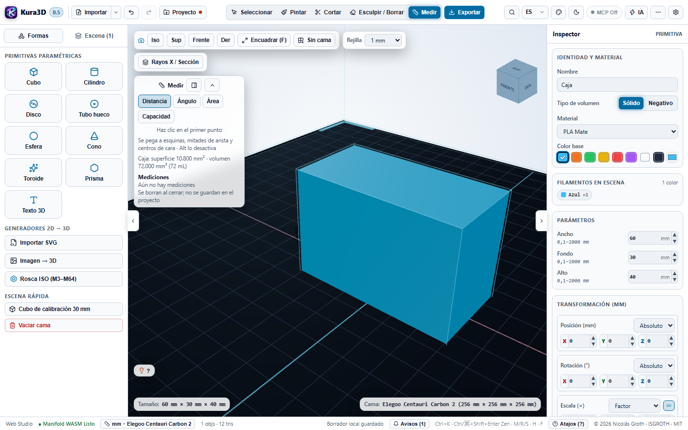
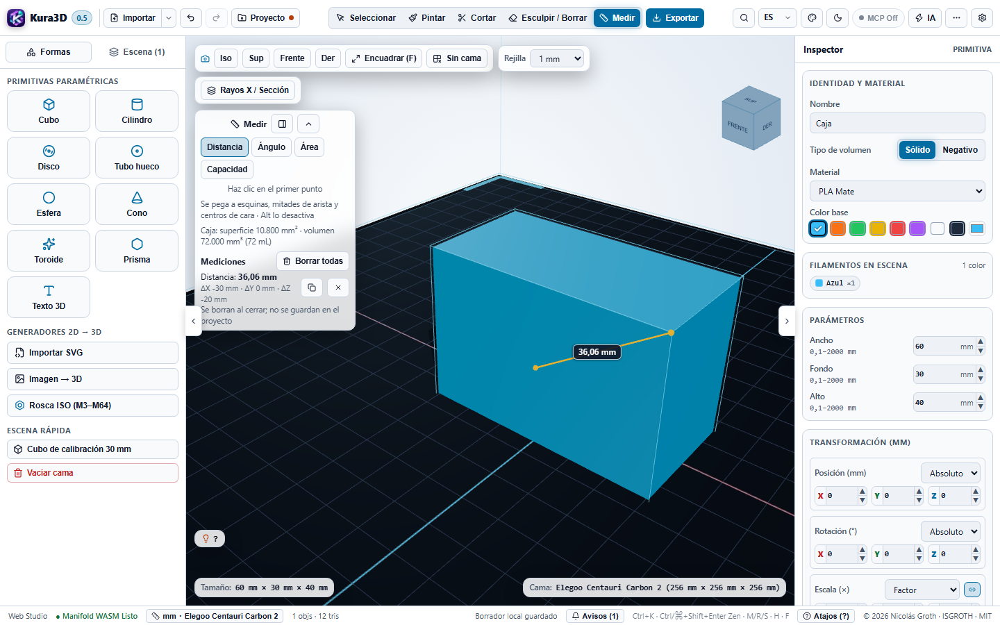
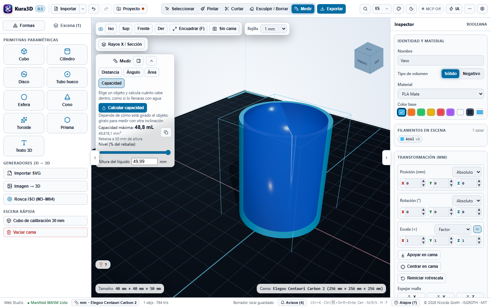

# Medir

La herramienta **Medir** responde preguntas sin tocar tu modelo: cuánto mide algo, qué ángulo forma, cuánta superficie tiene y **cuánto líquido cabe** en un recipiente. Las mediciones no se guardan en el proyecto.

## Activarla

Pulsa **Medir** en la barra superior o la tecla **D**. Para volver a la selección, **D** o **V** otra vez. El panel *Medir* aparece acoplado al borde izquierdo del visor, bajo la barra de vistas, con cuatro modos: **Distancia**, **Ángulo**, **Área** y **Capacidad**, y un resumen de la pieza (superficie y volumen). Es angosto y, si tu modelo queda detrás, la cámara lo corre al área libre. En su título tienes dos botones: **mover el panel al otro borde** (izquierdo o derecho; Kura3D recuerda tu elección mientras la app está abierta) y **plegar** (deja solo el título).

## Distancia

1. Elige **Distancia** y haz clic en el primer punto. Los puntos se **pegan** a esquinas, mitades de arista y centros de cara; mantén `Alt` para desactivar el imán.
2. Haz clic en el segundo punto. El visor dibuja la línea y la lista *Mediciones* muestra la distancia y su desglose en X, Y y Z.
3. Clic derecho o `Esc` cancela la medición en curso.

## Ángulo, área y volumen

- **Ángulo:** elige *3 puntos* (el segundo es el vértice) o *2 caras* (ángulo entre ellas).
- **Área:** haz clic en una cara y Kura3D mide la zona plana conectada.
- **Volumen:** aparece en el resumen de la pieza, en mm³ y en mL (1 cm³ = 1 mL).
- Las unidades siguen las que elegiste en *Ajustes* (mm, cm, pulgadas); la capacidad sale en mL o litros.

## Capacidad de un recipiente

1. Selecciona el vaso, jarro o caja ahuecada y elige **Capacidad**.
2. Pulsa **Calcular capacidad**. Kura3D calcula cuánto cabe en la orientación **actual** de la pieza, hasta el nivel de **rebalse**.
3. Lee la **capacidad máxima** (por ejemplo «48,8 mL») y la altura de rebalse. Con el deslizador *Nivel* o el campo *Altura del líquido* ves cuánto cabe hasta cierto nivel.
4. Para medir inclinado, gira la pieza y vuelve a calcular. Si hay varias cavidades puedes elegir cuál.

## Problemas frecuentes

- **«Haz clic en un punto de la pieza»** (en pantallas táctiles, «Toca un punto de la pieza»): el clic cayó fuera del modelo; apunta sobre la pieza.
- **El panel tapa parte del modelo:** muévelo al otro borde con el botón de su título, pliégalo con la flecha o gira la vista (**1**, **2**, **3**, **7**).
- **Capacidad 0:** el objeto es macizo, o su orientación actual no retiene nada; prueba girarlo.
- **Cierres sellados dentro de la pieza:** se informan aparte y no cuentan como capacidad.

Anterior: [Grupos y escena](grupos-y-escena.md) · Siguiente: [Colores y pintura](colores-y-pintura.md) · [Índice](README.md)
