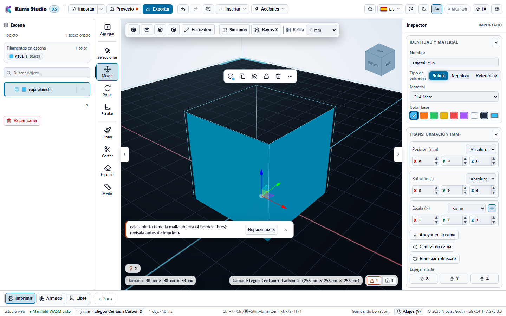
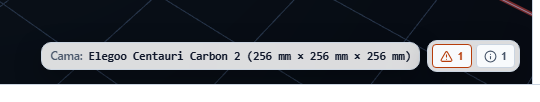
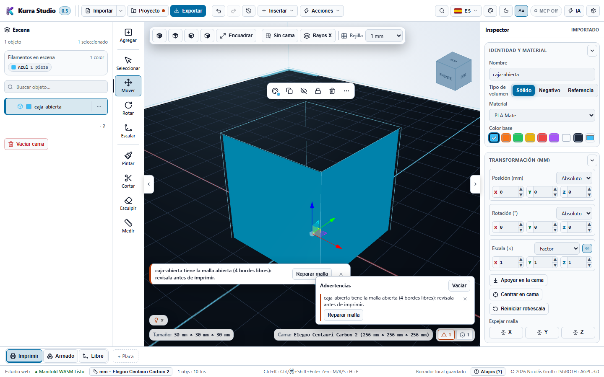

# Mensajes

Kurra Studio te habla con **mensajes**: confirma lo que hizo, te advierte de algo que conviene revisar o te dice que una operación falló. Todos pasan por el mismo lugar, el **centro de mensajes**, para que ninguno tape tu trabajo ni se pierda.

## Un solo mensaje a la vista

Cuando pasa algo, aparece **un mensaje** abajo, sobre el visor. Nunca hay más de uno a la vez: si llega otro, reemplaza al anterior y el anterior queda guardado en el histórico.

Cuánto dura a la vista depende de qué es:

- **Información** (por ejemplo «Placa 2 creada»): se guarda sola en el histórico a los 6 segundos. Si dejas el cursor encima, espera.
- **Advertencias y errores:** se quedan hasta que los cierras con **Cerrar**. Un mensaje informativo que llegue mientras tanto va directo al histórico. Todo aviso que te pide revisar o hacer algo («repárala antes de imprimir», «revisa que la forma sea la esperada», «la pieza quedó junto a la cama») es una advertencia.
- **Mensajes con un botón** (como **Reparar malla**, **Convertir en placas** o **Simplificar…**): no se cierran solos mientras el botón sirva, y un mensaje informativo que llegue después no los quita de la vista: ese va directo al histórico. Sí los reemplaza un error, una advertencia con botón u otro mensaje con botón. Una advertencia sin botón no los reemplaza: va directo al histórico y enciende el icono de advertencias.
- **Mensajes con Deshacer:** quedan 9 segundos a la vista.

Cerrar un mensaje no lo borra: pasa al histórico de su tipo.

## Los iconos del pie del visor

Abajo a la derecha del visor, junto al rótulo **Cama:**, aparecen hasta tres iconos con un número: **errores**, **advertencias** e **información**. Cada número dice cuántos mensajes de ese tipo hay guardados. Si no hay mensajes de un tipo, su icono no se muestra.

## Ver el histórico

1. Pulsa uno de los iconos (o llega a él con **Tab** y pulsa **Enter**).
2. Se abre un panel con los mensajes de ese tipo, del más nuevo al más antiguo.
3. Si un mensaje traía un botón y todavía sirve, lo tienes ahí mismo: puedes **Reparar malla** o **Deshacer** desde el panel.
4. El botón de quitar de cada fila (**Quitar este mensaje**) saca uno; **Vaciar** saca todos los de ese tipo.
5. **Esc** cierra el panel y el foco vuelve al icono. Si encima hay un diálogo o la paleta de comandos, **Esc** cierra primero eso.

Solo hay un panel abierto a la vez: al abrir el de otro tipo, el anterior se cierra.

## Qué se va solo

- Los mensajes que hablan de una pieza se quitan al **borrar la pieza** o al **reparar su malla**: ya no aplican.
- El botón **Deshacer** de un mensaje vale hasta el siguiente cambio que hagas; después el mensaje queda, sin el botón.
- El histórico es de la sesión: no se guarda en el proyecto y parte vacío al recargar la página, al crear un proyecto nuevo o al abrir otro. Guarda hasta 50 mensajes.

## Problemas frecuentes

- **«Vi pasar un mensaje y no alcancé a leerlo»:** está en el histórico; abre el icono de información.
- **«No veo ningún icono»:** no hay mensajes guardados todavía, o los vaciaste.
- **«El botón del mensaje ya no está»:** la acción dejó de servir (la pieza cambió o se borró). Búscala en el menú **Acciones** o en la paleta (**Ctrl+K**).
