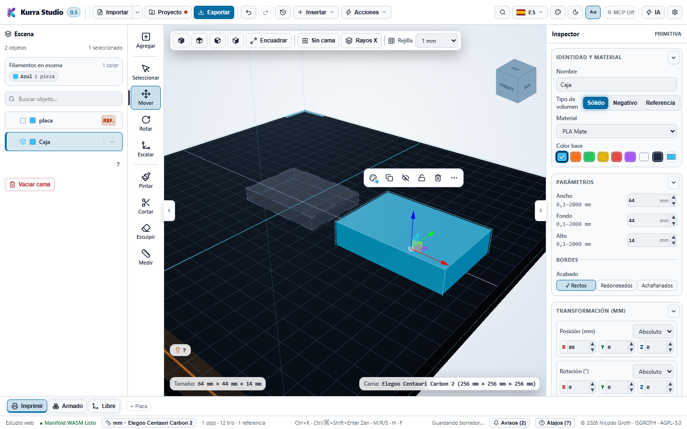
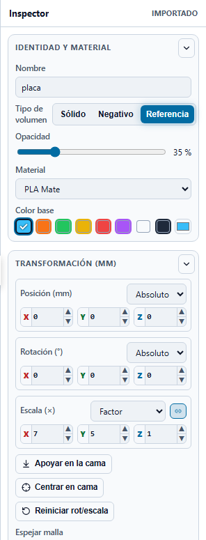

# Objetos de referencia

Una **referencia** es un objeto que se ve y se mide, pero **nunca se imprime ni se exporta**. Sirve para diseñar alrededor de algo real: la placa de un circuito, un tornillo, un imán o un enchufe. Importas su modelo, lo ubicas en la escena y construyes la caja, el soporte o la tapa a su medida.

Kurra3D Studio tiene tres tipos de objeto:

| Tipo | Qué hace |
|---|---|
| **Sólido** | Se imprime y se exporta. |
| **Negativo** | Se resta de los sólidos que toca al *Aplicar restas* (ver [Sólidos negativos y restas](solidos-negativos-y-restas.md)). |
| **Referencia** | Se ve semitransparente, con un contorno discontinuo. Se puede seleccionar, mover, medir y ocultar. No se imprime, no se exporta, no se resta y no entra en uniones ni divisiones. |

## Importar como referencia

1. Abre la flecha junto a **Importar 3D** (*Opciones de importación*).
2. Elige **Importar como referencia…** y busca el archivo (STL, 3MF, OBJ o PLY).
3. El modelo entra en la escena como referencia y queda **seleccionado y móvil**. Muévelo donde lo necesites; si no quieres moverlo sin querer, bloquéalo con el candado del panel *Escena*.

Una referencia no ocupa la cama: lo que crees después puede quedar encima o alrededor de ella. Tampoco te avisa si su malla está abierta o tiene varios cuerpos, porque no se va a imprimir.

## Convertir un objeto en referencia (y de vuelta)

- **Menú contextual** (clic derecho sobre el objeto): **Convertir en ▸ Sólido / Negativo / Referencia**.
- **Inspector**: en *Tipo de volumen*, pulsa **Sólido**, **Negativo** o **Referencia**.

Cada cambio es un paso de **Deshacer** (`Ctrl+Z`). La tecla **H** sigue alternando entre Sólido y Negativo, y no cambia una referencia (así no la conviertes por accidente).

En el panel *Escena*, una referencia lleva un icono de recuadro discontinuo y la etiqueta **REF.**; los lectores de pantalla la anuncian como «Referencia».

## Opacidad

- Cada referencia tiene su **Opacidad** en el inspector (de 15 % a 100 %). El cambio queda en un paso de deshacer al soltar el deslizador; **Usar la de Ajustes** vuelve al valor general.
- El valor general está en **Ajustes ▸ Apariencia y Temas ▸ Opacidad de las referencias** (35 % al empezar). Se aplica a cada referencia que no tiene una opacidad propia.

## Qué hace Kurra3D Studio con una referencia

| Acción | Con una referencia |
|---|---|
| Exportar STL, 3MF (también la escena completa), OBJ, GLB o PLY | Se omite siempre. Si exportas una selección que la incluye, un aviso dice cuántas referencias quedaron fuera. |
| Guardar el proyecto `.kura` y el borrador de recuperación | Se guarda con su malla completa y su opacidad. |
| Aplicar restas | No se le resta nada y no actúa como negativo. |
| Unir, restar, intersectar, combinar, envolvente convexa | Se rechaza con un aviso: conviértela en sólido si quieres usarla. |
| Dividir para imprimir, cortar, ahuecar, textura, pintar, separar por colores, segmentar, molde, análisis de impresión | No actúan sobre ella. |
| Pie de página y aviso *Fuera de volumen* | No cuenta como objeto ni triángulos; el pie dice aparte «1 referencia». |
| Mover, girar, escalar, espejar, medir, simplificar, ocultar, encuadrar | Funcionan igual que en un sólido. Medir se pega a sus vértices. |

## Problemas frecuentes

- **No aparece en el archivo exportado.** Es lo esperado: las referencias solo viven en el proyecto. Si quieres imprimirla, conviértela en **Sólido**.
- **No la veo bien.** Sube su opacidad en el inspector o el valor general en *Ajustes*.
- **La moví sin querer.** Deshaz con `Ctrl+Z` y bloquéala con el candado.
- **Un archivo `.kura` nuevo no abre en una versión antigua de Kurra3D Studio.** Desde que existen las referencias, el proyecto se guarda en la versión 3 del formato; una versión anterior dice «versión no soportada» en vez de leer la referencia como sólido. Actualiza Kurra3D Studio.
