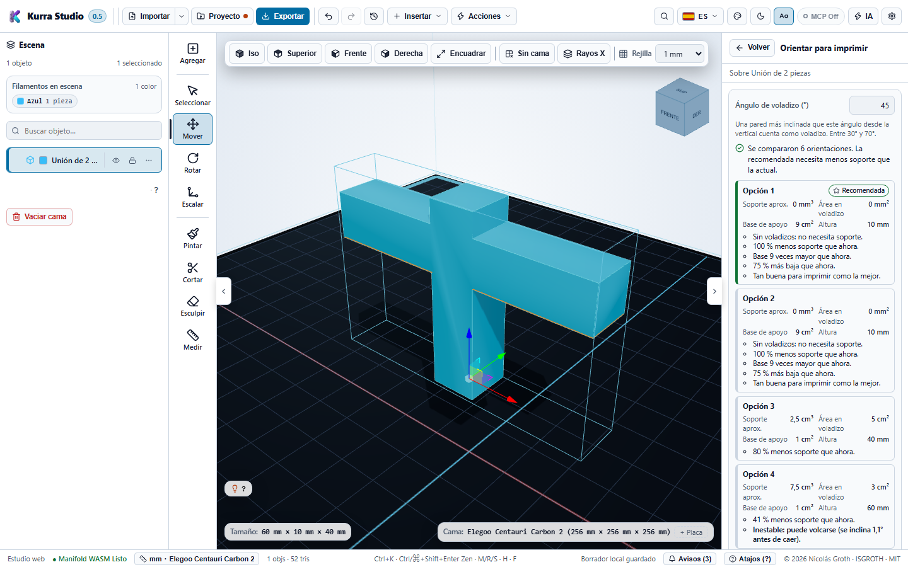
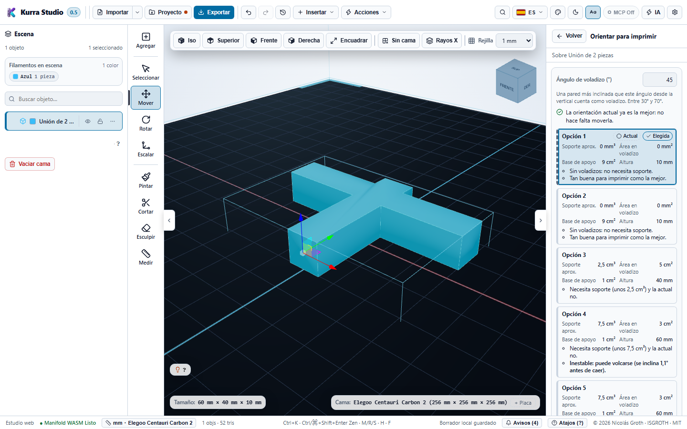

# Orientar para imprimir

**Orientar para imprimir** te dice cómo apoyar una pieza en la cama para que necesite **menos soporte**. Compara la orientación actual con las que se pueden obtener apoyando la pieza sobre cada una de sus caras planas, las ordena y te explica cada una en palabras. Tú eliges.

Kurra Studio **no genera soportes ni lamina**: solo orienta y mide. Mirar las opciones no cambia la escena; la pieza solo se mueve cuando pulsas **Aplicar orientación**.

## Orientar una pieza

1. Selecciona **una** pieza sólida (no un negativo ni una referencia, y que no esté bloqueada).
2. Abre **Acciones ▸ Preparar para imprimir ▸ Orientar para imprimir…**, haz clic derecho sobre la pieza y elígelo en el mismo grupo, o búscalo con **Ctrl+K**. Si no se puede usar, la opción dice por qué.
3. El panel de la derecha calcula al abrirse. Mientras tanto ves «Calculando orientaciones…» y **Cancelar**.
4. Aparece la lista, de la mejor a la peor. Cada opción trae:
   - las insignias **Actual** (cómo está la pieza hoy) y **Recomendada**;
   - **Soporte aprox.** (en mm³ o cm³ según el tamaño), **Área en voladizo**, **Base de apoyo** y **Altura**;
   - sus **motivos** en lenguaje claro: «Sin voladizos: no necesita soporte», «82 % menos soporte que ahora», «Base 3 veces mayor que ahora», «No cabe en la cama», «Inestable: puede volcarse».
5. Si la orientación actual ya es la mejor, arriba dice **«La orientación actual ya es la mejor»** y no se propone ninguna. Si todas son equivalentes (una esfera), dice que **no hay una recomendada**. Si ninguna se sostiene sola (la pieza no tiene una cara plana que apoye en la cama), un aviso lo dice: «La pieza no se sostiene sola en ninguna de estas orientaciones… Necesitará soporte, balsa o un corte plano».

### Las que no se sostienen solas

Las orientaciones sin **base de apoyo** (la pieza no queda apoyada sobre una cara plana) no se mezclan con las demás: van en un grupo aparte, **No recomendadas: sin base de apoyo (N)**, y nunca se proponen como recomendada. Si de todos modos eliges una, el panel pide confirmar: «Esta orientación no tiene base de apoyo. Pulsa **Aplicar de todos modos** para confirmarla.»

## Ver cada opción en el visor

- Pasa el cursor por una opción, enfócala con el teclado o elígela: el visor muestra la pieza **en esa orientación**, translúcida y apoyada en la cama, sin tocar la pieza real.
- Las zonas que **necesitarían soporte** se pintan en **naranja**. La leyenda con texto está en el panel, bajo la lista.

## Aplicar

1. Elige una opción distinta de la actual (la recomendada ya viene elegida).
2. Decide si quieres **Conservar posición en la cama** (viene marcada: la pieza gira sobre su sitio) o centrarla en la cama (desmarcada).
3. Pulsa **Aplicar orientación**, o **Enter** sobre la opción. La pieza gira, queda apoyada en la cama y es **un solo paso de deshacer** (**Ctrl+Z**). Después de apoyarla, Kurra Studio la gira además sobre la vertical para dejarla **alineada con la cama**, con la huella de menor caja (un cubo que estaba girado queda con sus lados paralelos a los bordes de la cama).
4. La lista se calcula de nuevo, la orientación aplicada pasa a ser la **Actual** y el foco queda sobre ella, así que puedes seguir con el teclado o pasar a otra pieza.

Los alojamientos de imán de la pieza la siguen al girar.

## Ajustar el ángulo de voladizo

Un voladizo es una pared inclinada hacia abajo. Por defecto cuenta como voladizo lo que se inclina **más de 45°** desde la vertical, la regla habitual en FDM. Puedes cambiarlo entre **30° y 70°** en el campo **Ángulo de voladizo**; al confirmar con Enter (o salir del campo) la lista se calcula de nuevo.

## Con el teclado

- **Flechas**, **Inicio** y **Fin** recorren la lista y muestran la vista previa de la opción enfocada.
- **Espacio** elige la opción; **Enter** la aplica.
- **Esc** vuelve al resumen de la pieza y quita la vista previa.

## Lo que hay que saber

- **El soporte es una aproximación.** Se mide con columnas verticales bajo cada zona en voladizo; sirve para comparar opciones, no para predecir el material exacto de tu laminador.
- **Los puentes cortos cuentan como voladizo.** Un techo horizontal apoyado en ambos lados (un agujero pequeño) se marca aunque tu laminador lo imprima sin soporte.
- **La decisión final es tuya.** Una pieza puede pedir una orientación peor por resistencia (las capas se rompen más fácil entre sí) o por acabado de una cara.
- **Una sola pieza por vez.** En un bloque con varias piezas, orienta cada una por separado.

## Problemas frecuentes

- **La opción está deshabilitada.** Selecciona una sola pieza sólida y desbloqueada.
- **«No cabe en la cama».** Esa orientación es más grande que tu cama con su margen. Usa [Ajustar a la impresora](ajustar-a-la-impresora.md) para escalarla o dividirla.
- **Una opción dice «Inestable».** Se apoya en una base chica y puede volcarse; con borde (*brim*) o soportes a veces se imprime igual.
- **Una opción dice «Sin base».** Solo toca la cama con aristas o puntos y no se sostiene sola (pasa con piezas de varios cuerpos separados o con formas redondeadas). Nunca sale recomendada; si la aplicas igual, el aviso dice «orientada, pero sin base».
- **Cambié la pieza y la lista desapareció.** Es lo esperado: pulsa **Calcular de nuevo**.
