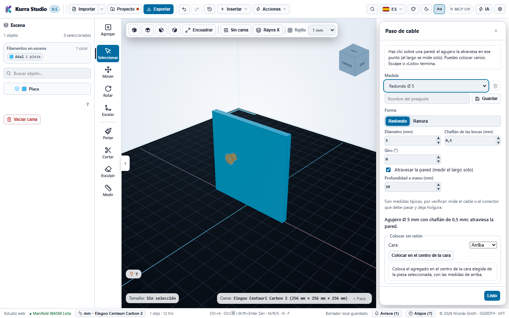
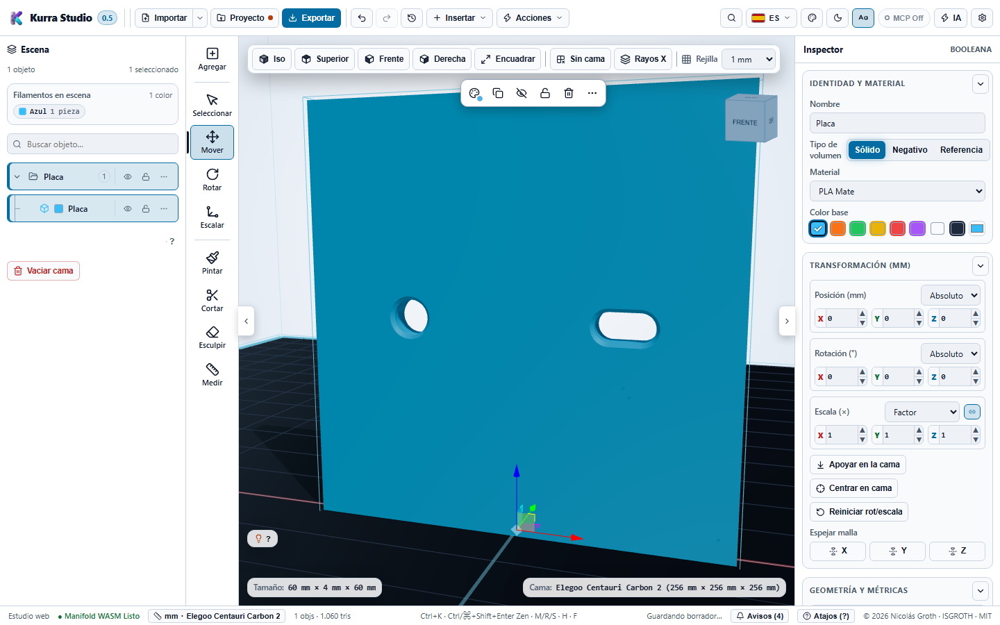

# Paso de cable

Un **paso de cable** es un agujero que atraviesa una pared para sacar un cable o un conector (USB, alimentación, un cable plano). En Kurra Studio lo colocas con un clic sobre la pared y **el largo se mide solo**: Kurra Studio lanza un rayo desde el punto tocado y lo alarga hasta salir por el otro lado.

El paso es una **pieza negativa**: se resta de tu pieza cuando usas **Aplicar restas** (ver [Sólidos negativos y restas](solidos-negativos-y-restas.md)). Puede ser **redondo** u **ovalado** (ranura) y lleva un **chaflán de 0,5 mm** en las dos bocas para que el cable no se corte con el canto.

## Abrir el panel

1. Ten al menos una pieza sólida visible en la escena. Si no hay ninguna, Kurra Studio te avisa y el panel no se abre.
2. Elige **Insertar › Paso de cable** en la barra superior. También puedes hacer clic derecho sobre la pieza y elegir **Más › Paso de cable**, o abrir la paleta con `Ctrl+K` y escribir *cable* o *usb*.
3. El panel **Paso de cable** se abre a la derecha, con un **redondo de Ø 5 mm** que atraviesa la pared.

## Elegir la medida

Los valores incluidos son **típicos y por verificar**: mide tu cable o conector y deja holgura.

| Preajuste | Forma | Medida (mm) | Fuente |
|---|---|---|---|
| **Redondo Ø 5** (por defecto) | Redondo | Ø 5 | Cable USB típico; por verificar |
| Redondo Ø 8 | Redondo | Ø 8 | Por verificar |
| Redondo Ø 12 | Redondo | Ø 12 | Por verificar |
| USB-C | Ranura | 9,5 × 4 | Paso del conector; por verificar con tu cable |
| Micro-USB | Ranura | 8 × 4 | Por verificar |
| Cable plano | Ranura | 12 × 2,5 | Por verificar |

- **Forma**: *Redondo* o *Ranura*. Al cambiar a ranura se carga 8 × 4.
- **Diámetro** (redondo) o **Largo** y **Alto** de la ranura. El largo no puede ser menor que el alto.
- **Chaflán de las bocas**: 0,5 mm por defecto; 0 lo quita.
- **Giro**: 0° deja el lado largo horizontal; 90° lo pone vertical.
- **Atravesar la pared (medir el largo solo)**: activado por defecto.
- **Profundidad a mano**: se usa si desactivas *Atravesar la pared*, o si la pared es demasiado gruesa para medirla (más de 40 mm).

Si un campo está fuera de rango, queda marcado y el panel no coloca nada hasta que lo corrijas. Guarda tus medidas con nombre (*Nombre del preajuste* › **Guardar**); quedan en este navegador.

## Colocar el paso

1. Pasa el cursor sobre la pared: la vista previa naranja muestra la boca y un tramo del agujero. El largo real se mide al hacer clic.
2. Haz **clic** donde lo quieras. Se agrega el paso agrupado con la pieza. Lo que tenías seleccionado no cambia; cada clic agrega otro y `Ctrl+Z` quita solo el último.
3. Termina con **Listo**, con la X del panel o con `Esc`.

### Avisos

- **Pared muy gruesa**: el rayo no salió dentro de 40 mm. Se usó la profundidad a mano; súbela si quieres que atraviese.
- **No atraviesa**: elegiste una profundidad a mano menor que la pared.
- **Cerca del borde**: queda a menos de 1,2 mm del borde de la cara; el borde puede romperse.
- **Cerca de otro agregado**: queda a menos de 1,2 mm de otro agregado que aún no restaste.

Si la boca es más ancha que la cara en esa zona (sale de la pieza por lados opuestos), el paso **no se coloca** y Kurra Studio te lo dice.

El paso **sigue a su pieza** al moverla, girarla o escalarla, y conserva sus medidas. Al duplicar la pieza se copia; al borrarla se borra. Se guarda en el proyecto `.kura`.

## Aplicar las restas

1. Usa **Aplicar restas** (en el inspector o con `Ctrl+K`).
2. Queda **una sola pieza cerrada** con un agujero pasante real por cada paso.

Las pruebas del motor comprueban que el resultado es cerrado, que cada paso agrega un agujero pasante (el género de la pieza sube en 1) y que la sección libre a media pared mide lo pedido.

## Si algo no sale

- **El conector no pasa:** sube el largo o el alto de a 0,5 mm; el plástico impreso suele achicar los agujeros.
- **El agujero no sale por el otro lado:** revisa el aviso; activa *Atravesar la pared* o sube la profundidad a mano.

Anterior: [Colgar en el muro](colgar-en-el-muro.md) · Siguiente: [Exportar](exportar.md) · [Índice](README.md)
