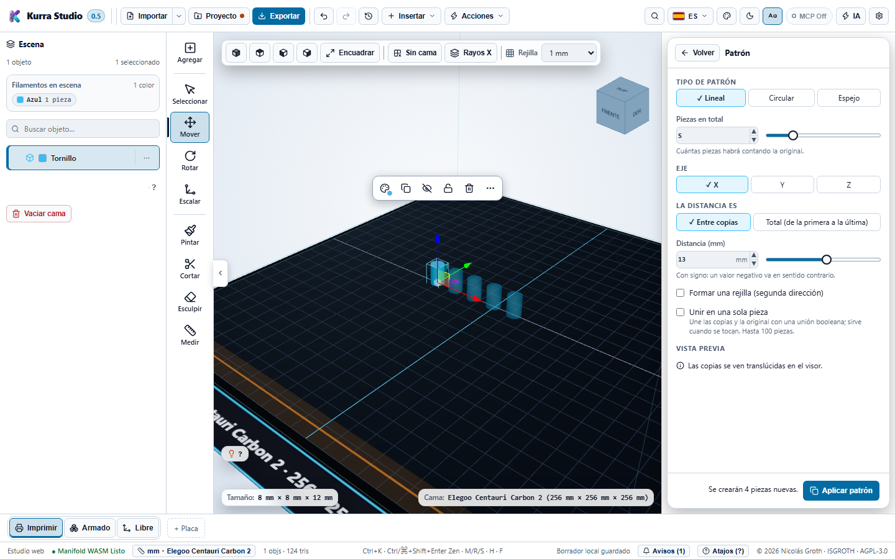
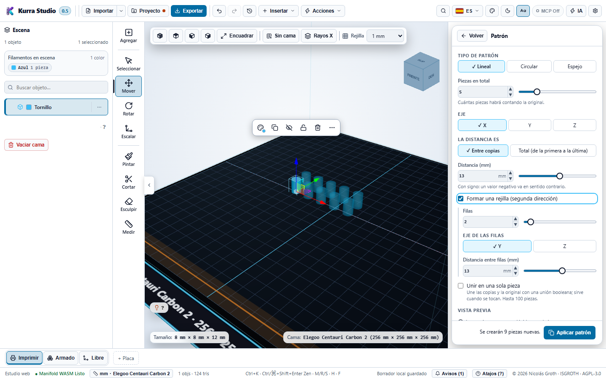
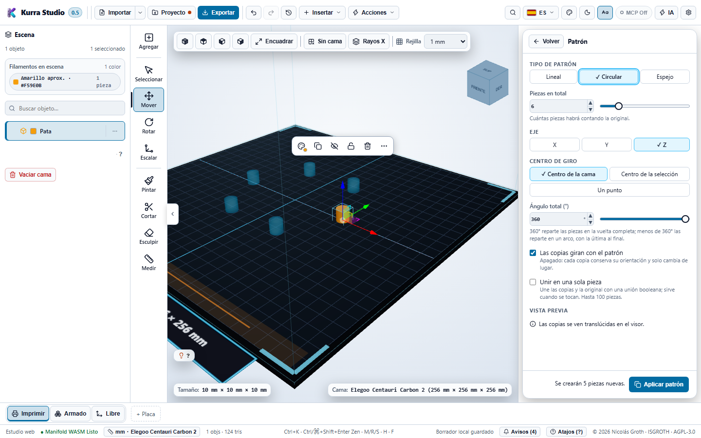
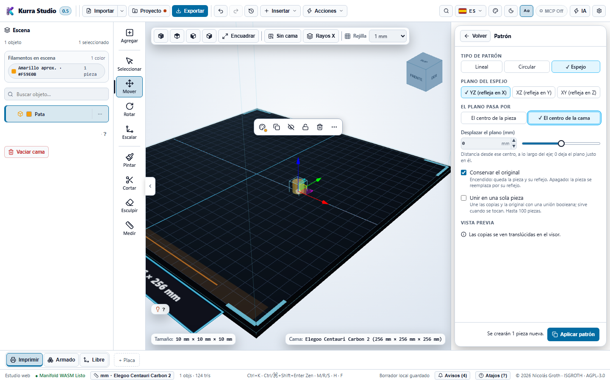
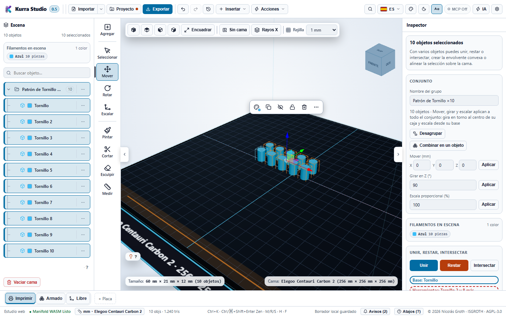

# Patrón: repetir y reflejar piezas

**Patrón** repite una pieza (o varias) en una fila, en una rejilla o alrededor de un eje, y también la refleja como en un espejo conservando la original. Sirve para hacer diez tornillos iguales, una parrilla de agujeros, seis patas alrededor de una base o la otra mitad de una pieza simétrica. Antes de aplicar ves **cómo quedarían las copias** en el visor.

> Capturas pendientes de generar (no están en `img/` todavía): `patrones-01-lineal.png`, `patrones-02-rejilla.png`, `patrones-03-grupo.png`, `patrones-04-circular.png` y `patrones-05-espejo.png`. Las crea `e2e/docs/capturas-patrones.spec.ts` con `npm run docs:capturas -- -g patrones`; al generarlas, quita este aviso.

## Abrir el panel

1. Selecciona una o más piezas.
2. Abre **Acciones › Posición › Patrón…** (o pulsa **Ctrl+K** y escribe *Patrón*).
3. Arriba eliges el **tipo**: **Lineal**, **Circular** o **Espejo**.

Sin nada seleccionado el panel no abre y un aviso te lo dice. **Volver** o **Esc** cierran el panel sin cambiar nada.

## Lineal: fila y rejilla

1. **Piezas en total**: cuántas habrá contando la original (con el deslizador o escribiendo).
2. **Eje**: X (derecha), Y (fondo) o Z (altura).
3. **La distancia es**: *Entre copias* (el paso) o *Total* (de la primera a la última). Un valor negativo va en sentido contrario. Al abrir, Kurra Studio propone el tamaño de la pieza más 5 mm.
4. Para una **rejilla** marca *Formar una rejilla* y elige las filas, su eje y la distancia entre filas.

## Circular

1. **Piezas en total** y **Eje** de giro (Z es el vertical).
2. **Centro de giro**: el centro de la cama, el centro de la selección o un punto con sus coordenadas. Pon la pieza lejos del centro: si el centro cae sobre ella y las copias no giran, todas quedarían en el mismo lugar y el panel te lo dice.
3. **Ángulo total**: 360° reparte las piezas en la vuelta completa; menos, las reparte en un arco con la última al final.
4. **Las copias giran con el patrón**: encendido, cada copia mira hacia afuera como en un reloj; apagado, conserva su orientación.

## Espejo con copia

1. **Plano del espejo**: YZ (refleja en X), XZ (en Y) o XY (en Z).
2. **El plano pasa por**: el centro de la pieza o el centro de la cama, y **Desplazar el plano** lo mueve esa distancia.
3. **Conservar el original**: encendido deja la pieza y su reflejo; apagado reemplaza la pieza por su reflejo.

## Aplicar

Pulsa **Aplicar patrón**. Las copias quedan en un **grupo con nombre** («Patrón de Tornillo ×6») junto a la original, cada una editable por separado, y todo es **un solo paso de deshacer** (**Ctrl+Z**).

- Las copias conservan el color, el material, el tipo (sólido o negativo) y la placa de la original. Si salen de la cama, el aviso de **Fuera de volumen** lo dice.
- Los imanes de una pieza se copian con ella.
- Una pieza **bloqueada** se puede copiar, pero no se mueve ni entra al grupo nuevo.
- **Unir en una sola pieza** hace la unión booleana de las copias y la original (solo piezas sólidas sin bloquear, hasta 100 piezas); sirve cuando se tocan.

## Límites y avisos

- Máximo **500** piezas nuevas por patrón y un tope de triángulos; si lo pasas, el panel lo explica y «Aplicar» queda deshabilitado.
- Si las copias **podrían solaparse** se avisa (la comprobación usa la caja de cada pieza, así que en piezas giradas puede avisar de más). No impide aplicar.
- Con muchas copias, la vista previa puede no dibujarse; el patrón se aplica igual.

## Con un asistente de IA

Las herramientas `kura_pattern_linear`, `kura_pattern_circular` y `kura_mirror_object` (con `plane`, `at`, `offsetMm` y `keepOriginal`) hacen lo mismo, con `dryRun` para ver las posiciones antes. Detalle en el [servidor MCP](../MCP.md).

## Problemas frecuentes

- **«Con el centro en la propia pieza…»**: elige otro centro o activa que las copias giren.
- **No hay vista previa en el visor**: hay demasiados triángulos para dibujarla; aplica igual.
- **«Unir» no se deja**: hay una pieza bloqueada, una que no es sólida o más de 100 piezas.
