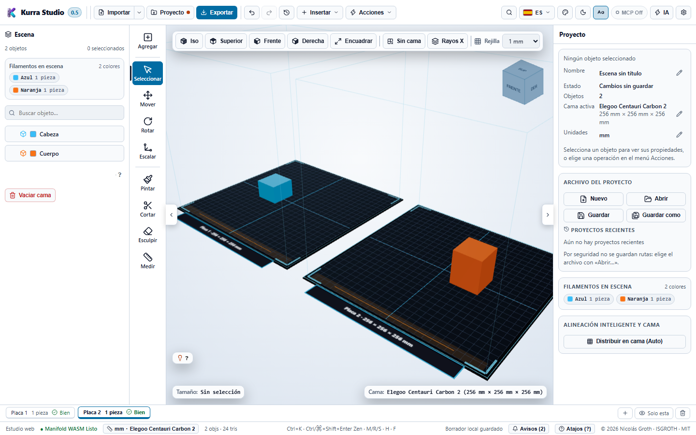
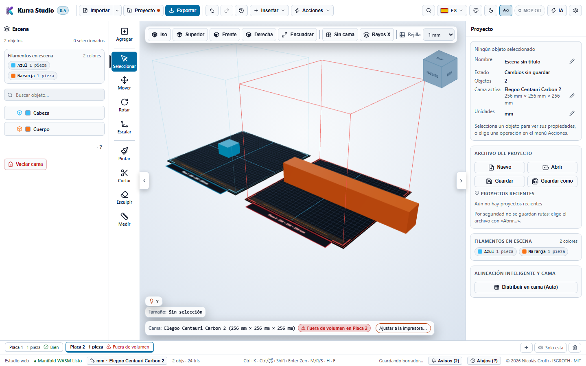

# Placas

Una **placa** es una cama de impresión con sus propias piezas. Sirve para repartir un trabajo grande en varias tandas: lo que cabe en una impresión va en una placa, lo demás en otra. Cada placa se ve como una cama separada en el visor.

Placas está **en revisión**: ya puedes crearlas, nombrarlas, mover piezas entre ellas y ver si alguna se pasa de su cama. Lo que falta está al final de esta guía.

## Si no creas ninguna, nada cambia

Un proyecto nuevo trabaja con una sola cama, como siempre. No ves la tira de placas y los proyectos que ya tenías se abren y se guardan igual. Lo único distinto es un botón pequeño, **+ Placa**, junto al rótulo de la cama, abajo en el visor.

## Crear una segunda placa

1. Pulsa **+ Placa**. Aparece una segunda cama al lado de la primera y el visor se acomoda para mostrar las dos.
2. Abajo, sobre la barra de estado, aparece la **tira de placas**: una ficha por placa con su nombre, cuántas piezas tiene y su estado (**Bien**, **Vacía** o **Fuera de volumen**). La placa nueva queda **activa**: es la que tiene el borde marcado.
3. Para más placas usa el botón **+** al final de la tira.

Crear una placa es un paso de deshacer (**Ctrl+Z**): al deshacer la segunda vuelves a una sola cama, sin tira.

## La tira de placas

- **Hacer activa una placa:** pulsa su ficha. Si su cama estaba fuera de vista, el visor la trae.
- **Renombrar:** doble clic en la ficha, o enfócala con **Tab** y pulsa **F2**. Escribe el nombre y confirma con **Enter**; **Esc** cancela. Es un paso de deshacer.
- **Solo esta:** muestra únicamente la cama de la placa activa. Vuelve a pulsarlo para ver todas.
- **Borrar:** la papelera borra la placa activa. Si tiene piezas, Kurra Studio te pregunta primero y dice a qué placa pasan (en el mismo lugar relativo). **Cancelar** no cambia nada, y **Ctrl+Z** la restaura.

El estado nunca depende solo del color: lleva texto y un icono.

## Mover piezas entre placas

Todas estas formas dejan la pieza en el mismo lugar **relativo** de la otra cama (si estaba al centro de la placa 1, queda al centro de la placa 2):

- **Con la paleta:** selecciona la pieza, pulsa **Ctrl+K** y escribe *Mover a placa*. Elige la placa de destino, o **Placa nueva** para crear una y llevarla ahí.
- **Con el clic derecho:** sobre la pieza, **Posición y tipo › Mover a placa**.
- **Arrastrando:** arrastra la pieza y suéltala sobre la otra cama. Esa placa pasa a ser la activa.

Con la paleta o el menú, la placa de destino también pasa a ser la activa. Cada movimiento es un solo paso de deshacer, también con varias piezas seleccionadas. La opción aparece cuando hay al menos dos placas y la selección tiene una pieza sólida sin bloquear.

## Lo que cae en cada placa

- **Lo nuevo va a la placa activa.** Una forma que insertas aparece en la placa que tengas activa.
- **Dividir respeta la placa.** Si divides una pieza que está en la placa 2, sus partes quedan en la placa 2, y la cama que se usa para calcular los cortes es la de esa placa.
- **Distribuir en cama** reparte las piezas dentro de cada placa, sin pasarlas de una a otra. Si las piezas no están en ninguna placa, te lo avisa en vez de quedarse callado.

## Fuera de volumen, placa por placa

Cada placa se compara con su propia cama. Si una pieza se sale del volumen de impresión, la ficha de esa placa dice **Fuera de volumen** y el aviso del visor nombra cuál: «Fuera de volumen en Placa 2». Las demás placas siguen en **Bien**.

## Guardar

Las placas se guardan dentro del proyecto `.kura` y en el borrador de recuperación. Un proyecto sin placas se guarda exactamente como antes, así que se abre en cualquier versión.

## Qué todavía no existe

- **Vista de armado:** una vista que muestre juntas las piezas de todas las placas.
- **Repartir automático:** que Kurra Studio decida qué pieza va en qué placa. Hoy las mueves tú.
- **Exportar por placa:** un archivo por placa. Hoy exportas la selección o la escena entera.
- **Una cama distinta por placa:** todas las placas usan la cama de la impresora activa.

## Problemas frecuentes

- **No veo la tira de placas:** aparece cuando hay dos o más. Con una sola placa solo ves **+ Placa**.
- **No aparece «Mover a placa»:** necesitas al menos dos placas y una pieza sólida seleccionada y sin bloquear.
- **Creé una placa y no la veo:** pulsa su ficha; el visor la trae. **Encuadrar** muestra todas.

Anterior: [Guardar y recuperar](guardar-y-recuperar.md) · [Índice](README.md)
