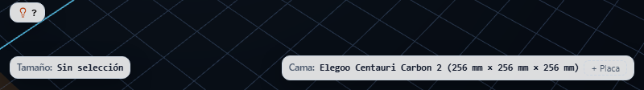
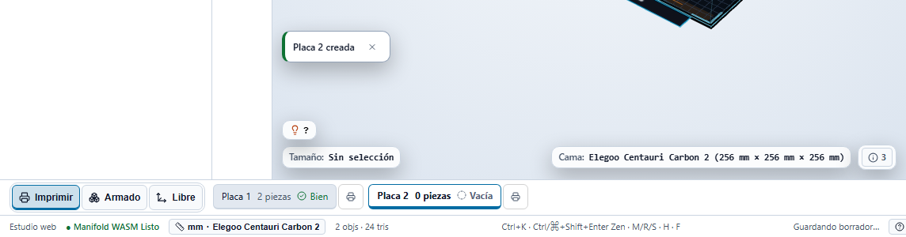
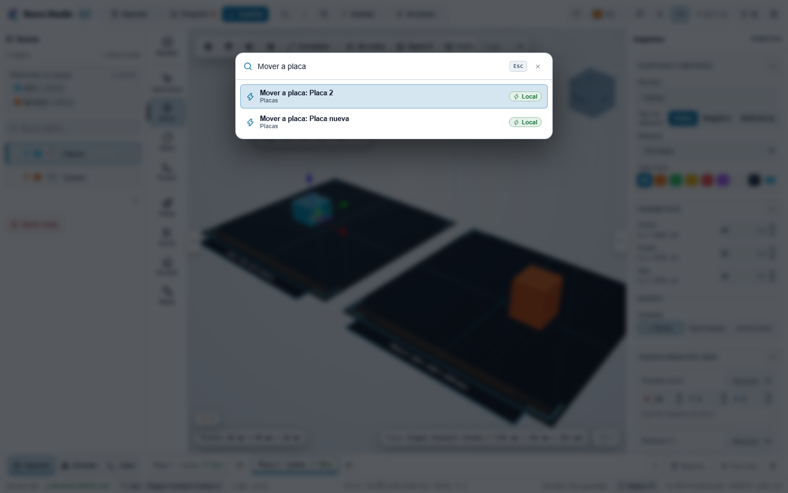
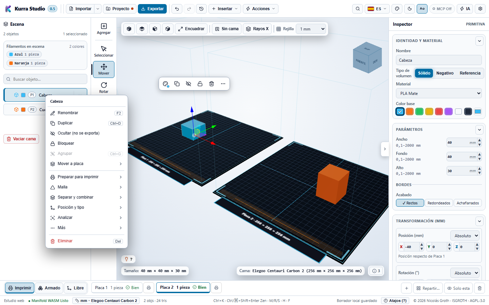
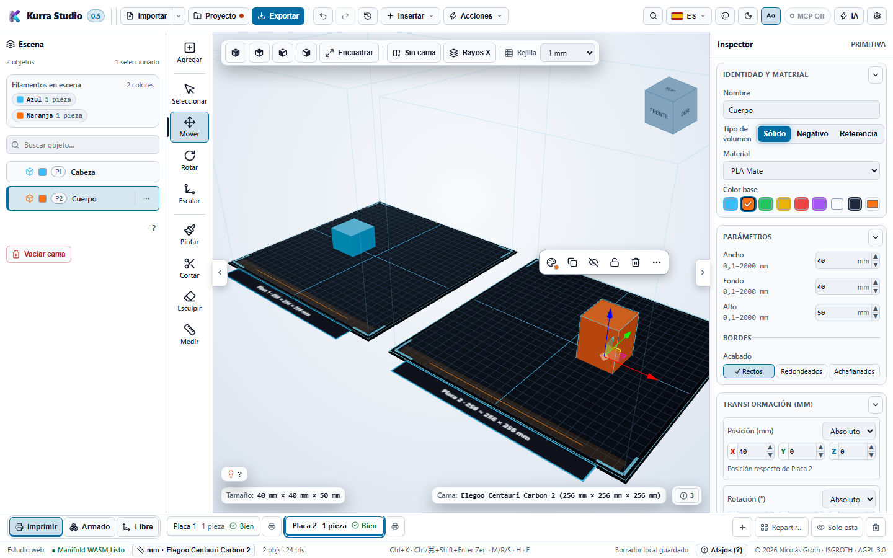
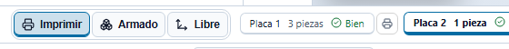
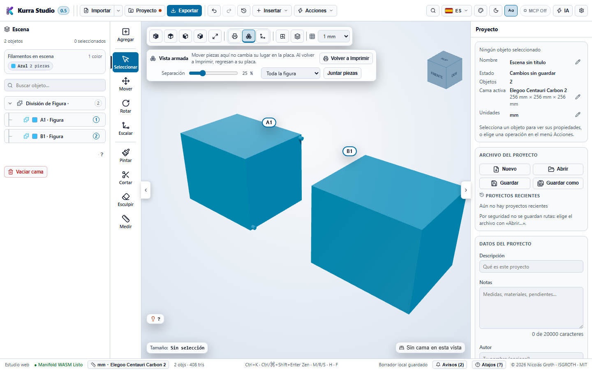
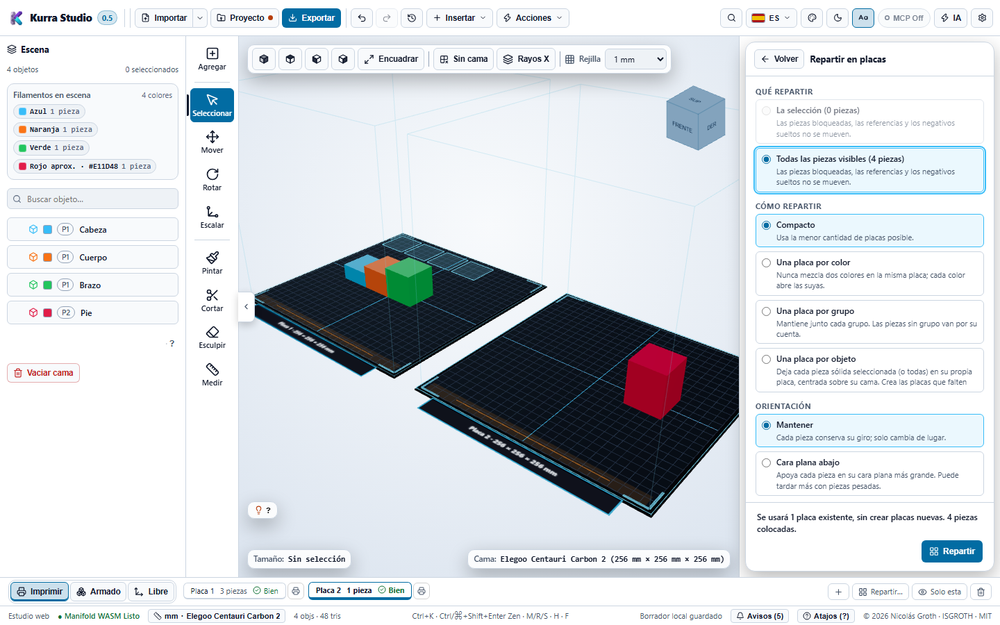
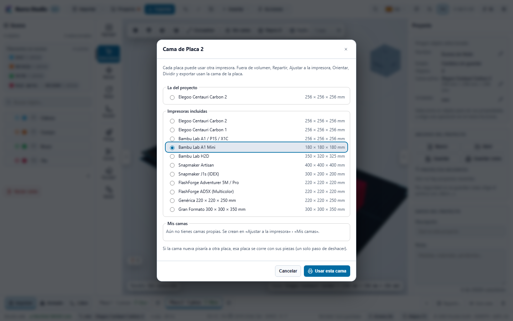
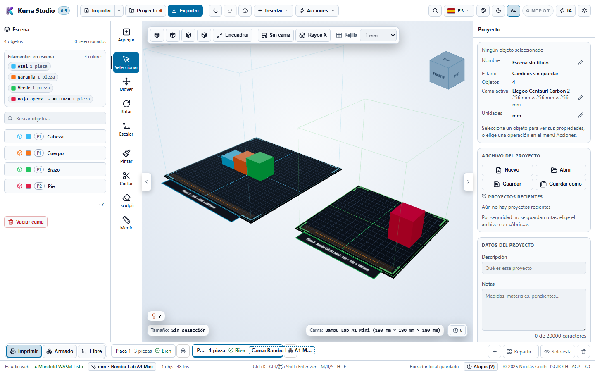

# Placas

Una **placa** es una cama de impresión con sus propias piezas. Sirve para repartir un trabajo grande en varias tandas: lo que cabe en una impresión va en una placa, lo demás en otra. Cada placa se ve como una cama separada en el visor.

Placas está **en revisión**: ya puedes crearlas, nombrarlas, repartir las piezas solo, mover piezas entre ellas, darle a cada placa su propia cama, ver la figura armada y exportar una placa por archivo. Lo que falta está al final de esta guía.

## Si no creas ninguna, nada cambia

Un proyecto nuevo trabaja con una sola cama, como siempre. No ves la tira de placas y los proyectos que ya tenías se abren y se guardan igual. Lo único distinto es una tira corta abajo, sobre la barra de estado, con el selector de vistas (**Imprimir / Armado / Libre**) y un botón pequeño, **+ Placa**.

## Crear una segunda placa

1. Pulsa **+ Placa**. Aparece una segunda cama al lado de la primera y el visor se acomoda para mostrar las dos.
2. Abajo, sobre la barra de estado, aparece la **tira de placas**: una ficha por placa con su nombre, cuántas piezas tiene y su estado (**Bien**, **Vacía** o **Fuera de volumen**). La placa nueva queda **activa**: es la que tiene el borde marcado.
3. Un aviso breve confirma «Placa 2 creada».
4. Para más placas usa el botón **+** al final de la tira (solo en la vista Imprimir).

Crear una placa es un paso de deshacer (**Ctrl+Z**): al deshacer la segunda vuelves a una sola cama, sin tira.

## La tira de placas

- **Hacer activa una placa:** pulsa su ficha. Si su cama estaba fuera de vista, el visor la trae.
- **Renombrar:** doble clic en la ficha, o enfócala con **Tab** y pulsa **F2**. Escribe el nombre y confirma con **Enter**; **Esc** cancela. Si el nombre ya lo usa otra placa, se rechaza y la placa conserva el suyo. Es un paso de deshacer.
- **Solo esta** (solo en Imprimir): muestra únicamente la cama de la placa activa y la encuadra en el visor. Vuelve a pulsarlo para ver todas.
- **Borrar:** la papelera borra la placa activa. Si tiene piezas, Kurra Studio te pregunta primero y dice a qué placa pasan (en el mismo lugar relativo). El botón de cancelar del aviso no cambia nada. Después de borrar, el mensaje trae **Deshacer**, y **Ctrl+Z** también la restaura.

El estado nunca depende solo del color: lleva texto y un icono.

## Mover piezas entre placas

Todas estas formas dejan la pieza en el mismo lugar **relativo** de la otra cama (si estaba al centro de la placa 1, queda al centro de la placa 2):

- **Con la paleta:** selecciona la pieza, pulsa **Ctrl+K** y escribe *Mover a placa*. Elige la placa de destino, o **Placa nueva** para crear una y llevarla ahí.
- **Con el clic derecho:** sobre la pieza, **Mover a placa** está en el primer nivel del menú (ya no hay que buscarlo dentro de un submenú); al apuntarlo se despliegan las placas de destino.
- **Arrastrando, con el panel o con las flechas:** si llevas la pieza a otra cama (arrastrándola y soltándola sobre ella, escribiendo una posición en el inspector o moviéndola con las flechas del teclado), la pieza **cambia de placa**. Esa placa pasa a ser la activa.

Con la paleta, el menú o arrastrando (con el cuerpo de la pieza o con las flechas del gizmo) aparece un aviso («1 pieza pasó a «Placa 2»») con **Deshacer**. Al arrastrar, la pieza queda donde la soltaste si su caja cabe en la cama de la placa destino; si sobresale, se acerca lo justo para quedar dentro. El arrastre y el cambio de placa son un solo paso: **Deshacer** del aviso o **Ctrl+Z** revierten ambos. Con la paleta o el menú, la placa de destino también pasa a ser la activa. Si la placa de destino está llena, la pieza igualmente queda dentro de su cama y un aviso lo dice; revisa que no se superponga con otras. Cada movimiento es un solo paso de deshacer, también con varias piezas seleccionadas. La opción aparece cuando hay al menos dos placas y la selección tiene una pieza sólida sin bloquear.

## Saber en qué placa está cada pieza

- **Insignia en la lista:** cuando hay varias placas, cada pieza de la lista de escena lleva una insignia con el número de su placa (P1, P2…; con el cursor encima, un tooltip dice «Esta pieza está en…»). La insignia se ve siempre, también en la fila seleccionada.
- **Posición del inspector:** con varias placas, la posición X y Z del inspector se mide **desde el centro de la placa de la pieza** y el rótulo dice «Posición respecto de Placa 2». Una pieza al centro de cualquier placa marca 0, 0. Pasa el cursor por el rótulo y un tooltip lo explica: la posición global es la de la escena completa.

## Tres vistas: Imprimir, Armado y Libre

El selector **Imprimir / Armado / Libre** está al inicio de la tira de placas, abajo en el visor (ya no está en la barra de arriba). Aparece siempre que haya piezas; también puedes cambiar con la tecla `A`.

- **Imprimir:** las piezas sobre sus placas, como se van a imprimir. Es la vista donde editas las placas.
- **Armado:** la figura con las piezas en su lugar final. La tira muestra el deslizador **Separación** para abrir la figura y ver cómo encaja cada parte, el selector **Toda la figura / Grupo seleccionado** (a qué piezas se aplica la separación) y **Juntar piezas**, que la cierra. Al final, la nota «N placas · se editan en Imprimir» recuerda dónde se editan las placas. La separación es solo dibujo: no mueve nada de verdad.
- **Libre:** como Armado, pero sin plano de apoyo ni avisos de cama; la tira dice «Vista libre: sin camas».

Lo que muevas en Armado o Libre no cambia el lugar de la pieza en su placa: al volver a **Imprimir** con el selector, todo regresa a su placa.

## Repartir en placas

Si no quieres mover las piezas una por una, pulsa **Repartir…** en la tira de placas (solo en la vista Imprimir). Se abre el panel **Repartir en placas** (para volver, **Volver** arriba a la izquierda o `Esc`).

1. **Qué repartir:** la selección o todas las piezas visibles.
2. **Cómo repartir:** *Compacto* (la menor cantidad de placas posible), *Una placa por color*, *Una placa por grupo* o *Una placa por objeto*.
3. **Orientación:** *Mantener* el giro de cada pieza, o *Cara plana abajo*.
4. **Separación entre piezas** y **Margen al borde**, en milímetros.

Mientras cambias las opciones, el visor dibuja con **contornos** dónde caería cada pieza y el panel resume el resultado. Nada se mueve hasta que pulsas **Repartir**; es un solo paso de deshacer (**Ctrl+Z**). Las piezas bloqueadas, las referencias y los negativos sueltos no se mueven.

## Una cama distinta por placa

Cada placa puede usar otra impresora, por ejemplo una cama grande y una chica.

1. En la ficha de la placa, pulsa el botón de la impresora. Se abre el diálogo **Cama de Placa 2**.
2. Elige la impresora de esa placa: la del proyecto u otra de la lista.
3. Pulsa **Usar esta cama**. La ficha muestra **Cama: …** con el nombre elegido.

Desde entonces, **Fuera de volumen**, **Repartir**, **Ajustar a la impresora**, **Orientar**, **Dividir** y la exportación usan la cama de esa placa. Si la cama nueva pisaría a otra placa, esa placa se corre junto con sus piezas, en el mismo paso de deshacer.

## Placas que vienen de un laminador

Al importar un 3MF que trae varias placas, cada una queda en su propio **grupo**. Kurra Studio te ofrece **Convertir en placas** para dejarlas como placas reales, cada grupo centrado en su cama. También lo encuentras en **Acciones › Convertir grupos en placas** (en la vista Imprimir): sirve con los grupos que selecciones o con grupos llamados «Placa 1», «Placa 2»… Las placas creadas desde esos grupos se numeran seguidas («Placa 2», «Placa 3»…, sin saltos aunque el laminador las llamara «Placa 7» u «Placa 8») y quedan en el orden de origen; un grupo con nombre propio conserva su nombre. Los grupos con piezas bloqueadas o sin piezas sólidas no se convierten, y el aviso dice cuáles. Los grupos de origen se disuelven al convertirlos (las piezas quedan sueltas en su placa). Es un solo paso de deshacer.

## Lo que cae en cada placa

- **Lo nuevo va a la placa activa.** Una forma que insertas aparece en la placa que tengas activa.
- **Dividir respeta la placa.** Si divides una pieza que está en la placa 2, sus partes quedan en la placa 2, y la cama que se usa para calcular los cortes es la de esa placa.
- **Distribuir en cama** reparte las piezas dentro de cada placa, sin pasarlas de una a otra. Si las piezas no están en ninguna placa, te lo avisa en vez de quedarse callado.

## Fuera de volumen, placa por placa

Cada placa se compara con su propia cama. Si una pieza se sale del volumen de impresión, la ficha de esa placa dice **Fuera de volumen** y el aviso del visor nombra cuál: «Fuera de volumen en Placa 2». Las demás placas siguen en **Bien**.

## Exportar por placa

El diálogo **Exportar** sabe de placas: con piezas en dos o más, ofrece un 3MF con todas las placas o un archivo por placa. Está explicado en [Exportar con varias placas](exportar.md#exportar-con-varias-placas). Para que el laminador lo abra con una bandeja por placa, carga antes un proyecto de ejemplo en la sección **Laminador** (explicado en [Exportar](exportar.md#abrir-el-3mf-con-sus-bandejas-en-el-laminador)); está probado en Elegoo Slicer, no aún en Bambu Studio ni OrcaSlicer. Si necesitas la opción más segura, elige un archivo por placa (ZIP).

## Guardar

Las placas se guardan dentro del proyecto `.kura` y en el borrador de recuperación. Un proyecto sin placas se guarda exactamente como antes, así que se abre en cualquier versión.

## Qué todavía no existe

- **Repartir con reglas propias:** Repartir no sabe de tiempos de impresión ni de colores por capa; solo de tamaño, color y grupo.
- **Comprobar las placas en más laminadores:** el 3MF con varias placas se probó en Elegoo Slicer (1, 3 y 5 placas); falta Bambu Studio y OrcaSlicer.

## Problemas frecuentes

- **No veo la tira de placas:** aparece cuando hay dos o más. Con una sola placa ves una tira corta con el selector de vistas y **+ Placa**.
- **No aparece «Mover a placa»:** necesitas al menos dos placas y una pieza sólida seleccionada y sin bloquear.
- **Creé una placa y no la veo:** pulsa su ficha; el visor la trae. **Encuadrar** muestra todas.

Anterior: [Guardar y recuperar](guardar-y-recuperar.md) · [Índice](README.md)
