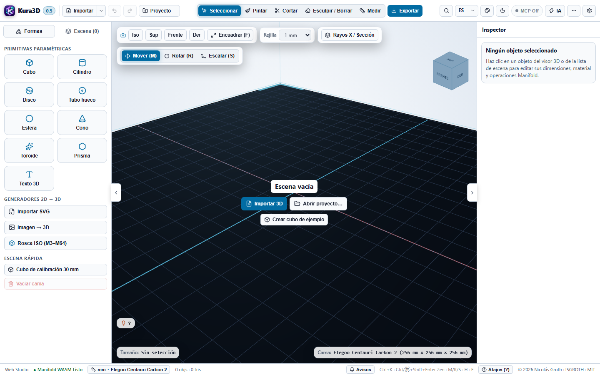

# Primeros pasos

Esta guía te lleva de la pantalla vacía a una escena con tres piezas que puedes mover, girar, escalar y deshacer. No necesitas saber de modelado 3D.

## La pantalla

- **Barra superior:** importar, deshacer y rehacer, el menú *Proyecto*, las herramientas (*Seleccionar*, *Pintar*, *Cortar*, *Esculpir / Borrar*, *Medir*) y *Exportar*. A la derecha: búsqueda de comandos, idioma, tema claro u oscuro, el estado del puente MCP, el asistente *IA*, el menú *Más* y *Ajustes*.
- **Panel izquierdo:** la pestaña *Formas* (piezas para crear) y la pestaña *Escena* (lista de todo lo que hay).
- **Visor 3D:** la cama de tu impresora con la rejilla. Abajo ves el tamaño de la selección y la cama activa.
- **Inspector (derecha):** nombre, color, medidas y posición del objeto seleccionado.
- **Barra de estado:** unidad (mm), impresora, cantidad de objetos y triángulos, y *Atajos*.

## Los ejes

Kura3D usa los mismos ejes que los laminadores: **X hacia la derecha, Y hacia el fondo, Z hacia arriba** (la altura). Las flechas del manipulador son roja (X), verde (Y) y azul (Z).

## Crear, mover, girar y escalar

1. En *Formas* pulsa **Cubo**, **Cilindro** y **Esfera**. Cada pieza nueva aparece en un lugar libre de la cama, sin quedar encima de otra.
2. Haz clic en una pieza para seleccionarla. El inspector muestra su nombre, su color y sus parámetros (por ejemplo *Ancho*, *Fondo* y *Alto*): cámbialos escribiendo un valor.
3. Elige el modo con la barra del visor o con el teclado: **M** mover, **R** rotar, **S** escalar. Arrastra las flechas del manipulador.
4. Para valores exactos, escribe en *Posición*, *Rotación* y *Escala* del inspector. Los campos aceptan operaciones y unidades (`10+5`, `2cm`).
5. Con una pieza seleccionada, las flechas del teclado la mueven en X e Y, y `Re Pág` / `Av Pág` la suben y bajan en Z. `Alt` + arrastrar la clona; `Mayús` escala en proporción; `Ctrl` ajusta el giro a 15°.
6. Para volver atrás: **Ctrl+Z** deshace y **Ctrl+Y** rehace (también los botones de la barra superior).

## Mover la cámara

Arrastra para orbitar y usa la rueda para acercar. Las teclas **1** (frente), **2** (derecha), **3** (isométrica) y **7** (superior) cambian la vista, y **F** encuadra lo seleccionado o toda la escena. El cubo de vistas de la esquina superior derecha también sirve.

## Problemas frecuentes

- **No veo mi pieza:** pulsa **F** para encuadrar. Si la pieza es muy grande o muy pequeña, el aviso del visor te lo dice.
- **Moví algo sin querer:** **Ctrl+Z**. El historial guarda cada cambio.
- **No sé qué atajo existe:** pulsa **?** o abre *Atajos* en la barra de estado; **Ctrl+K** abre la paleta de comandos para buscar cualquier acción por nombre.
- **La pieza se ve "flotando":** selecciónala y pulsa **L** para apoyarla en la cama.

Siguiente: [Importar y reparar](importar-y-reparar.md) · [Índice de guías](README.md)
