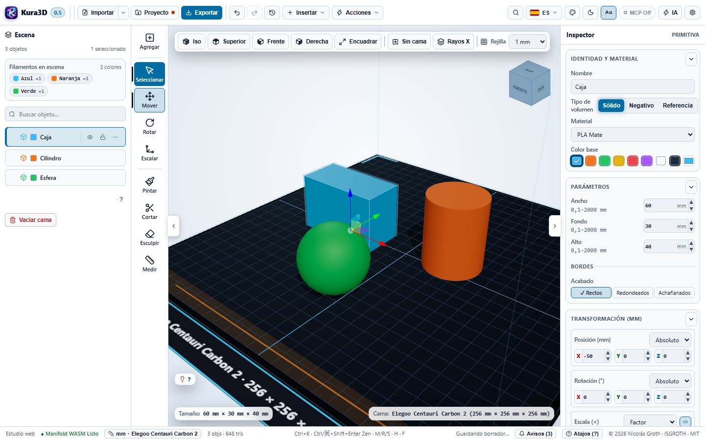
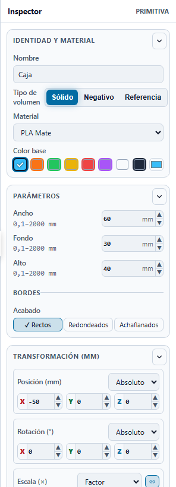

# Primeros pasos

Esta guía te lleva de la pantalla vacía a una escena con tres piezas que puedes mover, girar, escalar y deshacer. No necesitas saber de modelado 3D.

## La pantalla

- **Barra superior:** a la izquierda el grupo *Archivo* (**Importar**, *Proyecto* y **Exportar**), *Deshacer*, *Rehacer* y el **historial** (el reloj: lista lo que hiciste y te deja volver a cualquier punto), y el menú **Acciones**. A la derecha: búsqueda de comandos, idioma, temas, tema claro u oscuro, **Rótulos**, el estado del puente MCP, el asistente *IA* y *Ajustes*.
- **Barra de herramientas (vertical, junto al visor):** *Seleccionar*, *Mover*, *Rotar* y *Escalar* (el modo del manipulador), y después *Pintar*, *Cortar*, *Esculpir / Borrar* y *Medir*. La herramienta activa queda marcada con fondo y una raya al costado. Con el teclado es una sola parada de **Tab**; las flechas recorren los botones.
- **Barra de vista (arriba del visor, en una sola fila):** vistas *Iso*, *Superior*, *Frente* y *Derecha* (el icono del cubo marca la cara que miras), *Encuadrar*, *Sin cama*, *Rayos X* y la *Rejilla*. Si falta espacio, quedan solo los iconos.
- **Panel izquierdo:** la pestaña *Formas* (piezas para crear) y la pestaña *Escena* (lista de todo lo que hay). Tiene tres estados (ver más abajo).
- **Visor 3D:** la cama de tu impresora con la rejilla. Abajo ves el tamaño de la selección y la cama activa.
- **Inspector (derecha):** nombre, color, medidas y posición del objeto seleccionado.
- **Barra de estado:** unidad (mm), impresora, cantidad de objetos y triángulos, y *Atajos*. Al pasar el cursor o el foco por cualquier botón de las barras, el centro de la barra de estado explica qué hace y su atajo.

### Menú Acciones

Reúne las operaciones sobre la selección que no son herramientas de puntero: *Ahuecar*, *Dividir para imprimir*, *Ajustar a la impresora*, *Generar molde*, *Reparar malla*, *Simplificar*, *Separar por colores*, *Separar piezas sueltas*, *Agrupar*, *Combinar*, *Aplicar restas*, *Convertir en ▸*, *Apoyar* y *Centrar en la cama*, *Alinear y distribuir ▸* y las revisiones. Cada una hace lo mismo que en el menú contextual o la paleta. Si una sale gris, debajo dice por qué (por ejemplo «Selecciona un objeto primero»).

### Rótulos: iconos con texto o solo iconos

El botón **Rótulos** (*Aa*) alterna todas las barras a la vez entre iconos con texto e iconos solos; la elección se recuerda (también está en la paleta: «Mostrar u ocultar rótulos»). *Importar* y *Exportar* conservan su texto siempre. En modo solo iconos, cada icono muestra un tooltip con su nombre, qué hace y su atajo, con el cursor o con el foco del teclado; **Esc** lo cierra.

## Los ejes

Kura3D usa los mismos ejes que los laminadores: **X hacia la derecha, Y hacia el fondo, Z hacia arriba** (la altura). Las flechas del manipulador son roja (X), verde (Y) y azul (Z).

## Crear, mover, girar y escalar

1. En *Formas* pulsa **Cubo**, **Cilindro** y **Esfera**. Cada pieza nueva aparece en un lugar libre de la cama, sin quedar encima de otra.
2. Haz clic en una pieza para seleccionarla. El inspector muestra su nombre, su color y sus parámetros (por ejemplo *Ancho*, *Fondo* y *Alto*): cámbialos escribiendo un valor.
3. Elige el modo en la barra de herramientas o con el teclado: **M** mover, **R** rotar, **S** escalar. Arrastra las flechas del manipulador.
4. Para valores exactos, escribe en *Posición*, *Rotación* y *Escala* del inspector. Los campos aceptan operaciones y unidades (`10+5`, `2cm`).
5. Con una pieza seleccionada, las flechas del teclado la mueven en X e Y, y `Re Pág` / `Av Pág` la suben y bajan en Z. `Alt` + arrastrar la clona; `Mayús` escala en proporción; `Ctrl` ajusta el giro a 15°.
6. Para volver atrás: **Ctrl+Z** deshace y **Ctrl+Y** rehace (también los botones de la barra superior). El botón del historial, junto a ellos, lista los pasos con nombre: elige uno para volver a ese punto de una vez.

## Bordes redondeados y chaflanes

**Cubo**, **Cilindro**, **Tubo** y **Prisma** tienen un grupo *Bordes* al final de sus parámetros en el inspector:

1. En *Acabado* elige **Redondeados** (con radio) o **Achaflanados** (corte a 45°). **Rectos** los deja como estaban.
2. Escribe el *Radio* o el *Chaflán* en mm (acepta coma decimal). Junto a la etiqueta se ve el máximo que permiten las medidas de la pieza; si pides más, se aplica el máximo y una nota bajo el campo lo dice.
3. En *Aristas* elige **Solo verticales** (las esquinas vistas desde arriba: la base queda plana y se imprime sin voladizo; es lo habitual en cajas), **Solo superior** (el borde de arriba) o **Todas**. Cilindro y tubo ofrecen *Todas* y *Solo superior*.

Las medidas exteriores no cambian: una caja de 40 × 30 × 20 mm con las esquinas redondeadas sigue midiendo 40 × 30 × 20 mm, y su volumen baja justo lo que quitan las esquinas. Cada cambio se deshace en un paso (**Ctrl+Z**). Como el resto de los parámetros, los bordes dejan de editarse si después restas o unes la pieza: ahí deja de ser paramétrica.

## Mover la cámara

Arrastra para orbitar y usa la rueda para acercar. Las teclas **1** (frente), **2** (derecha), **3** (isométrica) y **7** (superior) cambian la vista, y **F** encuadra lo seleccionado o toda la escena. El cubo de vistas de la esquina superior derecha también sirve.

## Barra lateral: completa, compacta u oculta

El tirador del borde del panel izquierdo (la pestaña con la flecha) recorre tres estados con cada clic: **completa** (iconos y texto), **compacta** (solo iconos, una columna angosta) y **oculta**. Con clic derecho sobre el tirador, o `Mayús+F10` con el foco en él, eliges uno directamente. También están en la paleta de comandos (**Ctrl+K**, «Barra lateral»). Kura3D recuerda tu elección, y el modo sin distracciones (**Ctrl+Mayús+Enter**) no la cambia.

En la barra compacta cada icono muestra su nombre al pasar el cursor. La pestaña *Escena* no cabe en ella: pulsa su icono y luego **Expandir la barra** para ver la lista.

## Vista sin cama

Para ver cómo encajan las piezas entre sí sin la cama de por medio, pulsa **Sin cama** en la barra de vistas del visor (o la tecla **B**, o clic derecho en el fondo del visor → *Vista sin cama*). Se ocultan la rejilla, la cama, el rótulo de la impresora, el volumen de impresión y las sombras; las piezas quedan flotando y puedes girar la vista por debajo para mirarlas desde abajo. Es solo una forma de ver: no cambia tus piezas ni lo que se exporta, y no se guarda en el proyecto. En la línea inferior el chip de la cama pasa a **Cama oculta** (púlsalo para volver a mostrarla); mientras está oculta no se avisa de piezas fuera del volumen de impresión, pero el aviso reaparece apenas vuelve la cama. Vuelve a pulsar **Sin cama** (o **B**) para ver la cama otra vez.

## Problemas frecuentes

- **No veo mi pieza:** pulsa **F** para encuadrar. Si la pieza es muy grande o muy pequeña, el aviso del visor te lo dice.
- **Moví algo sin querer:** **Ctrl+Z**. El historial guarda cada cambio.
- **No sé qué atajo existe:** pulsa **?** o abre *Atajos* en la barra de estado; **Ctrl+K** abre la paleta de comandos para buscar cualquier acción por nombre.
- **La pieza se ve "flotando":** selecciónala y pulsa **L** para apoyarla en la cama.

Siguiente: [Importar y reparar](importar-y-reparar.md) · [Índice de guías](README.md)
