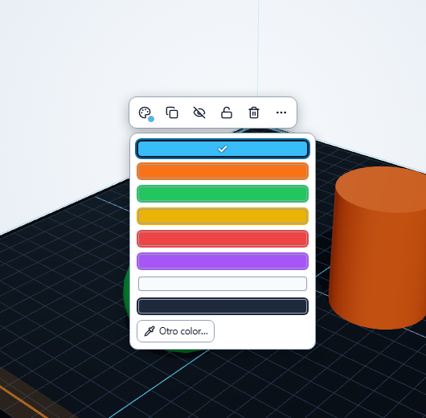
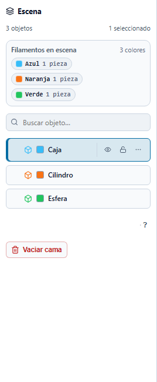
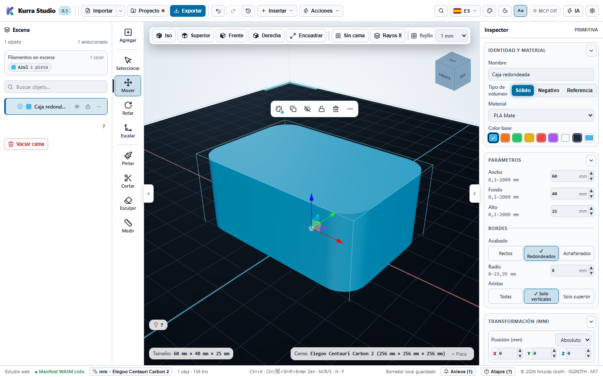
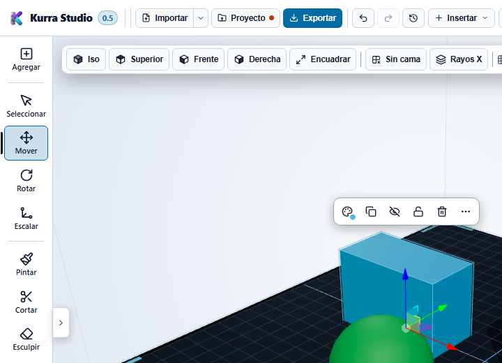
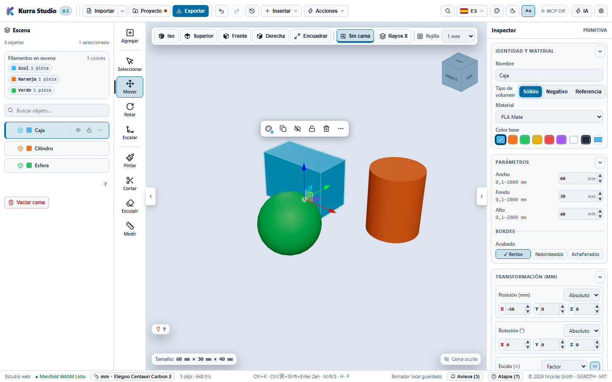

# Primeros pasos

Esta guía te lleva de la pantalla vacía a una escena con tres piezas que puedes mover, girar, escalar y deshacer. No necesitas saber de modelado 3D.

## La pantalla

- **Barra superior:** a la izquierda el grupo *Archivo* (**Importar**, **Proyecto** —muestra el panel del proyecto a la derecha— y **Exportar**), *Deshacer*, *Rehacer* y el **historial** (el reloj: lista lo que hiciste y te deja volver a cualquier punto), y los menús **Insertar** (formas, Texto 3D, SVG, imagen, rosca y cubo de calibración) y **Acciones**. A la derecha: búsqueda de comandos, idioma (con su bandera), temas, tema claro u oscuro, **Rótulos**, el estado del puente MCP, el asistente *IA* y *Ajustes*. La insignia de versión junto al logo (o *Acerca de* en la paleta de comandos y en Ajustes) abre **Acerca de**: qué es el programa, cómo se construyó, su licencia y las bibliotecas abiertas que usa.
- **Barra de herramientas (vertical, junto al visor):** arriba **Agregar** (abre a su lado las formas básicas: Cubo, Cilindro, Disco, Tubo hueco, Esfera, Cono, Toroide, Prisma y Texto 3D), luego *Seleccionar*, *Mover*, *Rotar* y *Escalar* (el modo del manipulador), y después *Pintar*, *Cortar*, *Esculpir* (esculpir o borrar volumen; el nombre completo sale en la ayuda) y *Medir*. La herramienta activa queda marcada con fondo y una raya al costado. Con el teclado es una sola parada de **Tab**; las flechas recorren los botones. Sin nada seleccionado, *Mover*, *Rotar* y *Escalar* toman solas el objeto (o todos los visibles sin candado) y *Pintar* pinta directo lo que tocas; *Cortar*, *Esculpir* y *Medir* toman el objeto si hay uno solo. Con la escena vacía quedan apagadas (atenuadas y tachadas) y el tooltip y la barra de estado dicen por qué.
- **Barra de vista (arriba del visor, en una sola fila):** vistas *Iso*, *Superior*, *Frente* y *Derecha* (el icono del cubo marca la cara que miras), *Encuadrar*, *Sin cama*, *Rayos X* y la *Rejilla*. Si falta espacio, primero las vistas y luego el resto quedan solo con su icono.
- **Panel izquierdo:** la *Escena*, un árbol con todo lo que hay (carpetas para los grupos, icono por tipo y una muestra del color de cada objeto) y **Vaciar cama** al pie. Se muestra u oculta con su tirador (ver más abajo).
- **Visor 3D:** la cama de tu impresora con la rejilla. Abajo ves el tamaño de la selección y la cama activa.
- **Panel derecho (contextual):** muestra una sola cosa según lo que estés haciendo:
  - **Sin selección (o con el botón *Proyecto*), el *Proyecto*:** nombre (el lápiz lo vuelve editable: **Enter** confirma, **Esc** cancela), si hay cambios sin guardar, cantidad de objetos, y cama activa y unidades, cada una con su lápiz que abre el selector ahí mismo. Debajo, **Nuevo**, **Abrir**, **Guardar** y **Guardar como** (con sus atajos en el tooltip), los proyectos recientes y la nota de rutas.
  - **Con un objeto, su resumen:** nombre, tipo de volumen, material y color, parámetros, posición, rotación y escala, medidas y estado de la malla, y debajo los accesos a sus operaciones (*Ahuecar…*, *Simplificar…*, *Textura superficial…*, *Módulos…*, revisar e imprimir, detectar estructuras, cortar, dividir, ajustar a la impresora, molde, proyectar y rosca). Con varios objetos, las booleanas y la alineación. Las operaciones son filas compactas de iconos (cada uno con su nombre en el tooltip; **▾** muestra variantes, como *Refinar* junto a *Simplificar*), y cada sección se pliega con su botón de la esquina; lo plegado se recuerda.
  - **Con una herramienta activa, solo lo suyo:** *Pintar* muestra pincel, colores, goma, separar por colores y filamentos (sin transformación ni medidas); *Mover*, *Rotar* o *Escalar* elegidos muestran solo la posición, la rotación o la escala (y medidas) del objeto, con **Ver todo el objeto** para volver al resumen; *Esculpir*, *Cortar* y *Medir*, sus opciones.
  - **Con una operación activa, solo sus opciones:** el título, sobre qué objeto actúa, su botón de aplicar y **Volver** (o **Esc**) para regresar al resumen. Al abrir una operación el foco pasa al panel y, al volver, regresa al botón desde el que la abriste. Cortar, Dividir para imprimir, Ajustar a la impresora, Molde, Proyectar, Rosca y Medir abren su propio panel en el mismo lugar.
  - **Ancho y plegado:** arrastra el borde izquierdo del panel (o enfócalo con **Tab** y usa **←** / **→**; **Inicio** y **Fin** van al mínimo y al máximo) para ensancharlo o reducirlo. El botón **›** del borde lo pliega a una tira y **‹** lo vuelve a abrir; ancho y estado se recuerdan. Si eliges una operación con el panel plegado, se abre solo.
  - En el teléfono el mismo contenido va en la hoja inferior (botón **Inspector**).
- **Barra de estado:** unidad (mm), impresora, cantidad de objetos y triángulos, y *Atajos*. Al pasar el cursor o el foco por cualquier botón de las barras, el centro de la barra de estado explica qué hace y su atajo.

### Menú Acciones

Está dividido en submenús, uno por grupo y con su icono (*Preparar para imprimir*, *Malla*, *Separar y combinar*, *Posición y tipo*, *Analizar*): **→** o el cursor abre el grupo y **←** vuelve. Reúne las operaciones sobre la selección que no son herramientas de puntero: *Ahuecar*, *Dividir para imprimir*, *Ajustar a la impresora*, *Generar molde*, *Módulos*, *Reparar malla*, *Simplificar*, *Textura superficial*, *Separar por colores*, *Separar piezas sueltas*, *Agrupar*, *Combinar*, *Aplicar restas*, *Convertir en ▸*, *Apoyar* y *Centrar en la cama*, *Alinear y distribuir ▸* y las revisiones. Cada una hace lo mismo que en el menú contextual o la paleta; las que tienen opciones (Ahuecar, Simplificar, Textura, Módulos, las revisiones) las muestran en el panel derecho. Si una sale gris, debajo dice por qué (por ejemplo «Selecciona un objeto primero»).

### Rótulos: iconos con texto o solo iconos

El botón **Rótulos** (*Aa*) alterna todas las barras a la vez entre iconos con texto e iconos solos; la elección se recuerda (también está en la paleta: «Mostrar u ocultar rótulos»). *Importar* y *Exportar* conservan su texto siempre, y el estado del puente conserva «MCP» y su indicador. En modo solo iconos, cada icono muestra un tooltip con su nombre, qué hace y su atajo, con el cursor o con el foco del teclado; **Esc** lo cierra.

## Los ejes

Kurra Studio usa los mismos ejes que los laminadores: **X hacia la derecha, Y hacia el fondo, Z hacia arriba** (la altura). Las flechas del manipulador son roja (X), verde (Y) y azul (Z).

## Crear, mover, girar y escalar

1. Pulsa **Agregar** en la barra de herramientas (o **Insertar** en la barra superior) y elige **Cubo**; repite con **Cilindro** y **Esfera**. Con el teclado: enfoca **Agregar**, **→** abre el menú, las flechas recorren y **Enter** crea; **Esc** cierra y vuelve al botón. En el teléfono, la hoja **Agregar** de la barra inferior tiene las mismas piezas. Cada pieza nueva aparece en un lugar libre de la cama, sin quedar encima de otra.
2. Haz clic en una pieza para seleccionarla. El inspector muestra su nombre, su color y sus parámetros (por ejemplo *Ancho*, *Fondo* y *Alto*): cámbialos escribiendo un valor.
3. Elige el modo en la barra de herramientas o con el teclado: **M** mover, **R** rotar, **S** escalar (sin selección, toman la pieza o todas las visibles). Arrastra las flechas del manipulador. El panel derecho deja arriba solo ese grupo de campos.
4. Para valores exactos, escribe en *Posición*, *Rotación* y *Escala* del inspector. Los campos aceptan operaciones y unidades (`10+5`, `2cm`).
5. Con una pieza seleccionada, las flechas del teclado la mueven en X e Y, y `Re Pág` / `Av Pág` la suben y bajan en Z. `Alt` + arrastrar la clona; `Mayús` escala en proporción; `Ctrl` ajusta el giro a 15°.
6. **Arrastrar para mover:** con una pieza ya seleccionada (herramienta *Seleccionar* o *Mover*), arrastra su cuerpo y se desplaza sobre el plano horizontal a la altura del punto que agarraste, también si está en el aire. Con varias seleccionadas se mueven juntas (las bloqueadas no). Respeta el paso de la rejilla de la barra de vista, **Esc** cancela y soltar es un solo paso de deshacer. Arrastrar el fondo o una pieza no seleccionada gira la cámara, y las flechas del manipulador tienen prioridad.
7. **Barra junto al objeto:** al seleccionar una pieza aparece una barra flotante con *Color base*, *Duplicar*, *Ocultar*, *Bloquear*, *Eliminar* y *Más* (abre el menú del objeto). Hace lo mismo que el menú de clic derecho. Se coloca sola **fuera de la pieza**, en un hueco libre dentro del visor, para no taparla. *Color base* abre una paleta con los colores de siempre y **Otro color…** para elegir cualquiera. La barra se oculta mientras arrastras la pieza, el manipulador o la cámara, y mientras hay un panel de una operación abierto en el inspector (Suavizar, Orientar, Torreta, etc.), con Pintar, Cortar, Esculpir o Medir y en modo Zen. **Alt+.** lleva el foco a la barra (flechas para recorrerla, **Esc** o **Tab** para salir). Se apaga en *Ajustes* con «Barra de acciones junto al objeto».

   
8. Para volver atrás: **Ctrl+Z** deshace y **Ctrl+Y** rehace (también los botones de la barra superior). El botón del historial, junto a ellos, lista los pasos con nombre: elige uno para volver a ese punto de una vez.

## Bordes redondeados y chaflanes

**Cubo**, **Cilindro**, **Tubo** y **Prisma** tienen un grupo *Bordes* al final de sus parámetros en el inspector:

1. En *Acabado* elige **Redondeados** (con radio) o **Achaflanados** (corte a 45°). **Rectos** los deja como estaban.
2. Escribe el *Radio* o el *Chaflán* en mm (acepta coma decimal). Junto a la etiqueta se ve el máximo que permiten las medidas de la pieza; si pides más, se aplica el máximo y una nota bajo el campo lo dice.
3. En *Aristas* elige **Solo verticales** (las esquinas vistas desde arriba: la base queda plana y se imprime sin voladizo; es lo habitual en cajas), **Solo superior** (el borde de arriba) o **Todas**. Cilindro y tubo ofrecen *Todas* y *Solo superior*.

Las medidas exteriores no cambian: una caja de 40 × 30 × 20 mm con las esquinas redondeadas sigue midiendo 40 × 30 × 20 mm, y su volumen baja justo lo que quitan las esquinas. Cada cambio se deshace en un paso (**Ctrl+Z**). Como el resto de los parámetros, los bordes dejan de editarse si después restas o unes la pieza: ahí deja de ser paramétrica.

## Mover la cámara

Arrastra para orbitar y usa la rueda para acercar. Las teclas **1** (frente), **2** (derecha), **3** (isométrica) y **7** (superior) cambian la vista, y **F** encuadra lo seleccionado o toda la escena. El cubo de vistas de la esquina superior derecha también sirve.

## Barra lateral: mostrar u ocultar la Escena

El tirador del borde del panel izquierdo (la pestaña con la flecha) muestra u oculta la *Escena* con un clic (o **Enter** con el foco en él); oculta, el visor gana ese ancho. También está en la paleta de comandos (**Ctrl+K**, «Barra lateral»). Kurra Studio recuerda tu elección, y el modo sin distracciones (**Ctrl+Mayús+Enter**) no la cambia.

## Vista sin cama

Para ver cómo encajan las piezas entre sí sin la cama de por medio, pulsa **Sin cama** en la barra de vistas del visor (o la tecla **B**, o clic derecho en el fondo del visor → *Vista sin cama*). Se ocultan la rejilla, la cama, el rótulo de la impresora, el volumen de impresión y las sombras; las piezas quedan flotando y puedes girar la vista por debajo para mirarlas desde abajo. Es solo una forma de ver: no cambia tus piezas ni lo que se exporta, y no se guarda en el proyecto. En la línea inferior el chip de la cama pasa a **Cama oculta** (púlsalo para volver a mostrarla); mientras está oculta no se avisa de piezas fuera del volumen de impresión, pero el aviso reaparece apenas vuelve la cama. Vuelve a pulsar **Sin cama** (o **B**) para ver la cama otra vez.

## Problemas frecuentes

- **No veo mi pieza:** pulsa **F** para encuadrar. Si la pieza es muy grande o muy pequeña, el aviso del visor te lo dice.
- **Moví algo sin querer:** **Ctrl+Z**. El historial guarda cada cambio.
- **No sé qué atajo existe:** pulsa **?** o abre *Atajos* en la barra de estado; **Ctrl+K** abre la paleta de comandos para buscar cualquier acción por nombre.
- **La pieza se ve "flotando":** selecciónala y pulsa **L** para apoyarla en la cama.

Siguiente: [Importar y reparar](importar-y-reparar.md) · [Índice de guías](README.md)
