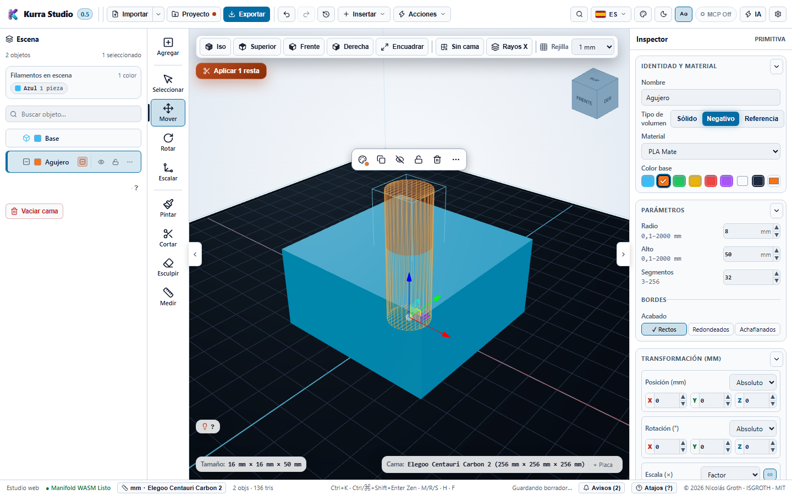
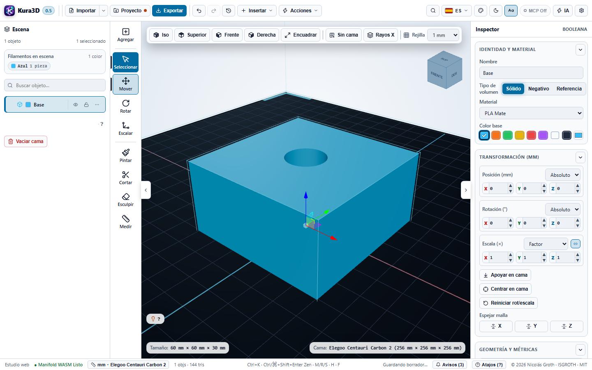

# Sólidos negativos y restas

Para hacer agujeros, ranuras y rebajes no se "taladra": se coloca un **negativo** (la forma de lo que quieres quitar) y se **resta** del sólido. También puedes unir e intersectar.

## Vocabulario

- **Sólido:** un objeto que se imprime.
- **Negativo:** un objeto que se resta de otros. Se ve como una malla naranja de alambre y no se exporta.
- **Restar, Unir, Intersectar:** las tres operaciones con varios objetos.

## Hacer un agujero

1. Crea el sólido (por ejemplo un **Cubo**) y, desde **Agregar**, un **Cilindro** que lo atraviese.
2. Selecciona el cilindro y pulsa **H**, o elige **Negativo** en *Tipo de volumen* del inspector. El cilindro pasa a malla naranja.
3. Coloca el negativo donde quieres el agujero (ver [Primeros pasos](primeros-pasos.md)). Debe cruzar el sólido: si no se tocan, la resta no hace nada y Kura3D avisa.
4. Pulsa **Aplicar 1 resta** (botón naranja arriba a la izquierda del visor, o `Ctrl+K` → *Aplicar restas*). Con varios negativos dice «Aplicar 3 restas».
5. El resultado es un solo sólido con el agujero. **Ctrl+Z** lo deshace en un paso.

## Restar, unir e intersectar entre dos objetos

1. Selecciona dos o más objetos. El inspector muestra **Unir, restar, intersectar** con la **Base** (resaltada en azul) y las **Herramientas** (en rojo, a trazos).
2. Si el orden no es el que quieres, pulsa **Invertir**.
3. Elige **Unir** (un solo cuerpo), **Restar** (quita las herramientas de la base) o **Intersectar** (deja lo que comparten).
4. Antes de aplicar, el visor muestra una vista previa con los rótulos *Base* y *Herramienta*.

## Problemas frecuentes

- **«Las piezas no se tocan»:** la resta no se aplica. Acerca el negativo hasta que cruce el sólido.
- **El agujero no aparece:** mira que el negativo sea realmente un negativo (naranja, no azul) y que esté seleccionada la base correcta.
- **El negativo desapareció al exportar:** es lo esperado, los negativos no se exportan; aplica la resta primero.
- **Resultado raro tras restar:** deshaz con **Ctrl+Z**, ajusta la posición con valores exactos en el inspector y vuelve a aplicar.

Anterior: [Cortar y ahuecar](cortar-y-ahuecar.md) · Siguiente: [Grupos y escena](grupos-y-escena.md) · [Índice](README.md)
