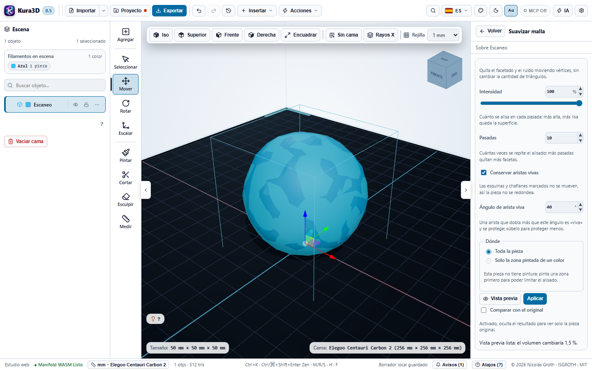
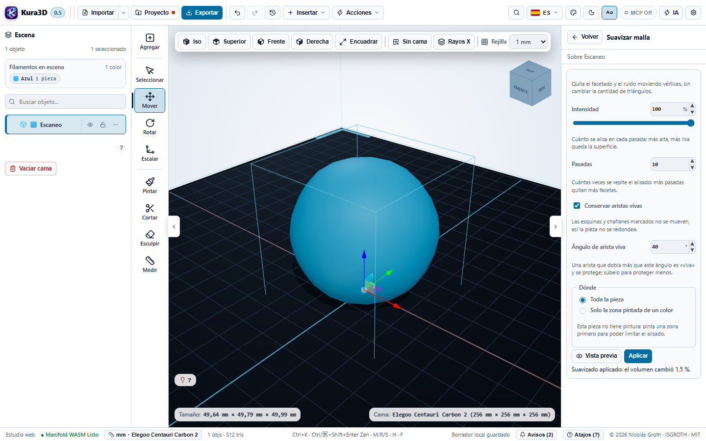

# Suavizar malla

Suavizar quita el facetado y el ruido de una pieza importada o esculpida (por ejemplo un escaneo) moviendo sus vértices. **No cambia la cantidad de triángulos**, no abre la malla y no agranda la caja de la pieza. Las aristas marcadas (esquinas y chaflanes) se pueden proteger para que no se redondeen. Kura3D solo prepara la geometría; no lamina.

## Abrir el panel

1. Selecciona una pieza que no esté bloqueada. Si no hay ninguna, o está bloqueada, el ítem aparece apagado y dice por qué.
2. Elige **Acciones › Malla › Suavizar…** en la barra superior. También está en el clic derecho sobre la pieza (grupo *Malla*) y en la paleta de comandos (`Ctrl+K`, escribe *suavizar*).
3. El panel **Suavizar malla** se abre a la derecha con el foco en la primera casilla, **Intensidad**.

## Los controles

Cada control trae una línea de ayuda debajo. Los valores por defecto sirven para casi todo.

- **Intensidad** (10 a 100 %, por defecto 100): cuánto alisa cada pasada. Hay un deslizador y una casilla; un doble clic en el deslizador vuelve al valor por defecto.
- **Pasadas** (1 a 100, por defecto 10): cuántas veces se repite. Más pasadas quitan más facetas; con muchas, la pieza puede inflarse apenas, por eso el aviso de volumen (abajo).
- **Conservar aristas vivas** (activada): las esquinas y chaflanes no se mueven. Al activarla aparece **Ángulo de arista viva** (por defecto 40°): una arista que dobla más que ese ángulo cuenta como viva. Súbelo para proteger menos; con 40° se protegen chaflanes de 45° y aristas de 90°. Los bordes abiertos de una malla no cerrada también quedan fijos.
- **Dónde**: *Toda la pieza* o *Solo la zona pintada de un color*. La segunda necesita que la pieza tenga pintura (ver [Colores y pintura](colores-y-pintura.md)); si no la tiene, la opción está apagada y el panel lo explica. Con ella eliges el color (la lista muestra cuántos triángulos tiene cada uno) y la **Transición**: de 0 a 10 anillos de triángulos donde el efecto se atenúa hasta cero para que no quede un escalón en el borde de la zona.

Un valor fuera de rango queda marcado junto a su campo y, mientras no lo corrijas, los botones esperan. La coma decimal funciona como en el resto de la app.

## Vista previa

1. Pulsa **Vista previa** (o `Enter` dentro de cualquier campo). El cálculo corre aparte, sin congelar la pantalla, y una línea de estado dice en qué pasada va («Suavizando: pasada 3 de 10») y luego «Comprobando que la malla no se dañe…». **Cancelar** lo detiene.
2. El resultado aparece como una copia translúcida sobre la pieza. No se toca la escena ni el historial.
3. Activa **Comparar con el original** para ocultar la copia y ver solo la pieza.
4. Si cambias cualquier valor, la vista previa se descarta (ya no corresponde). Pedirla de nuevo con los mismos valores no recalcula.

## Aplicar

**Aplicar** usa la vista previa si no cambiaste nada, o calcula en ese momento. Es **un solo paso de deshacer** (`Ctrl+Z`). Después el panel dice, por ejemplo: «Suavizado aplicado: el volumen cambió 0,6 %».

Avisos que puedes ver:

- **Se redujo la intensidad** de 100 % a 25 %: con la intensidad pedida, la malla se dañaba (triángulos invertidos o paredes finas que se cruzan), así que Kura3D bajó la intensidad hasta que no hubiera daño. Si necesitas más alisado, protege las aristas o limita la zona.
- **El volumen cambió más de 2 %**: revisa que la pieza conserve sus medidas.
- **No se pudo suavizar sin dañar la malla**: sale como error junto a los controles y no cambia nada. Baja la intensidad o protege las aristas.

## Problemas frecuentes

- **«La protección de aristas está frenando el suavizado»**: en un escaneo con mucho ruido, muchas aristas parecen vivas y quedan fijas (más de un 30 % de los vértices), así que el ruido casi no baja. El panel te lo dice y ofrece un botón que sube el ángulo a 70°; si ya estaba alto, el botón desactiva la protección.
- **No pasó nada visible**: «con estos valores no se mueve ningún vértice». Baja la protección de aristas o amplía la zona.
- **La pieza se ve igual de facetada**: una malla muy gruesa no tiene vértices suficientes para alisarse; refínala antes con **Acciones › Malla › Refinar malla**.
- **Esquinas redondeadas**: sube la intensidad solo si lo necesitas; con **Conservar aristas vivas** activada y un ángulo bajo se mantienen. Suavizar no sirve para redondear aristas a propósito.
