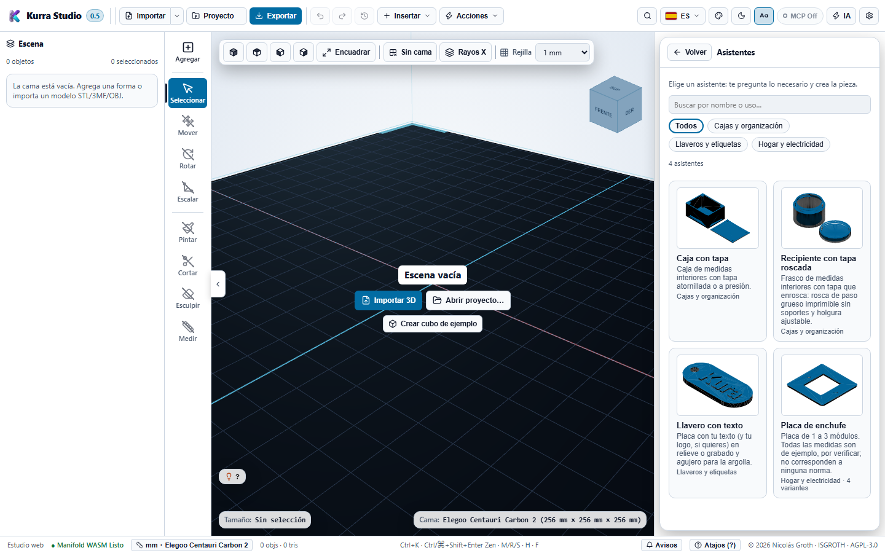
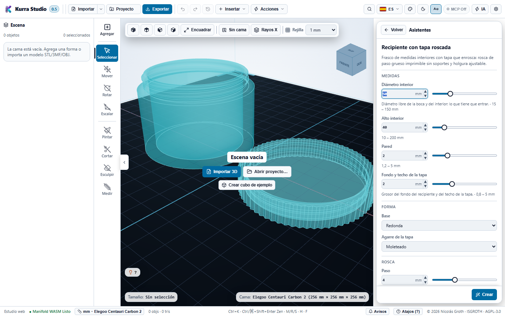
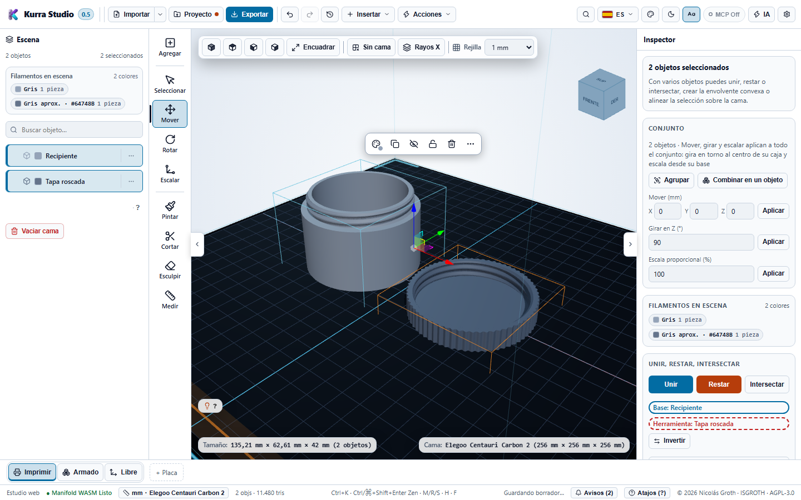
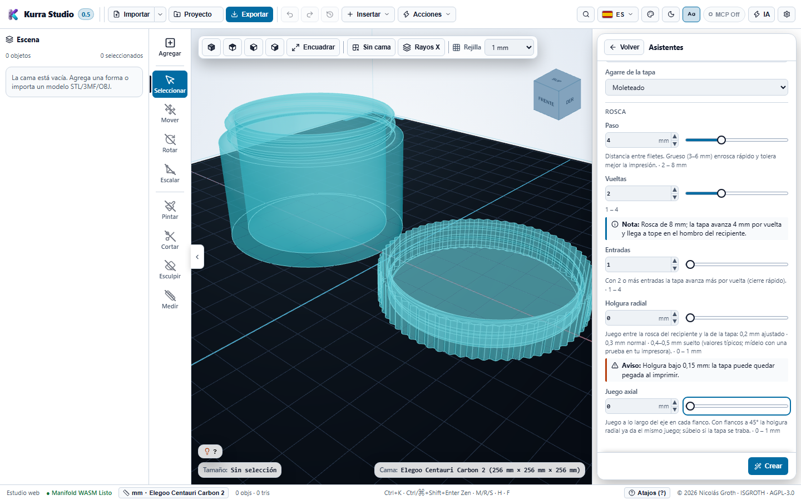
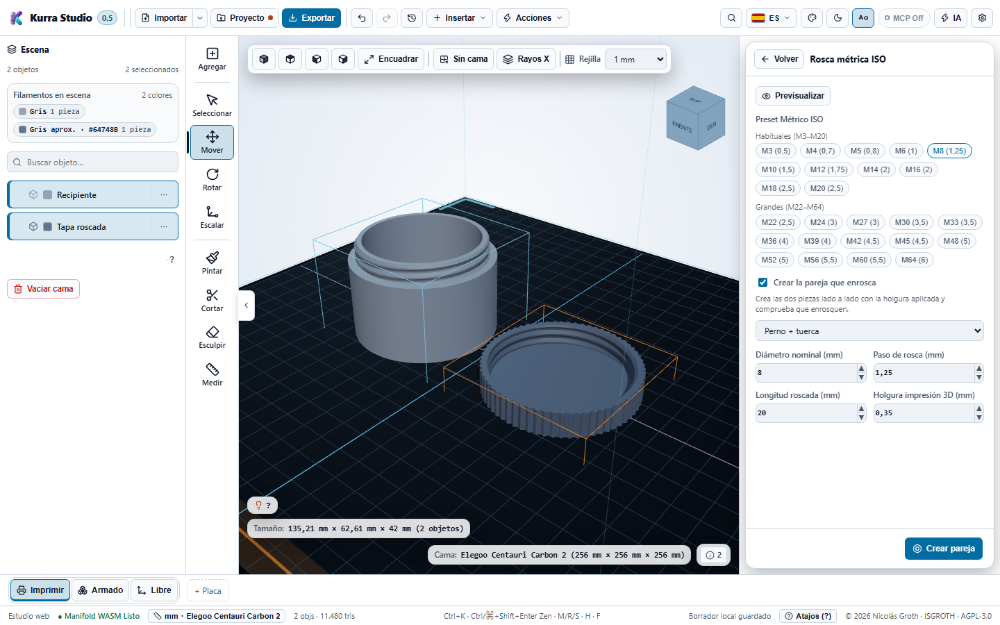

# Recipiente con tapa roscada

El asistente **Recipiente con tapa roscada** crea un frasco y su tapa que enrosca: das las medidas de lo que quieres guardar y Kurra Studio arma las dos piezas, listas para imprimir sin soportes. Antes de crear, comprueba que la tapa enrosque y te dice la holgura mínima que queda entre las dos roscas.

Solo prepara la geometría: no lamina ni genera G-code.

## Crear el recipiente

1. Elige **Insertar › Asistentes** y, en la galería, la tarjeta **Recipiente con tapa roscada** (categoría *Cajas y organización*). También sirve `Ctrl+K` y escribir *Recipiente*.

   

2. Rellena el formulario. Viene con medidas razonables (Ø 50 × 40 mm):
   - **Medidas**: *Diámetro interior* (el diámetro libre de la boca y del interior: lo que tiene que entrar), *Alto interior*, *Pared* y *Fondo y techo de la tapa*.
   - **Forma**: *Base* redonda o cuadrada (la boca sigue siendo redonda) y *Agarre de la tapa*: moleteado (estrías verticales), caras planas (hexágono, sirve para una llave) o liso.
   - **Rosca**: *Paso*, *Vueltas*, *Entradas*, *Holgura radial* y *Juego axial* (ver más abajo).
   Cada campo tiene su deslizador y muestra su rango.
3. Mira la barra **Vista previa**: además del fantasma de las dos piezas en el visor, dice **Enrosca: holgura mínima 0,31 mm** (con los valores por defecto: la holgura radial de 0,3 mm más el juego axial de los flancos). Si la holgura no alcanza, en su lugar aparece un aviso: *Sin holgura suficiente* (menos de 0,1 mm, se pegaría al imprimir) o *Interferencia* (las roscas se cruzan), con un icono y el texto, no solo color.

   

4. Pulsa **Crear**. El **Recipiente** sale apoyado en su fondo y la **Tapa roscada** a su lado, boca arriba (el techo sobre la cama), en un solo paso de deshacer. Un aviso repite el resultado del enroscado.

   

Para cambiar las medidas después, selecciona una de las piezas y pulsa **Editar con el asistente**: el formulario vuelve con tus respuestas y **Actualizar** reemplaza las dos piezas (ver [Asistentes](asistentes.md#editar-con-el-asistente)).

## Cómo es la rosca

- **Perfil para imprimir sin soportes.** Es un trapecio con flancos a 45° del eje (el eje queda vertical al imprimir), así que ningún flanco es un voladizo más tendido que 45°. La cresta y la raíz son planas, y la entrada de la rosca está biselada en el cuello y en la boca de la tapa para que empiece a enroscar sin trabarse.
- **Paso grueso.** Por defecto 4 mm (rango 2–8 mm). Un paso de 3 a 6 mm enrosca rápido y tolera mejor la imprecisión de la impresión; bajo 3 mm aparece un aviso.
- **Vueltas.** El largo roscado es *vueltas × avance*. Entre 1,5 y 3 vueltas es lo habitual: con menos la tapa se suelta con poco giro, con más tarda en cerrar (los dos casos dan aviso).
- **Entradas.** Con 2 o más entradas la tapa avanza *entradas × paso* por vuelta: cierra con menos giro manteniendo un filete grueso.
- **Tope.** La tapa llega a tope cuando su borde apoya en el hombro del recipiente; entre la boca del cuello y el techo de la tapa quedan 0,6 mm de luz.

## Holgura: cómo elegirla

La **holgura radial** es el juego entre la rosca del recipiente y la de la tapa; el **juego axial** es el juego a lo largo del eje en cada flanco. Con flancos a 45°, la holgura radial ya deja el mismo juego axial; el juego axial por defecto (0,45 mm) suma un poco más en los flancos, para que la holgura mínima medida quede en ≈ 0,3 mm.

Son medidas del modelo, no ajustes de la impresora. Como punto de partida:

| Situación | Holgura radial |
|---|---|
| Ajustada (boquilla de 0,4 mm bien calibrada, PLA) | 0,2 mm |
| Normal (la mayoría de los casos) | 0,3 mm |
| Suelta (boquilla de 0,6 mm o más, PETG o materiales que se expanden, piezas grandes) | 0,4 – 0,5 mm |

Si dudas, imprime primero un recipiente pequeño (Ø 20–30 mm, 1,5 vueltas) con la misma holgura y ajusta. Una holgura bajo 0,15 mm o sobre 0,6 mm da aviso. Con holgura 0 la vista previa avisa que no enrosca:

Si el juego axial no cabe en el paso (deja las crestas demasiado delgadas), el formulario lo marca como error junto al campo, con el máximo posible.

## Consejos de modelado para imprimir

- **Pared de 1,6 mm o más** en el cuello: la rosca come parte de la pared y bajo eso aparece un aviso.
- **Diámetro interior** es el de la boca: lo que guardes tiene que pasar por ahí.
- **Imprime la tapa como sale**, boca arriba: así la rosca interior no necesita soportes y el techo queda plano sobre la cama.
- **Caras planas** en la tapa ayudan si la vas a apretar con una llave; el **moleteado**, si la abres con la mano.

## Roscas ISO que enroscan (perno + tuerca)

El diálogo de roscas (**Insertar › Rosca ISO (M3–M64)**) también crea la **pareja**: marca **Crear la pareja que enrosca** y elige *Perno + tuerca* o *Agujero roscado + perno*. Las dos piezas salen lado a lado con la holgura del formulario aplicada a la tuerca o al agujero, y un aviso dice **Enrosca: holgura mínima X mm** (o el problema). El tipo de pieza se oculta mientras la pareja está marcada.

## Desde un agente (MCP)

`kura_create_screw_container` crea el recipiente con las mismas medidas del formulario y responde `screwFit` (estado, holgura mínima, volumen de interferencia). `kura_create_thread_pair` crea la pareja ISO. `kura_check_screw_fit` comprueba, sin cambiar nada, si una pieza hembra ya colocada en su posición final enrosca en una macho (eje, avance por vuelta). Detalles en [MCP](../MCP.md).

## Si algo no sale

- **«El alto interior no alcanza…»**: la rosca necesita *largo roscado + 2 mm* de alto interior. Sube el alto o baja las vueltas o el paso.
- **La vista previa dice *pausada***: pulsa **Actualizar**. Con recipientes muy grandes la comprobación tarda más.
- **La tapa quedó apretada al imprimir**: sube la holgura radial 0,05–0,1 mm y vuelve a crear con **Editar con el asistente**.

Anterior: [Asistentes](asistentes.md) · Siguiente: [Acople de tubería](acople-de-tuberia.md) · [Índice](README.md)
