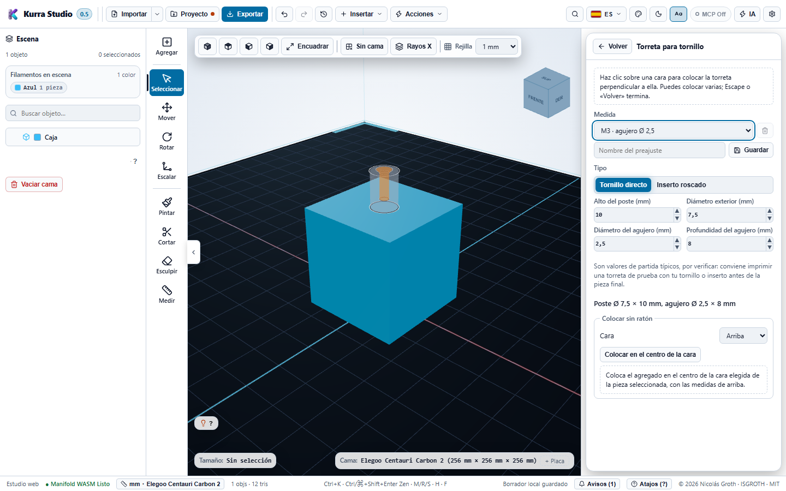
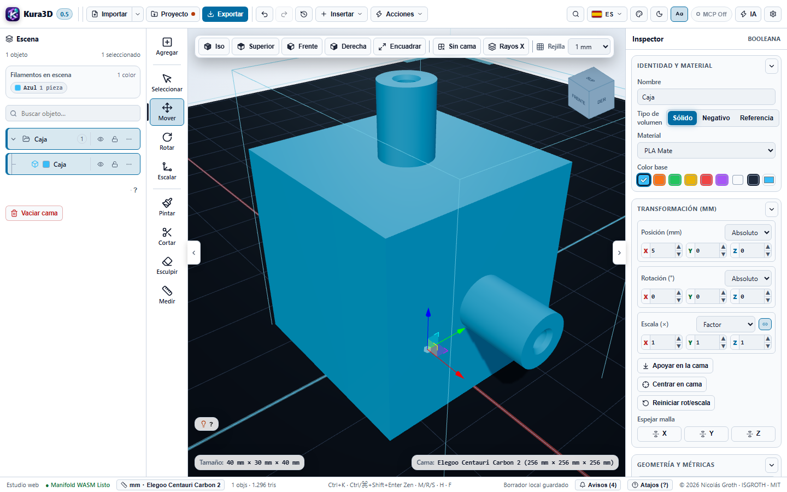

# Torreta para tornillo

Una torreta es un poste con un agujero donde atornillas una tapa o una placa. En Kurra3D Studio la colocas con un clic sobre una cara de una pieza y queda perpendicular a ella. Sirve para dos casos:

- **Tornillo directo**: el tornillo abre su rosca en el plástico. El agujero es un piloto, más chico que el tornillo.
- **Inserto roscado**: un inserto de latón que metes con el cautín. El agujero tiene el diámetro del inserto y 1 mm más de profundidad que su largo, para el plástico que el inserto empuja al entrar.

La torreta son dos piezas: el **poste**, un sólido que se une a tu pieza, y el **agujero**, una pieza negativa. Las dos se aplican cuando usas **Aplicar restas** (ver [Sólidos negativos y restas](solidos-negativos-y-restas.md)).

## Abrir el panel

1. Ten al menos una pieza sólida visible en la escena. Si no hay ninguna, Kurra3D Studio te avisa y el panel no se abre.
2. Elige **Insertar › Torreta para tornillo** en la barra superior. También puedes hacer clic derecho sobre la pieza y elegir **Más › Torreta para tornillo**, o abrir la paleta con `Ctrl+K` y escribir *torreta* o *inserto*.
3. El panel **Torreta para tornillo** se abre a la derecha, con un **tornillo directo M3**: poste Ø 7,5 × 10 mm y agujero Ø 2,5 × 8 mm.

## Elegir la medida

- **Tipo**: *Tornillo directo* o *Inserto roscado*. Al cambiar de tipo se carga la misma medida del otro tipo (M3 pasa a inserto M3).
- **Medida**: los valores incluidos son **típicos y por verificar**:

| Tipo | Medida | Agujero | Profundidad | Poste |
|---|---|---|---|---|
| Tornillo directo | M2 | Ø 1,7 | 6 | Ø 5 × 8 |
| Tornillo directo | M2,5 | Ø 2,1 | 7 | Ø 6,25 × 9 |
| Tornillo directo | **M3** (por defecto) | Ø 2,5 | 8 | Ø 7,5 × 10 |
| Tornillo directo | M4 | Ø 3,4 | 10 | Ø 10 × 12 |
| Inserto (largo 3) | M2 | Ø 3,2 | 4 | Ø 5,6 × 6 |
| Inserto (largo 4) | M2,5 | Ø 3,6 | 5 | Ø 6,25 × 7 |
| Inserto (largo 5,7) | M3 | Ø 4,0 | 6,7 | Ø 7,5 × 8,7 |
| Inserto (largo 8,1) | M4 | Ø 5,6 | 9,1 | Ø 10 × 11,1 |
| Inserto (largo 9,5) | M5 | Ø 6,4 | 10,5 | Ø 12,5 × 12,5 |

  El piloto del tornillo directo es cerca de 0,85 veces el diámetro del tornillo. El poste mide 2,5 veces el diámetro del tornillo, y nunca deja menos de 1,2 mm de pared alrededor del agujero. Las medidas de los insertos cambian según la marca: **mide el tuyo** con un pie de metro.
- **Alto del poste**, **Diámetro exterior**, **Diámetro del agujero** y **Profundidad del agujero**, en milímetros. Puedes escribir con coma decimal (`2,4`).
- Debajo ves el resumen, por ejemplo *Poste Ø 7,5 × 10 mm, agujero Ø 2,5 × 8 mm*. Si un campo está fuera de rango o el poste no es más ancho que el agujero, el campo queda marcado y el panel no coloca nada hasta que lo corrijas.

Son valores de partida. Los agujeros impresos en FDM suelen salir más chicos que el modelo, y cada plástico agarra distinto. **Imprime antes una torreta de prueba** con tu tornillo o tu inserto y ajusta el diámetro del agujero.

### Tus preajustes

1. Ajusta las medidas a tu tornillo o inserto.
2. Escribe un nombre en *Nombre del preajuste* (hasta 40 caracteres) y pulsa **Guardar**. Si ya tienes uno con ese nombre, se actualizan sus medidas.
3. Aparece en la lista bajo *Mis medidas* y sigue ahí cuando vuelves a abrir Kurra3D Studio (se guarda en este navegador, no en el proyecto).
4. Para borrarlo, elígelo y pulsa la papelera. El aviso ofrece **Deshacer**.

## Colocar la torreta

1. Con el panel abierto, pasa el cursor sobre la pieza: la vista previa muestra el poste (gris) y el agujero (naranja) sobre la cara bajo el cursor, perpendicular a ella.
2. Haz **clic** donde la quieras. Se agregan el poste (por ejemplo **Torreta M3**) y su agujero, agrupados con la pieza. Funciona en caras de arriba, de los costados e inclinadas, también si la pieza está girada o escalada. Lo que tenías seleccionado no cambia.
3. Cada clic agrega otra torreta. Arrastrar para orbitar la cámara no coloca nada.
4. Termina con **Listo**, con la X del panel o con `Esc`.

Cada torreta es un paso de deshacer: `Ctrl+Z` quita solo la última, con su poste y su agujero.

### Avisos

Al colocar, Kurra3D Studio revisa la torreta y te avisa sin impedir que la coloques:

- **Pared delgada**: queda menos de 1,2 mm de plástico alrededor del agujero. Aumenta el diámetro exterior.
- **El agujero entra en la pieza**: es más hondo que el poste y sigue dentro de tu pieza. Revisa que ahí haya material de sobra.
- **El agujero sale por el otro lado**: atraviesa la pieza. Sube el poste o acorta el agujero.
- **Choca con otra**: el poste toca otra torreta o un imán que aún no restaste.

Si el poste es más ancho que la cara en esa zona (sale de la pieza por lados opuestos), la torreta **no se coloca** y Kurra3D Studio te lo dice.

### Caras curvas y piezas escaladas

- **En una cara curva** (el costado de un cilindro), Kurra3D Studio mide la superficie bajo el pie del poste y lo hunde lo necesario para que se una sin rendijas. La vista previa usa el hundimiento mínimo; el poste real puede quedar un poco más hundido.
- **La torreta sigue a su pieza.** Si mueves, giras o escalas la pieza, el poste y el agujero se mueven con ella y **conservan sus medidas**. Al duplicar la pieza se copian con ella, y al borrarla se borran.

## Aplicar las restas

1. Cuando tengas todas las torretas, usa **Aplicar restas** (en el inspector o con `Ctrl+K`).
2. Cada poste se une a su pieza y el agujero se abre: queda **una sola pieza cerrada**, lista para exportar.

El agujero es un polígono de 64 lados que *rodea* el círculo pedido: su ancho más chico es justo el diámetro del agujero. La boca tiene un chaflán de 0,5 mm para que el tornillo o el inserto entren derechos.

## Si algo no sale

- **El panel no se abre:** no hay ninguna pieza sólida visible. Crea o muestra una pieza.
- **El clic no coloca nada:** revisa que no haya un campo marcado; el panel lo indica arriba. Si el motor está ocupado, espera a que termine.
- **El tornillo queda suelto o no entra:** ajusta el diámetro del agujero de a 0,1 mm y guarda la medida que te funcione como preajuste.
- **El inserto queda torcido:** el poste es angosto o bajo. Súbelo o ensánchalo, y calienta el inserto sin empujar de más.

Anterior: [Alojamiento de imán](alojamiento-de-iman.md) · Siguiente: [Colgar en el muro](colgar-en-el-muro.md) · [Índice](README.md)
